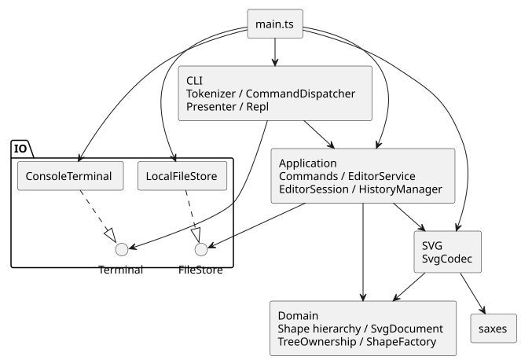
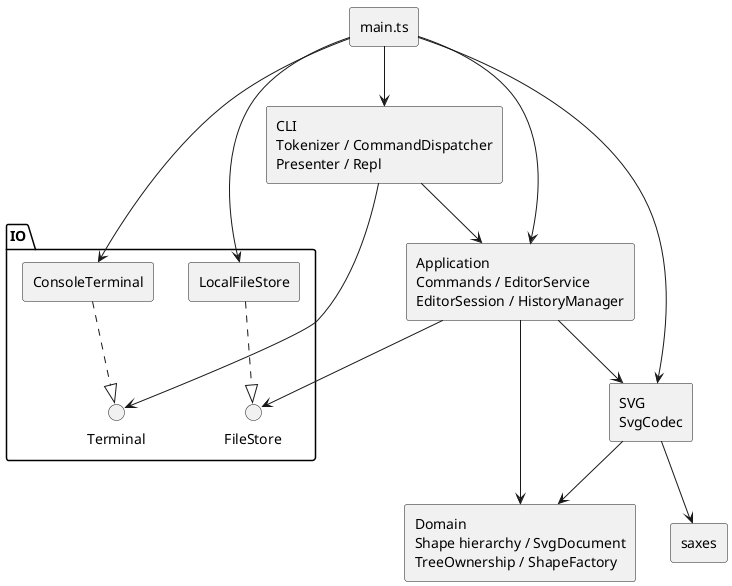

# SVG Editor Lab — Phase 1 工程报告

**GitHub 仓库地址：** [https://github.com/WSYits/svg-editor-lab](https://github.com/WSYits/svg-editor-lab)

本项目依据 [Phase 1 任务书](../requirements/phase1.md)，实现了 TypeScript CLI SVG 编辑器，包含六种图形、有序图形树、19 个命令、快照 Undo/Redo，以及受控 SVG 子集的文件读写。功能版本 `21ca5dc` 于 2026-10-24 完成综合验收，716 项自动化测试全部通过。安装和快速使用方法见[项目首页](../README.md)。

## 一、架构方案

### 1.1 模块划分与依赖方向

项目按图形语义、应用状态、交互、格式转换和外部设备划分模块，使终端与文件访问不进入图形模型。

| 目录或入口 | 主要对象 | 职责 |
| --- | --- | --- |
| `src/domain/` | Shape、五种叶子图形、GroupShape、SvgDocument、TreeOwnership、ShapeFactory、PreservedAttributes | 几何操作、属性校验、图形创建、有序树、唯一 id 和归属约束 |
| `src/application/` | EditorService、EditorSession、HistoryManager、CommandResult、DocumentIoResult、查询投影 | 协调编辑、文档操作、历史恢复和正式状态发布，提供独立展示值 |
| `src/application/commands/` | Command 及十种具体编辑 Command | 封装目标查询与领域操作，不承担终端解析或文件访问 |
| `src/cli/` | Tokenizer、CommandDispatcher、Presenter、Repl、CommandOutput | 分词、语法转换、命令选择、展示及逐行交互 |
| `src/svg/` | SvgCodec | SVG 字符串与领域文档互转、补 id、XML 与兼容性校验 |
| `src/io/` | FileStore、LocalFileStore、Terminal、ConsoleTerminal | 同步文件持久化和终端输入输出 |
| `src/main.ts` | 程序装配入口 | 创建并连接具体依赖，启动 REPL，设置退出码 |





依赖方向遵循以下规则：

- domain 仅依赖领域内部类型和语言基础能力，保持几何与树结构规则独立于交互通道。
- application 可以依赖 domain、SvgCodec 和 FileStore 接口，不依赖 CLI 或 LocalFileStore，便于用真实文件系统或测试替身验证相同状态流程。
- cli 依赖应用接口、稳定展示值和 Terminal 接口，不直接修改 Shape 或 SvgDocument。
- svg 依赖 domain 和 XML 解析器，不访问文件、会话或终端；io 依赖 Node.js 原生能力，不依赖业务模块。
- main 负责装配具体实现，避免把环境选择逻辑放进领域和应用服务。

### 1.2 领域模型与 Composite 模式

[Shape](../src/domain/Shape.ts) 定义 `move`、`scale`、`clone` 和属性操作契约，不假设所有图形都具有相同几何字段。RectShape、CircleShape、EllipseShape、LineShape、TextShape 分别封装自身状态；[GroupShape](../src/domain/GroupShape.ts) 保存有序子节点视图，并通过同一契约递归操作后代。

平移使用增量坐标，缩放围绕原点同乘各图形的位置和尺寸。文字内容与样式不随几何缩放改变。公共样式省略时保持缺省，不主动写入 SVG 默认值。组的 `set` 修改组自身公共样式，移动和缩放递归作用于后代；删除组会删除完整子树。叶子和容器因此可以通过相同编辑 Command 操作，而不需要集中判断图形类型。

叶子在更新前验证全部候选数值，包括计算溢出。组的递归几何操作保存可恢复状态，后部节点失败时恢复先前修改，保留原节点引用。深复制保留具体类型、id、几何、文字、显式样式、保留属性和子节点顺序，副本之间不共享可变状态。

[SvgDocument](../src/domain/SvgDocument.ts) 管理画布和根节点，支持按 id 查询、插入、删除及结构编辑。[TreeOwnership](../src/domain/TreeOwnership.ts) 统一维护实际成员序列和对象归属，保证全局 id 唯一且大小写敏感、单一归属及无环。集合不可由调用方直接改写，结构操作在完整校验和候选序列准备后提交。查询直接遍历受控树，没有额外维护容易失配的持久 id 索引。

任务书未细化的跨容器规则形成了以下设计补充：

- `group` 至少选择一个节点，拒绝重复选择以及祖先、后代同时入选。按操作前文档前序排列成员，在最近公共祖先容器的最前相关直接分支之前插入新组；原容器变空后仍保留。
- `addto` 将节点放到目标组末尾，同父级操作也按末尾重排；自身和后代目标被拒绝。
- `front` 移至同级绘制序列末尾，`back` 移至开头；未涉及节点的相对顺序保持。
- `ungroup` 只提升指定组的直接子节点，占据原组位置；原组成为游离空组，内部嵌套组不递归解散。顶层组解散按任务书规定拒绝。

上述结构操作保留节点的几何和显式属性，不承诺重挂后继承样式或层叠外观不变。跨父级分组后解组不会还原原父级，完整恢复由 Undo 完成。

### 1.3 Command 模式与应用执行链路

本项目选择 Command 模式，以统一封装编辑操作、隔离 CLI 与领域业务，并让不同编辑操作共享执行、错误处理和 Undo/Redo 历史机制。

[Command](../src/application/commands/Command.ts) 是同步编辑行为的抽象，具体实现包括 Create、Delete、Move、Scale、SetAttribute、Group、Ungroup、AddTo、Front、Back 十种 Command。每个实现自行查询当前候选文档并调用领域操作。例如 [MoveCommand](../src/application/commands/MoveCommand.ts) 根据 id 查找目标、检查缺失、调用 `shape.move` 并返回摘要，因此 Command 不只是参数容器。

[EditorService](../src/application/EditorService.ts) 只多态调用 `Command.execute`，不通过命令名、具体类型或 `instanceof` 选择编辑业务。以 `move r1 10 20` 为例：

1. Tokenizer 生成 token，Dispatcher 校验参数并创建 MoveCommand。
2. Service 从会话取得独立候选文档，Command 在其中查询并移动 r1。
3. 编辑结果、编辑前历史快照和下一会话全部准备成功后，一次发布新的会话与历史组合。
4. Presenter 格式化稳定结果，Terminal 输出；展示失败不重新执行或回滚已经成功的编辑。

EditorSession 只保存隔离文档和默认路径；HistoryManager 只管理过去栈、未来栈及禁用状态；Service 负责协调两者。查询使用冻结的值投影，CommandResult 和 DocumentIoResult 不暴露正式领域对象。Create 属性字典和 Group id 列表防御性复制，复用命令时重新查询当前文档，不缓存旧节点。

CommandDispatcher 是**命令名分派的集中入口和待重构点**；[ShapeFactory](../src/domain/ShapeFactory.ts) 是**图形类型名分派的集中入口和待重构点**。工厂维护构造行为、CLI 创建参数描述和独立的 XML 属性描述，供 CLI 与 Codec 共用。Presenter 仅按展示数据选择格式，不分派领域业务。

### 1.4 快照历史与文档状态

[HistoryManager](../src/application/HistoryManager.ts) 使用完整 SvgDocument 快照，而不为每种 Command 编写逆操作。这使删除子树、跨父级分组和解组都能作为一个 Undo 单元恢复父级、顺序及全部属性，代价是随文档规模增长的复制与内存成本。

[EditorSession](../src/application/EditorSession.ts) 在接收和返回文档时进行复制，历史内部快照也不向外暴露。恢复后的节点具有独立归属关系；跨历史恢复不保证 JavaScript 对象身份延续，外部操作以 id 重新定位。领域单次结构编辑保留对象引用，与应用层切换快照是两个不同契约。

| 操作 | 文档及路径 | 历史行为 |
| --- | --- | --- |
| 成功编辑，包括合法无变化编辑 | 发布候选文档，保留默认路径 | 记录编辑前状态、清 Redo、解除禁用 |
| Undo / Redo | 恢复完整快照，路径不随历史回退 | 在两栈之间准备并转换快照 |
| init | 新空文档，默认 800×600，清除路径 | 清双栈并禁用 |
| read(path) | 替换文档，更新默认路径 | 清双栈并禁用 |
| save(path) / save() | 保持文档语义，更新或沿用路径；无默认路径时拒绝省略路径 | 成功后清双栈并禁用 |
| canvas 修改 | 保留图形和路径，修改尺寸；同尺寸修改也成立 | 清双栈并禁用 |
| 查询或失败操作 | 正式文档、路径保持 | 不改变双栈或禁用状态 |

文档边界之后，失败编辑不解禁，下一次成功编辑才解禁。禁用时 Undo/Redo 的错误主体为 `undo not allowed after io command`；解禁后空栈分别为 `nothing to undo`、`nothing to redo`。成功文档操作建立新边界是项目采用的统一历史策略。

### 1.5 SVG、文件与终端边界

[SvgCodec](../src/svg/SvgCodec.ts) 只处理字符串与模型。解码按 XML 属性名解析，不套用 CLI 的位置参数；经 ShapeFactory 创建图形，再通过文档接口建树。全部显式 id 预扫描后，按文档前序为缺失 id 分配“标签名＋序号”，跳过冲突编号。警告只随完整成功结果返回。

SVG 内容分为可编辑属性、安全保留但不可 CLI 修改的属性、无法安全处理而拒绝的语义。PreservedAttributes 独立于可编辑属性，参与全部复制，不加入组 setter 的回滚集合。保留属性随节点移动和历史快照保存，不使用按 id 建立的外部旁路缓存。

FileStore 只负责同步持久化。[LocalFileStore](../src/io/LocalFileStore.ts) 限制实际读取字节并严格解码 UTF-8，随后由 Service 调用 Codec。保存依次完成隔离快照、编码、下一会话、历史和成功结果准备，再独占创建同目录临时文件，完整写入、刷新、关闭并 rename 替换目标。替换成功后只发布预备状态，避免文件已经成功却因后续克隆失败而报告保存失败。

[Repl](../src/cli/Repl.ts) 逐行处理输入，业务执行和展示分阶段。普通错误由 Presenter 添加一次 `error:` 后继续；展示或终端故障最多尝试一次诊断，退出码为 1，不重试命令。正常 EOF 退出 0。stdin/stdout 均为 TTY 时显示 `svg>`，管道模式没有提示符；欢迎行在两种模式下均显示。终端传输是异步的，编辑和文件业务仍保持同步。

### 1.6 未来变化点与取舍

图形与命令扩展、SVG 格式兼容能力是优先考虑的未来变化点；其余变化点按实际需求再演进。

| 变化点 | 现有设计支持 | 当前取舍 |
| --- | --- | --- |
| 图形与命令扩展 | Shape 多态、Command 契约、工厂和 Dispatcher 集中入口 | 保留两个待重构的集中目录，不引入动态插件；box 属于后续阶段 |
| SVG 支持扩大 | 独立 Codec、XML 描述、安全保留属性 | 明确拒绝不能正确处理的语义，不建设完整 SVG/CSS/transform 引擎 |
| 交互通道变化 | Service 与 Terminal 接口隔离，查询为稳定值 | 不增加 GUI、鼠标或独立 Agent API |
| 历史性能 | 集中管理快照和双栈转换 | 接受当前复制成本，没有增量、持久化或分支历史 |
| 大文档查询 | 树结构入口统一 | 当前直接遍历，避免过早引入索引及缓存一致性问题 |

## 二、过程记录

本项目使用 Codex 参与需求拆解、架构讨论、代码生成、测试设计和只读审查。AI 给出的方案与代码也可能有缺陷，实际保留的设计经过任务书对照、方案比较、运行验证和 Git 差异检查。以下选取对架构和质量影响较大的案例；完整增量过程可从 Git 历史追溯。

### 2.1 工厂归属与架构简化

**问题背景。** 初步架构讨论中，ShapeFactory 的模块归属存在文字与图示不一致，同时考虑过 EditorService、EditorSession、EditTransaction、HistoryManager 等多个协调对象。

**发现与验证。** 审查 AI 提出的方案时，进一步追问 CLI 与 SVG 导入如何共用创建逻辑，以及一条 move 命令究竟由谁协调。若工厂放在应用层，Codec 复用它会产生不合理的依赖；多个事务协调对象也容易重复保存状态。该问题出现在设计草案中，并不是把已存在的应用层工厂源文件迁移了一次。

**讨论及选择。** 最终将工厂归入 domain，把创建描述与构造保留在同一目录；应用状态采用 Service 统一发布、Session 保存当前状态、History 管理历史的职责划分。去掉尚无独立职责的 EditTransaction，Codec 也没有再拆成内容重复的 Reader/Writer 层。

**修改结果。** 实际实现没有上述重复协调类。`1bbdd76` 集中完善了工厂创建描述，`cd3ba11` 增加 XML 属性描述，CLI 与 SVG 导入均依赖同一工厂。模块归属和简化结果体现在 §1 的最终结构中。

### 2.2 P1：结构维护入口没有形成真正封装

**问题背景。** 领域树初版 `d90095e` 导出了 `treeMutation`，并提供组成员修改及独立 claim/release 入口。设计原意是限制内部维护，但调用方仍能取得真实 token，绕过文档校验。

**发现与验证。** 针对 AI 生成实现的只读审查复现了三条路径：自身挂载形成循环、跳过文档 id 唯一性检查、只改归属登记而未移除实际成员。开发记录中的首次专项运行是 0 项通过、3 项失败，测试使用实际可访问 API，没有借助 `as any` 绕过类型系统。原来的正常插入测试不足以发现这些公开入口问题。

**讨论及选择。** 对比了“在每个节点保存父引用”和“统一维护成员及归属”两种方案。前者需要扩展节点与容器的协调契约；最终沿用 TreeOwnership，将有序成员和归属集中为私有状态，只暴露完整校验的结构操作。仅重命名 token 或添加内部使用说明不能解决问题。

**修改结果。** 修复提交 `49d9bd2` 删除危险入口，增加直接管理器调用、重复初始化拒绝、删除重插、复制后插入及冲突后仍可使用的回归。修复后共 102 项测试通过，其中 [tree-ownership-regression.test.ts](../test/tree-ownership-regression.test.ts) 保留 8 项专项检查。后续 group、ungroup 和重挂沿用这一边界，而不是重新开放底层写入能力。

### 2.3 快照方案与测试策略演进

**问题背景。** 分组、解组及删除子树涉及多个父级和顺序，逐命令逆操作会重复领域规则。另一方面，仅检查 id 列表或“是否抛错”也不能证明树和历史正确。

**发现与验证。** 在与 AI 讨论测试时，将判断标准从“命令看起来完成”扩展为完整树、几何和属性、对象身份、直接归属及失败后可继续使用。测试还保留候选文档引用，在成功提交后继续修改它，检查正式状态和历史没有被污染。

**讨论及选择。** 最终采用完整文档快照恢复历史，并区分领域单次操作保留引用、应用历史恢复生成独立对象这两个契约。失败测试比较操作前后状态，再实际执行原 Redo 分支；原来临时验证的“重挂→排序→再重挂→删除→跨文档插入”场景固化为持久回归。

**修改结果。** `ad4307b` 建立通用执行链路，`ba117ab` 接入创建和结构编辑 Command。证据包括 [editor-service.test.ts](../test/editor-service.test.ts)、[structure-commands.test.ts](../test/structure-commands.test.ts) 和 [tree-sequence.test.ts](../test/tree-sequence.test.ts)。测试同时覆盖“先改候选再抛错”、克隆失败、结果/历史准备失败、合法无变化编辑，以及修改参数或快照副本后的隔离。

### 2.4 P2：解析器接受了非法 XML 代理码元

**问题背景。** SVG 初版 `cd3ba11` 信任 saxes 的字符检查。实际孤立高代理码元 U+D800 后接 A，放在 text 或 CDATA 中可能被 decode 接受，但随后 encode 报 `invalid XML 1.0 character`；注释中的同类字符也可能被接受后丢弃。

**发现与验证。** 只读审查确认了解码与编码接受范围不一致。先加入 16 项专项测试，使用 `String.fromCharCode(0xd800)` 构造真实 UTF-16 码元，并检查 `charCodeAt`，避免把字面量反斜杠转义当成非法输入。修复前 7 项通过、9 项失败，涵盖未拒绝的输入和不稳定的错误路径。

**讨论及选择。** 核对已有 XML 1.0 字符校验后，确认合法代理对会按完整码点处理，孤立或错序代理项会被拒绝，因此没有更换依赖或扩大字符接受范围。最终在 decode 的大小检查之后、XML 解析之前，对完整输入调用已有校验；这样注释、CDATA 和属性等区域也不能绕过入口。

**修改结果。** 独立修复提交 `bc53c8f` 增加入口校验，[svg-xml-characters.test.ts](../test/svg-xml-characters.test.ts) 的 16 项全部通过，完整测试由 569 项增至 585 项。测试还确认非法字符时解析器和领域文档构建未执行，而 ASCII、中文、emoji 及合法补充平面字符完成语义往返。该问题针对 JavaScript 字符串中的 UTF-16；文件层另以严格 UTF-8 解码处理非法字节。

### 2.5 文件成功与展示失败的分离

**问题背景。** 保存同时涉及磁盘和内存状态。若替换目标后才构造下一会话或结果，后续失败可能导致“文件已保存、内存却报告失败”。CLI 初期的 Dispatcher 又直接调用 Presenter，整个 dispatch 被捕获时会混淆业务与展示异常。

**发现与验证。** 结合 AI 实现进行执行顺序检查，发现状态组合对象的准备也应放到写盘前。测试在写入、fsync、close、rename 及会话/历史/结果准备阶段注入故障，检查旧文件字节和完整应用状态，而不依赖当前账户权限判断“不可写”场景。

**讨论及选择。** 采用同步 FileStore 和同目录临时文件替换，Service 提前准备完整下一状态。CLI 则增加 `execute` 与稳定 CommandOutput 展示值，将 Presenter 和 Terminal 放在业务错误捕获之外，保留原 `dispatch` 便利接口供已有同步调用者使用。

**修改结果。** `c86bd5a` 接入真实文件 IO，`21ca5dc` 完成 REPL。真实 EPIPE 测试在创建图形后断开 stdout，再发送保存和后续命令：文件正确保存、后续保存标记文件未生成、进程退出 1，诊断没有误报 `cannot write file`。注入测试进一步验证内存路径、历史禁用状态和几何结果保持已提交状态。终端测试还复现并修正了 readline 在输入关闭后转发 error 的事件处理问题。

### 2.6 增量开发与记录追溯

Git 历史按工程初始化、领域模型、树结构操作、应用与历史、CLI/Codec/IO/REPL 分段推进；P1、P2 均有独立修复提交，而不是重写原实现提交。过程中的关键证据是失败输入、回归断言和修复前后结果。

可通过 `git log --reverse --oneline` 查看完整顺序，使用 `git show 49d9bd2`、`git show bc53c8f` 核查两项缺陷的修复范围；阶段原始记录可通过 `git show 2af66cc:doc/README.md` 查阅。报告保留这些可复核事实，也明确区分 AI 提议、代码实现和实际运行结论。

## 三、一致性自查

### 3.1 实际目录是否符合模块方案

实际目录与最初按 domain、application、cli、svg、io 划分的模块方案一致，另外有装配入口、测试和课程文档。每个业务类位于同名文件，main 没有为形式增加空 Bootstrap 类。

| 设计调整 | 原因及最终结果 | 记录位置 |
| --- | --- | --- |
| 工厂归属澄清 | 避免 Codec 反向依赖应用层；ShapeFactory 属于 domain | §2.1 |
| 删除重复事务协调层 | Service、Session、History 已能表达执行与状态职责，未实现冗余 EditTransaction | §2.1、§1.3 |
| 树成员和归属统一维护 | 修复公开 token 绕过校验及双重状态失配 | §2.2，提交 `49d9bd2` |
| 完整快照历史 | 降低复杂结构逆操作成本，接受复制开销 | §2.3、§1.4 |
| 增加保留属性值对象 | 保存不可 CLI 编辑但可安全保留的 SVG 语义，参与完整复制 | §1.5、§4.4 |
| 分离执行与展示 | 避免成功保存后的展示故障被误判为业务失败 | §2.5，提交 `21ca5dc` |

### 3.2 实际依赖是否符合规则

抽查实际 import，未发现模块级反向依赖。检查依据如下：

| 源码 | 实际依赖及判断 |
| --- | --- |
| [ShapeFactory.ts](../src/domain/ShapeFactory.ts)、[GroupShape.ts](../src/domain/GroupShape.ts) | 依赖领域内部图形、Shape 和 TreeOwnership，不依赖 CLI、应用或文件 IO |
| [EditorService.ts](../src/application/EditorService.ts) | 依赖领域、SvgCodec、FileStore 接口和应用状态；不导入具体 Command 或 LocalFileStore |
| [CreateCommand.ts](../src/application/commands/CreateCommand.ts) | 通过 ShapeFactory 创建，再调用文档插入；不维护第二套类型目录 |
| [CommandDispatcher.ts](../src/cli/CommandDispatcher.ts) | 依赖应用 Command/Service 接口及 CLI 展示类型，无直接领域对象修改 |
| [SvgCodec.ts](../src/svg/SvgCodec.ts) | 依赖 domain、saxes；node:module 仅用于加载 XML 库，不执行文件业务 |
| [LocalFileStore.ts](../src/io/LocalFileStore.ts)、[ConsoleTerminal.ts](../src/io/ConsoleTerminal.ts) | 依赖 Node.js 文件、路径、流和 readline 等能力，不依赖领域或应用 |
| [main.ts](../src/main.ts) | 装配具体依赖，不包含编辑业务或命令名分派 |

CommandDispatcher 和 ShapeFactory 两处集中名字分派已在 §1.3 标记为待重构点。字段校验、结构能力判断和展示值格式选择，没有扩散成按图形类型或命令名执行领域业务的分派。

### 3.3 文档与证据的一致性

根目录 README 提供安装与使用入口，本文保留架构、AI 协作案例、自查与质量证据。运行命令以 package.json 为准，源码和测试链接可以直接定位到实现。最终架构只描述现有能力，早期方案及缺陷放在 §2 解释；历史阶段结果不被当作最终功能状态。

## 四、质量保证手段

### 4.1 需求与测试覆盖

下表对应任务书 §2–§5。所有命令还由 [cli-process.test.ts](../test/cli-process.test.ts) 的真实进程工作流覆盖；完整输出检查包括 stdout、stderr、退出码及保存文件，不只判断进程是否返回 0。

| 要求及出处 | 实现依据 | 专项测试 |
| --- | --- | --- |
| init，§3 | Service 新文档、默认尺寸和清路径 | [document-boundaries](../test/document-boundaries.test.ts) |
| read，§2/§3 | Service、Codec、FileStore；补 id 与成功警告 | [document-io](../test/document-io.test.ts)、[cli-io](../test/cli-io.test.ts) |
| save，§3 | 显式/默认路径、同步替换及历史边界 | [file-store](../test/file-store.test.ts)、[document-io-failures](../test/document-io-failures.test.ts) |
| canvas，§3 | 查询不改历史，修改及同尺寸操作建边界 | [document-boundaries](../test/document-boundaries.test.ts) |
| create，§4.1 | 六类型、必填 id、样式缺省及 in 尾缀 | [creation-description](../test/creation-description.test.ts)、[command-dispatcher](../test/command-dispatcher.test.ts) |
| delete，§3 | 叶子和完整子树删除与恢复 | [structure-commands](../test/structure-commands.test.ts) |
| move，§3 | 增量平移、组递归及溢出拒绝 | [geometry-commands](../test/geometry-commands.test.ts)、[leaf-shapes](../test/leaf-shapes.test.ts) |
| scale，§3/§4.2 | 正有限倍率、位置/尺寸相乘和递归回滚 | [group-shape](../test/group-shape.test.ts)、[geometry-commands](../test/geometry-commands.test.ts) |
| set，§4.1 | 几何数值、文本字符串及公共样式白名单 | [shape-contract](../test/shape-contract.test.ts)、[command-dispatcher](../test/command-dispatcher.test.ts) |
| group，§3 | 同父/跨父、文档顺序、LCA/锚点及非法选择 | [tree-grouping](../test/tree-grouping.test.ts) |
| ungroup，§3/§4.2 | 只解一层、原位置替换及顶层拒绝 | [tree-ungrouping](../test/tree-ungrouping.test.ts) |
| addto，§3 | 同父/跨父重挂、自包含/循环拒绝 | [tree-reparenting](../test/tree-reparenting.test.ts) |
| front，§3 | 同级绘制末尾、其他顺序保持 | [tree-order](../test/tree-order.test.ts) |
| back，§3 | 同级绘制开头、其他顺序保持 | [tree-order](../test/tree-order.test.ts) |
| tree，§5.1 | 全树/子树、顺序及内联几何 | [presenter](../test/presenter.test.ts)、[application-queries](../test/application-queries.test.ts) |
| show，§5.2 | 类型/id/父级/几何/文字/显式样式 | [presenter](../test/presenter.test.ts)、[application-queries](../test/application-queries.test.ts) |
| help，§3 | 共用注册源列出 19 命令及工厂参数描述 | [command-dispatcher](../test/command-dispatcher.test.ts) |
| undo，§4.3 | 一编辑一单元、完整快照、禁用与空栈区分 | [history-manager](../test/history-manager.test.ts)、[editor-service](../test/editor-service.test.ts) |
| redo，§4.3 | 快照恢复、新编辑清分支、失败编辑保留分支 | [structure-commands](../test/structure-commands.test.ts)、[document-io](../test/document-io.test.ts) |
| id/Composite，§2/§2.1 | 全局唯一、大小写敏感、组与叶子统一操作 | [svg-document](../test/svg-document.test.ts)、[tree-ownership-regression](../test/tree-ownership-regression.test.ts) |
| CLI/错误，§2/§4.2 | 引号、转义、中文、注释、严格数值、错误前缀与继续交互 | [tokenizer](../test/tokenizer.test.ts)、[repl](../test/repl.test.ts)、[console-terminal](../test/console-terminal.test.ts) |
| SVG/XML，§0/§3 | 六类型、实体/CDATA、保留属性、资源限制与安全拒绝 | [svg-codec](../test/svg-codec.test.ts)、[svg-xml-characters](../test/svg-xml-characters.test.ts)、[preserved-attributes](../test/preserved-attributes.test.ts) |

### 4.2 测试层次与失败验证

单元测试覆盖几何、属性、复制、工厂、词法和历史转换；集成测试覆盖领域树、Command 执行、文档边界和真实文件 IO；进程测试从编译入口验证 REPL、保存读回和资源退出。测试采用“抛错、完整状态不变、后续仍可使用”的判断标准：

- 几何与树操作同时检查数值/属性、顺序、对象引用、唯一 id、查询与实际归属，不只比较输出 id。
- 在候选文档修改后抛错、历史或克隆准备失败时，检查正式文档、路径、双栈和禁用状态，继续运行原 Redo 分支确认快照内容。
- 修改构造参数、返回副本、保留的候选引用和历史恢复结果，验证不会污染正式状态或其他快照。
- 在实际写入部分字节及 fsync、close、rename、清理阶段注入故障，比较旧目标字节、临时文件与应用状态；权限失败使用注入，避免测试依赖账户权限。
- 将正常文件、缺 id、非法 UTF-8/XML/SVG、DTD/实体、命名空间及资源限制纳入持久回归。P1 的三条初始失败路径和 P2 的 7 通过/9 失败实验，分别说明结构封装与字符校验缺陷能够被测试实际暴露。

真实进程还覆盖 200 次连续编辑、无末尾换行、普通错误后继续、只读查询不改历史及成功/失败新编辑的 Redo 分支差异。TTY 测试通过 Python 标准库 PTY 启动 Node，检查提示符和 Ctrl-D；管道模式检查没有额外提示符或 ANSI 控制序列。该 PTY 测试在 Windows 或缺少 python3 时会明确跳过，本机验收结果为 0 跳过。

### 4.3 验收版本、结果与复现方法

| 项目 | 已记录结果与来源 |
| --- | --- |
| 功能版本 | `21ca5dc`，2026-10-24 完成 Phase 1 综合验收 |
| 自动化测试 | 716 项通过、0 失败、0 跳过；包含原领域、归属 P1、XML 字符 P2、历史、IO 和 CLI 回归 |
| 类型检查与构建 | 类型检查通过；综合验收在临时副本重新构建并运行全部测试，启动及进程测试使用新产物 |
| 后续交付审计 | 文档基线 `266b7a4` 上再次完成类型检查、重新构建和 716 项测试，结果一致；纯文档提交不作为新的功能测试执行记录 |
| 已验收环境 | macOS、Node.js v26.8.1、npm 11.19.0；依赖由 package-lock.json 锁定 |
| Git 过程 | 领域、树操作、应用、CLI/Codec/IO/REPL 和缺陷修复均有独立提交，详见 §2 与 Git 历史 |

可在项目根目录复现以下检查：

```sh
npm ci
npm run typecheck
npm run build
npm test
npm run cli
```

`npm test` 自身包含重新构建；`npm run cli` 也会先构建再启动。`npm start` 使用已有编译产物，需要先构建。报告整理仅核对文档、源码、测试及历史证据，没有再次运行上述功能验证。

在综合验收及交付审计中，真实 CLI 重放了任务书 §6 和 §6.1 版本 A，分别保存包含 5 个、8 个图形元素的 SVG，并再次读回检查。§6 的非法分组和文档边界 Undo 返回预期错误，版本 A 没有业务错误。额外工作流检查中文、空文本、XML 特殊字符、带空格路径、完整树恢复和失败后的默认路径/历史保持。

成功摘要采用可读的通用格式，例如 `moved by`、`undo completed`，tree 使用显式几何字段，未逐字复制示例排版；几何及状态信息完整。任务书 §4.2 明确规定的错误文本单独核对，交付审计实际运行的 13 个错误场景均匹配，不能用成功摘要的排版差异放宽错误约定。

浏览器验收通过真实 CLI 创建并保存 640×360 SVG，在本机 headless Chrome 直接打开并截图，实际目视检查六种图形、嵌套组、画布边界、位置/大小、颜色、描边、中文/XML 特殊字符和绘制覆盖顺序，结果符合预期。这一证据仅针对实际产物和本机 Chrome，不代表所有浏览器兼容；临时 SVG 和截图没有作为长期交付链接或纳入 Git。

### 4.4 兼容性限制与验证边界

受控 SVG 子集是工程设计策略，不是完整 SVG 标准的实现。支持六种元素及嵌套组、纯文本、预定义/数字实体、CDATA、Unicode 和必要空白。XML 按其规范进行行尾及属性空白规范化，测试主要比较类型、id、几何、文字、样式、保留属性、结构和顺序的语义一致性，不要求 XML 排版与字节完全相同。

| 内容 | 当前处理 |
| --- | --- |
| 几何与公共样式 | 支持既有几何、fill、stroke、stroke-width；几何字段显式提供，尺寸使用严格数值或 px |
| 安全保留属性 | 白名单字体、text-anchor、透明度、xml:space 和受校验的 data-*；与 CLI 可编辑属性分离，参与复制和历史，不进入 set 白名单 |
| 画布与坐标映射 | width/height 必填且为正；viewBox 缺省或等于 `0 0 width height`，其他映射拒绝 |
| 简单颜色 | 字母形式的简单色值、3/4/6/8 位十六进制；rgb()/hsl()、CSS 变量、currentColor、url() 等拒绝。CLI 接收的原始样式字符串不保证均可导出，编码遇到超出子集的值会失败 |
| 不支持的语义 | transform、CSS/style、未知图形/属性、复杂文本子结构、脚本/事件和外部或内部资源引用均明确拒绝，不静默丢弃 |
| XML 安全 | 检查命名空间、良构性、重复属性和完整输入字符；拒绝 DTD、实体声明及非 XML 声明的处理指令 |
| 资源限制 | 默认 1 MiB UTF-8 输入/输出、10,000 个解析节点、64 层深度（含 svg 根）；文件层限制实际读取字节，严格 UTF-8 解码 |

保留属性的具体白名单和值校验见 [PreservedAttributes.ts](../src/domain/PreservedAttributes.ts)，XML 属性描述见 ShapeFactory。根属性同样受限制，未支持的根 id、version 或其他语义不会在导入时被静默删除。tree/show 当前显示可编辑属性，安全保留元数据通过独立接口和 Codec 保存。

任务书样例的兼容性逐项核对如下：

| 样例及出处 | 结论 | 证据 |
| --- | --- | --- |
| §0.1 基础完整 XML | 支持语义往返 | [task-basic.svg](../test/fixtures/svg/task-basic.svg) |
| §0.1 基础内联预览 | 根 style 预期拒绝 | [task-preview-basic.svg](../test/fixtures/svg/task-preview-basic.svg) |
| §0.1 transform 嵌套 XML | transform 预期拒绝 | [task-transform.svg](../test/fixtures/svg/task-transform.svg) |
| §0.1 transform 内联预览 | 首先因根 style 拒绝 | [task-preview-transform.svg](../test/fixtures/svg/task-preview-transform.svg) |
| §6 other.svg | 支持，补 rect1 并返回警告 | [task-other.svg](../test/fixtures/svg/task-other.svg) |
| §6 会话与 §6.1 A | CLI 状态、保存产物和读回通过 | [svg-task-workflows](../test/svg-task-workflows.test.ts)、进程测试及交付审计 |
| §4.4 / §6.1 B 的 box | 属于后续插件阶段，不是 Phase 1 能力 | 工厂明确拒绝未注册类型 |

文件保存的正常本地失败路径已验证，但 rename 不构成跨文件系统与内存的完整事务。临时文件权限为 0600（受 umask 限制），覆盖产生新 inode，不保留旧 mode、owner、ACL、时间戳等元数据，其他硬链接仍指向旧内容。直接符号链接和非普通文件拒绝，父目录符号链接仍按系统解析，没有目录锁定。失败清理为尽力执行，可能残留临时文件；未承诺断电持久性、进程终止恢复或网络文件系统异常下的确定结果。

当前使用 saxes 6.0.0 解析 XML，并以局部公开 API 类型适配维持 TypeScript 严格检查；依赖升级需要重验字符、命名空间和资源限制行为。跨浏览器、其他 Node/操作系统环境，以及任意第三方图形扩展尚无同等验证。课程要求以 `final` 标签标识最终交付提交；验收结果按实际执行时的功能版本记录，不因后续文档或标签变动而推定重新测试。
