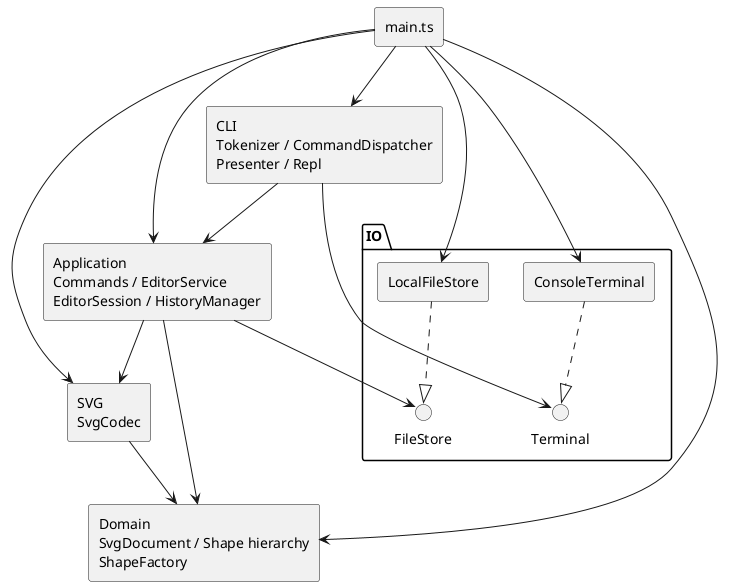

# Phase 1 工程记录

依据：`requirements/phase1.md`。本文将任务书要求、用户确认决策和设计假设分开记录。

当前完成工程初始化、2A 叶子图形、2B 领域图形树基础及其 P1 结构维护边界整改、3A 重挂/排序、3B 原子 group 分组与 3C 嵌套组 ungroup 解组。另已完成 4A 状态基础、4B 执行链路与几何/属性 Command、4C 创建/删除/树编辑 Command，十种编辑均接入快照 Undo/Redo；现已完成 4D 内存 init/canvas 与历史边界；已实现 5A CLI 词法、内存命令分发、查询与展示基础；现已实现 5B SVG 字符串编解码与安全属性保留及 P2 字符校验修复，并接入 5C 同步 FileStore、真实 read/save 与历史边界；现已完成 5D 的 Terminal/ConsoleTerminal、真实 REPL、19 个命令接线与进程级集成。`npm run cli` 先构建再启动交互程序，`npm start` 使用已构建入口；box 和插件不属于 Phase 1。Phase 1 最终综合验收已于 2026-10-24 通过，对应功能版本为 21ca5dc；远程推送与 final 标签仍等待用户后续授权。

## 一、架构方案

### 模块与职责

以下是已批准的目标结构；目前已实现 domain 的 Shape、六种图形、SvgDocument、ShapeFactory 及内部归属管理，以及 application 的会话、历史、Service 和十种编辑 Command，以及 cli 的 Tokenizer/Dispatcher/Presenter、svg 的 SvgCodec、io 的 FileStore/LocalFileStore 与 Terminal/ConsoleTerminal；CLI 的 Repl 和正式启动接线已实现。

| 模块 | 职责 |
| --- | --- |
| domain | SvgDocument、Shape 及六种图形类、ShapeFactory；几何行为、唯一 id、有序树及结构不变量 |
| application（含 commands） | Command 行为封装；EditorService 协调执行和提交；EditorSession 持有当前文档与路径；HistoryManager 管理历史 |
| cli | 输入、引号与注释、命令分发、结果格式化；不直接操作领域对象 |
| svg | SvgCodec 负责 XML 与领域文档互转、兼容性检查和补 id，不访问文件 |
| io | FileStore/Terminal 接口及本地实现 |
| main.ts | 装配 LocalFileStore、SvgCodec、EditorService、Presenter、Dispatcher、ConsoleTerminal 与 Repl，并设置退出码 |

### 依赖方向与图

- domain 只依赖自身和语言基础能力，保持业务模型独立。
- svg 依赖 domain 和 XML 库，不依赖 application、CLI 或文件系统。
- application 依赖 domain、svg 和 FileStore 接口，不依赖具体 IO 实现或 CLI。
- cli 依赖 application 和 Terminal 接口，通过应用结果展示信息。
- io 不依赖业务模块；启动入口可以依赖全部需接线的模块。
- 违反这些方向的依赖应记录并处理，不能用图与实现不一致的方式掩盖。



### 模式与执行策略

- **任务书要求（§1.2、§2.1）**：Command 模式、面向对象、一类一文件、字段封装及容器/叶子统一操作。
- **已落地范围**：十种图形编辑 Command 封装行为，不只是参数容器；EditorService 多态执行，不按命令名解释业务。组和叶子通过 Shape 多态完成几何操作；SvgDocument 协调跨节点结构变化。文档操作已有独立 Service 入口，5C 接入真实 read/save；CLI 的 19 个命令与 REPL 已接线；业务执行与展示/终端输出严格分阶段。
- **设计策略**：候选文档副本上执行，成功后统一提交；完整文档快照配合过去/未来双栈，避免复杂逆操作。
- CommandDispatcher 和 ShapeFactory 是仅有的名字行为分派入口，按 §2.1 标为待重构点。工厂同时服务 create 与 SVG 导入。
- 未增加 EditTransaction、HistoryEntry、Reader/Writer 接口、独立 CanvasSize 类或插件框架（4D 仅增加宽高值接口）；当前规模不需要这些层次。5B 的 PreservedAttributes 是有白名单校验职责的不可变值对象，不是事务层或插件框架。

### 2A 实际领域契约

- 六个类各占同名文件，位于 src/domain。Shape 不保存或假定 x/y/r 等固定几何字段，抽象 move/scale/clone，公共样式与具体属性设置通过基类和子类分别处理。
- 每个叶子类用 JavaScript 私有字段保存自身几何状态；先计算、验证全部候选值，再一次替换几何对象。有限输入导致的加法/乘法溢出也拒绝，不能留下先更新 x 后在 y 失败的状态。
- id 通过只读访问器读取；getAttribute/getAttributes 提供属性读取，后者是冻结的独立快照，内部没有可变集合泄漏。属性值当前仅为数值或字符串，浅复制即可完整隔离。
- setAttribute 几何属性要求数值，text/fill/stroke 要求字符串；不在领域层解析 CLI 数字字符串或 CSS 颜色。未设置的公共样式读取为 undefined，不填入默认 black/none；未知属性读取或设置均抛出错误。
- move 为增量平移；scale 围绕原点同乘所有位置和尺寸，文字内容及样式不变。各类多态完成操作，没有集中类型判断。
- clone 保留具体类型、id、几何、文字和全部当前样式；复制不改变 id。这是独立对象复制，不是向文档插入，唯一性检查留到 2B。
- 领域错误是无 CLI 前缀的 Error，不打印。新增设计假设：id 不允许为空或仅空白；stroke-width 为有限非负数；样式字符串暂不做 CSS 语义校验。这些不是任务书直接给出的完整验证规范。
- 不实现 GroupShape/文档/工厂，不添加插件或 SVG 属性保留框架。待 2B 落实递归行为与文档关系，不能把现有叶子多态声明为已完成 Composite。

### 2B 实际领域树与原子性

- GroupShape 表达有序子节点，构造时支持嵌套子树；children/roots 返回冻结的快照，节点引用保持稳定，不能通过集合改写归属。P1 整改后成员集合由 TreeOwnership 私有保存，结构变更以新的冻结数组替换，旧快照不随之变化。Shape 默认空 children，只用于统一结构遍历；五个叶子类未重构。
- GroupShape 的 move/scale 多态递归，set 仅修改组自身公共样式，clone 递归复制节点及样式。文档支持默认/显式画布、原子 resize、findById、parentOf、根或指定组末尾插入、子树删除及深复制；这些是领域基础能力，不是完整业务命令。
- **组几何原子性策略**：操作前保存全部后代的有效属性快照，失败时恢复这些属性后重抛原错误。当前六种内置图形的属性均为原始值，读取完整，设置原有效值不触发数值运算；几何行为不改变成员关系或样式缺省，因此可以完整恢复，同时保留原节点引用。不替换子树，不依赖未来 EditorService。
- 组策略选择了回滚而不是复制后替换子节点：后者会使外部节点引用和文档关系失效。没有为此改写通过审查的叶子运算逻辑或引入通用事务框架。代价是嵌套组重复捕获快照；任意未来自定义 Shape 若缺少完整可恢复属性或有 setter 副作用，必须重新审查该策略，不能宣称支持任意插件。
- **结构原子性策略**：先完整检查容器、循环、根节点是否游离、子树 id/对象与现有树冲突，再同步提交归属和有序集合变更；构造也先检查全部输入再登记归属。删除先定位和检查原归属，移除子树时仅释放其根，内部归属保持；可在之后重新插入游离子树。
- 2B 原实现的 TreeOwnership 只私有保存归属，导出 treeMutation 并允许组公开维护成员；专项审查证明它可以被直接调用绕过校验。该设计已被以下 P1 整改替代，不再依赖外部遵守 token 使用约定。
- **方案修订**：暂不维护持久 id 查询索引，findById 直接遍历受控树，避免树和索引双重可变状态失配。插入校验存在重复遍历，接受当前小规模成本；将来有实际性能证据后再增加索引并验证一致性。
- 2B 时 ShapeFactory 使用单个 switch 选择六种内置类型（5A 已改为同一工厂内的私有描述/构造目录；唯一类型行为分派，仍标为待重构），接受结构化属性而非 CLI 参数或 XML；各图形继续承担自身白名单和数值校验。未知类型含 box 拒绝，不添加注册/加载机制。
- 2B 不实现 group/ungroup/addto/front/back；3A 新增 addTo/front/back，3B 新增 group，3C 新增嵌套组 ungroup 子节点提升。基础 insert 仍仅接受未被拥有的子树，不偷偷执行重挂。

### P1 结构维护边界整改

- **根因**：真实 token 与底层写方法均公开，组 append 只检查游离状态；调用方可以跳过文档 id/循环校验，或者只释放归属却保留实际成员。@internal 和 AGENTS 约定没有形成封装。
- **思路 A：节点私有拥有者**。可将父引用放入 Shape，再通过完整结构操作修改；但需要扩展全部节点的归属契约，并解决独立组、文档与节点间的私有状态协调，本轮改动更广。
- **思路 B（采用）：统一结构管理器**。沿用 TreeOwnership 类，把真实有序成员与对象归属都存入 ECMAScript 私有 WeakMap；GroupShape/SvgDocument 不再各自保存可独立变更的集合，而是委托读取和结构操作。删除 treeMutation、公开 claim/release、appendChild/removeChild，不新增 token 或通用事务框架，不改叶子类。
- 所有仍公开的写入口均是完整操作：initializeGroup/initializeDocument 只允许初始化一次，不能清空已有容器；组初始化先校验所有游离子树的对象/id/循环再提交；insert 检查目标文档、父容器、循环、归属和全文档 id；remove 同步移除成员与根归属。即使直接导入管理器也无法只改登记。私有校验方法使用 #，不作为可反射调用的普通私有方法暴露。
- 校验、遍历和冻结候选数组完成后，再同步更新私有集合与归属，不在提交区调用业务回调。移除子树仅释放其根，内部归属不变。组几何回滚算法保持不变，仍保留原节点引用。
- 图形类型分派仍只在 ShapeFactory；管理器以已初始化组/文档身份判断结构能力，不按类型名分派几何行为。变化只发生在 domain 内部，外部模块依赖方向不变。

### 3A 实际实现与提交边界

- SvgDocument 新增 addTo(groupId, id)、front(id)、back(id)，委托 TreeOwnership 的同名完整操作。没有新增公共底层维护能力，也未改动 GroupShape、Shape、叶子类和工厂。
- addTo 的源节点与目标组都按当前文档 id 查询，拒绝不存在节点、缺失/非组目标、自身或自身后代目标。私有归属检查确认源节点在其登记拥有者的成员集合中，且该拥有者属于当前文档。
- 跨父级重挂准备旧父过滤后的序列和新父追加后的序列，全部冻结后提交。只改变被移动子树根的直接拥有者，后代拥有者不变，节点和 id 集合不增加、不替换，原文档 id 唯一性因而保持。原父变空时不删除。同父级仅重排一次，已在末尾合法成功且不写状态。
- front 表示视觉最前，移至同级绘制序列末尾；back 移至开头。私有排序实现只替换所属容器序列，不改变归属。已经位于目标位置的操作合法成功，是否记录历史留待应用层。
- **多步骤提交的依据**：遍历、检查、过滤/展开和冻结数组均在写入前完成；提交只对本类私有的真实 WeakMap 调用原生 set，receiver 不是代理，旧父/新父/节点均为已注册的有效对象键。原生 set 的普通 receiver/key 类型错误条件已经排除，键不需要属性读取或类型转换；不修改可能因冻结而抛错的数组，不调用其他可失败的公共结构操作。因此在正常内置运行时下，提交没有可恢复的领域异常路径。同步执行期间没有 await 或回调可以观察到两次成员更新之间的内部状态。进程终止、运行时资源耗尽或外部篡改运行时内建方法不属于这里的恢复保证；不把该策略称为通用数据库事务。
- 失败校验不触碰成员/拥有者映射，查询继续读取同一树；旧冻结快照和节点引用均保留。没有采用 remove 后 insert 或整树复制替换；前者可能部分成功，后者会改变对象身份。
- 重挂保持几何和显式属性，不承诺继承样式与视觉层叠不变。3A 时 group/ungroup 留待后续；3B 仅完成 group，不增加 CLI 或历史状态。

### 3B 实际分组契约与原子性

- SvgDocument.group(newId, ids) 返回实际新建 GroupShape，完整操作由 TreeOwnership.group 实施。至少选择一个已有节点，允许单节点分组；拒绝重复 id 选择、已有新 id、缺失目标及祖先/后代同时入选。设计假设按用户本轮明确确认记录，不冒充任务书对跨父级位置的直接规定。
- 操作前按根节点和子节点顺序作深度优先前序遍历，以此排序所选节点；每个目标沿直接拥有者链直到文档根取得父链，并校验归属。第一条父链从近到远找出所有父链共有的第一个容器，得到最近公共祖先；单节点取其原父级。
- 在公共容器的原成员中，找到最前包含任一所选节点的直接分支作锚点；在其前插入新组，再跳过该层被选走的直接节点。如果锚点是未被选择的祖先分支，它仍保留在新组之后。原父组变空仍保留，未移动兄弟/子树维持相对顺序。
- 私有 Map 为每个受影响原父容器准备一个冻结替代序列；公共容器的最终序列从原序列统一构造并覆盖其候选，防止多个来源共享父级时重复或覆盖移除。原节点不复制，只更新选中子树根的拥有者，内部关系、几何和显式属性不变。
- **新组创建边界**：目标、重复/祖先约束、父链、公共容器和锚点均检查成功后，才构造空 GroupShape；不能把已挂载目标传给游离子树构造函数。新组此时只在私有 WeakMap/WeakSet 登记，局部持有、尚未返回或接入原树，不拥有原节点。无效新 id 在 Shape 构造校验时失败，不登记新组。全部最终冻结数组和候选表完成后才提交原树变化。
- **提交异常边界**：提交只包含原生私有 WeakMap 的 set 及局部 Map/数组迭代；键均为已验证容器或刚构造的有效对象，没有 receiver/key 的普通异常条件，不调用构造函数、回调或公开 remove/insert。新组的 owner 是新增登记，可能涉及运行时内部资源分配，因此不宣称进程终止、资源耗尽或内建方法遭外部篡改时可恢复；正常领域错误全部在提交前发生。同步提交不暴露中间状态。
- TreeOwnership 增加对具体 GroupShape 的运行时导入，仅用于此确定类型的创建，不是第二个按类型名分派入口；双方只在方法执行时访问对方，不在模块顶层构造实例。构建和既有不同导入路径测试通过。没有修改领域外部依赖方向、GroupShape 或叶子几何实现，也未加入事务框架、插件或历史。

### 3C 实际解组契约与原子性

- **任务书要求（§3 编辑类、§4.2）**：直接子节点提升到父级并占据原组位置，禁止解散 SVG 根的直接子组。非容器按已确认假设报 not a container，缺失目标报 no such shape；领域层抛出无 error: 前缀的 Error，输出留给后续 CLI。
- **本轮用户确认及领域 API 选择**：SvgDocument.ungroup(id) 委托 TreeOwnership.ungroup，返回脱离文档的原 GroupShape。只解散指定层，原组变成游离空组，保留其 id 与自身显式属性；子节点及嵌套子树保持身份、几何、文本、显式属性和内部顺序。空嵌套组同样可解散，顶层空组同样拒绝。
- **准备与提交**：先定位目标、确认容器、父级及直接子节点归属；准备冻结的父级替代序列与空数组。提交仅替换父级成员、清空原组、把直接子节点 owner 改为原父级、删除原组 owner。不调用公开 remove/insert，不新增 token、claim/release 或原始成员写入口。
- **异常边界**：提交使用私有真实 WeakMap 的原生 set/delete，所有容器和子节点都是已有有效对象键，不发生键转换、领域方法调用或冻结数组写入；候选数组分配和可恢复校验已在写入前完成。普通 receiver/key 类型错误已排除；同步提交不暴露中间状态。资源耗尽、进程终止及内建方法遭外部篡改不在恢复保证内。
- 提升仅减少一层祖先关系，不添加对象/id，也不改变子树内部关系，因此保持唯一 id、单一归属和无环。查询遍历最终树，不存在独立索引更新。旧冻结数组仍是操作前快照。
- 跨父级 group 后 ungroup 只提升到当前父级，不恢复历史归属；Undo/Redo 尚未实现。与重挂一样，只保证显式属性与几何保持，不承诺继承样式或视觉层叠外观不变，不为此提前实现 SVG 样式计算。

### 4A 实际会话与快照历史基础

- **依据与边界**：任务书 §2 的失败不变、§4.3 的历史单元/禁用规则，以及已确认 D1、第四轮规划。4A 只准备状态，不执行编辑、文档命令或 IO；4B 才接入 EditorService 与 Command。领域层和启动入口均未修改。
- EditorSession 用私有只读字段保存文档及 defaultSavePath；构造时对输入文档 clone 一次，getDocumentSnapshot 每次返回独立 clone。hasDocument/defaultSavePath 只返回原始值，没有可写文档、路径 setter 或历史字段。准备下一会话直接构造新值，不修改原会话。
- **设计假设/接口选择**：无文档会话不允许带默认路径，避免孤立路径；路径暂按原始字符串保存，不做文件存在性、可写性或路径规范化。该状态约束不是任务书直接规定。新建无参数会话不等于执行 init。
- HistoryManager 构造为双空栈且未禁用；私有 #past/#future 保存文档快照，#disabled 与空栈分开。只公开计数、canUndo/canRedo/disabled 及完整转换，不暴露栈或原始快照。没有当前文档、路径、领域编辑或 IO 职责。
- recordEdit(before) 对编辑前文档 clone 一次，返回过去栈追加快照、未来栈清空、解除禁用的新管理器；调用者必须在编辑成功后使用。它不验证是否真正发生编辑，也不提交文档。合法无变化编辑沿用已有假设仍应记录。
- prepareUndo(current)/prepareRedo(current) 先检查禁用与空栈，再分别 clone 恢复目标、当前文档，准备新的两栈，最后返回只读 HistoryTransition { document, history }。document 是可编辑的独立输出副本，不是历史内部对象；结果外壳冻结只防止字段替换，不用于宣称文档深度不可变。原 HistoryManager 始终不变，失败不需回滚。
- **复制与所有权**：每次入栈产生一个新快照；每次恢复产生一个独立输出及一个当前文档快照。新历史版本只复制栈数组，未弹出的旧快照可在版本之间私有复用，因为所有 API 都不修改或泄漏这些对象；不同记录的捕获互不共享可变文档。私有工厂不接收外部裸快照，不新增公开接管 token。冻结数组仅辅助保护序列，真正隔离由 clone 与私有字段保证。
- resetBoundary() 仅返回清空且禁用的新历史值，不修改原值、不读写会话或文件，也不是 read/save 假成功入口。未禁用空栈抛 nothing to undo/nothing to redo，禁用抛任务书消息主体 undo not allowed after io command；不打印、不添加 CLI 前缀。空栈文案属于设计选择。
- SvgDocument.clone 通过现有 GroupShape/叶子 clone 和文档插入重新建立独立 TreeOwnership 归属；相同 id 在不同快照文档中合法。应用层跨快照不保证 JavaScript 对象身份延续，调用方应按 id 查询；不改变领域单次结构操作保留身份的契约。
- **未来统一提交**：EditorService 私有持有会话与历史的组合，准备 Command 结果、下一会话和历史后一次发布；本轮没有该协调器，也没有验证命令执行与会话/历史发布的原子性。向 EditorSession 交付恢复文档仍经过构造复制，防止公开的 HistoryTransition.document 引用污染正式会话，不通过公开接管接口减少这次必要复制。

### 4B 实际执行链路与原子提交

- 新增 EditorService、CommandResult 及 commands/Command 抽象类与 MoveCommand、ScaleCommand、SetAttributeCommand。每个业务类单独同名文件。Service 仅依赖 Command 契约、Session/History/Result 和领域文档类型；具体 Command 只依赖契约、Result 与领域类型；domain 无反向依赖，未增加名字行为分派。
- 具体 Command 自己按 id 查找候选节点、拒绝缺失目标、多态调用 move/scale/setAttribute，并构造摘要结果。参数仅为 string/number 原始值，构造时按值保存到只读私有字段，不接收外部数组/对象/Shape；复用表示在当次候选中重新查 id 并再次执行，不保存旧节点、执行结果或逆操作。
- CommandResult 仅保存私有字符串 summary，构造时验证字符串并冻结外壳；Service 再读取一次摘要并构造自己的 Result，隔离自定义 Command 保留或重写的结果对象。结果不含领域引用、回调或属性集合。Undo/Redo 暂返回通用完成摘要，不实现 CLI 渲染、逐命令逆操作或历史摘要元数据。
- EditorService 用单个私有 #state 持有不可变会话/历史组合。execute 依次取得候选副本、执行 Command、复制结果值、捕获编辑前历史、构造下一会话，再一次替换 #state。所有命令行为、克隆、数组和结果准备在发布前完成；发布只赋值一个有效私有字段，不调用领域方法、getter、回调或终端输出。
- **复制成本**：一次成功编辑有四次文档级 clone：候选输出、编辑前文档输出、历史入栈、下一会话输入。分别封闭不同所有权边界，不重复复制整个历史。Undo/Redo 也为四次：当前输出、历史目标恢复、当前入反向栈、下一会话输入。没有为减少复制增加裸文档接管入口；后续有性能证据再调整，不提前引入事务框架。
- 任一步失败都不替换 #state，旧文档、默认路径、双栈和禁用状态保持；成功无变化编辑同样 recordEdit 并清 Redo。Undo/Redo 从快照恢复且保留路径，不重执行原 Command。输入 Session/History 本身按 4A 契约不可变，Service 不修改它们，也不公开正式文档或内部状态对象；查询只输出独立文档和冻结的原始值历史状态。
- **HistoryManager 最小调整**：新增 assertUndoAllowed/assertRedoAllowed 只读前提检查，将与 prepare 共用的禁用/空栈判定收敛到私有 #target；内部文档仍只在私有方法返回，公开断言返回 void。Service 先检查无文档，再检查禁用/空栈，最后复制，避免克隆错误覆盖应优先返回的状态错误；没有增加历史执行协调职责。
- **同步边界**：Command 契约为同步执行。Service 的私有执行标志拒绝 Command/结果准备期间同步重入写操作，防止内层提交被外层旧状态覆盖；finally 总会释放标志。它不是新事务层，不保护任意外部篡改内建方法、原型或自定义 clone 契约，也不宣称支持异步命令。
- **接口选择/设计假设**：构造时可接收已存在的 Session/History，便于后续启动接线和本轮测试；无文档不得带非空历史。默认路径不变，Service 没有初始化、调整画布或 IO 成功入口。HistoryStatus 只读返回两栈计数、禁用和可执行状态。
- 本轮验证到实际候选执行与会话/历史一起发布；未执行 4C 的树编辑 Command，未实现文档历史边界的真实 init/read/save/canvas 行为。此前 4A 段落中的“未来 Service”描述保留为该迭代范围说明，以本段为当前状态。

### 4C 实际创建与树编辑 Command

- 新增 commands 下 CreateCommand、DeleteCommand、GroupCommand、UngroupCommand、AddToCommand、FrontCommand、BackCommand 七个同名类文件，均继承现有 Command。没有修改 EditorService、Command 契约、Session/History、既有几何 Command 或任何领域实现；执行、失败隔离、单次提交、Undo/Redo 全部复用 4B 链路。
- CreateCommand(type, id, attributes = {}, parentId?) 在构造时复制并冻结属性字典，属性值沿用 string/number 领域契约，浅复制即隔离；类型、id、父容器 id 按值保存。每次 execute 都用 ShapeFactory 创建新图形，再调用候选文档 insert，省略父容器即根级；不缓存图形或引入第二处图形类型名分派。
- GroupCommand(newId, ids) 构造时复制并冻结 id 列表，执行时交给候选文档 group 按既定公共祖先/操作前顺序规则处理，不在 Command 重写树算法。Delete/Ungroup/AddTo/Front/Back 分别调用候选文档对应完整操作，只保存原始值 id，查询及归属检查由现有领域 API 保证；局部节点引用仅用于生成字符串摘要，不保留或返回。
- **复用语义**：每次按当前候选状态执行。Create/Group 若新 id 已存在，Delete/Ungroup 若目标已不存在，均以领域错误拒绝；Undo 恢复前提后可重新执行同一对象。Create 在不同文档执行也产生独立节点，失败创建后重试不会复用临时节点。AddTo/Front/Back 已在目标位置仍合法成功并记录一个编辑单元。
- CommandResult 沿用稳定字符串数据，未增加可变集合、文档、Shape 或回调。命令不读写历史，不实现逆操作；结构方法返回值只在 execute 中临时使用。默认保存路径通过 Service 原样保持。
- **快照验收**：每项成功结构编辑先记录完整树，再 Undo 比较画布、类型、属性（包括未设置样式）、层级、兄弟顺序及全文档查询/归属；每个恢复对象与外部旧快照均不同。Group/ Ungroup 各只增一个历史单元。跨父级 group 的 Undo 恢复各原父级，而后续 ungroup 仅提升到当前父级，两者不是互逆。
- 新增一条十步混合序列，覆盖七种新 Command、属性修改、嵌套子树删除及删除后复用旧 id；逐步 Undo/Redo 对照所有中间树。测试还让 GroupCommand.execute 和文档 group/ungroup 在首次执行后抛错，确认历史恢复不重执行命令或模拟逆操作。
- 失败矩阵包括未知类型/box、创建 id/属性/几何/父级错误、非法 group 选择、顶层或非组解组、重挂循环和缺失排序目标。均在已有 Redo 分支上检查文档、路径、双栈及禁用状态保持，并实际 Redo 验证内容；失败不抹掉原分支。
- 截至 4C 只完成编辑 Command；该轮尚未实现文档历史边界实际操作、CLI 参数解析和 SVG/IO。既有四次文档级 clone 策略和同步执行边界不变，未增加插件或新抽象。

### 4D 实际内存文档操作与历史边界

- **依据与范围**：任务书 §3 的文档类规定 init 默认 800×600、canvas 查询/修改；§2 要求失败不改变任何状态，§4.3 规定文档命令之后禁用历史。已确认 D1 将成功文档操作作为清空双栈的新边界，失败与查询不改变历史；本轮只验证 init/canvas，不代表 read/save 已实现或通过验证。
- EditorService 新增 `init(width?, height?)`、`getCanvasSize()`、`resizeCanvas(width, height)`。init 可在无文档时调用，创建空文档并清除默认路径；尺寸省略时用领域默认值。零或两个参数、尺寸有限且严格为正是既有设计假设；缺一个尺寸拒绝。CLI 参数数量/文本解析仍待后续实现。
- canvas 查询由 EditorSession 新增只读投影返回冻结的 `{ width, height }`；没有文档时 Session 返回 undefined，Service 按无文档规则拒绝。查询不复制文档，不涉及历史，也不泄漏领域对象；调用方不能修改返回值，每次取得新值。
- canvas 修改先取得独立候选文档并调用现有 resize，再准备新 Session（保留路径）、清空禁用的新 History 和结果。合法同尺寸修改也执行完整边界流程；无文档时先报无文档错误。init 与 canvas 修改均不走普通编辑 Command。
- 私有 `#boundary` 只做已完成的内存文档操作的状态准备；没有公开的保存成功通知。未来 read/save 应由实际 IO 执行链路在确认成功后接入，并另行处理异步 IO 与提交时序，不可把调用此辅助方法当作 IO 成功证明。
- **统一发布**：新文档构造、候选修改、Session 复制、resetBoundary 和 CommandResult 全部准备成功后，才由私有 `#publish` 冻结新状态并一次替换引用；既有 execute/Undo/Redo 也复用该发布点。发布之后只返回已准备结果，不执行克隆、领域操作或回调。冻结状态对象在赋值前完成，若其准备失败原引用不变；不宣称可以恢复进程终止或资源耗尽。
- 继续使用既有 `#run` 的 try/finally 写重入保护；构造/克隆期间嵌套 init/resize 会拒绝，查询仍读取旧正式状态。任何准备失败不会发布新 Session 或 History，不清栈、不改路径或禁用状态；不调整领域接口、HistoryManager 或编辑 Command。
- **隔离和成本**：init 构造新文档后，在 Session 接收处做一次文档级 clone；canvas 修改做候选 clone 和 Session 接收 clone 共两次，后者阻断候选引用外泄；canvas 查询零次。边界无须额外保存旧文档快照，因为成功后历史明确清空。完整快照、TreeOwnership 独立归属和跨提交不保留节点身份的契约不变。
- **历史状态**：成功 init/resize 后过去/未来均为空且禁用，Undo 与 Redo 都返回原始错误体 `undo not allowed after io command`，不含 CLI `error:`。失败编辑或查询保持禁用；下一次成功编辑（含合法无变化编辑）记录边界后的编辑前文档并解禁。Undo 回到边界后栈为空，报 `nothing to undo`，不会重新进入禁用状态。

### 5A 实际 CLI 解析、查询与展示基础

- **范围**：新增 cli/Tokenizer、CommandDispatcher、Presenter，新增 application/QueryView 只读接口，给 EditorService 增加查询投影和工厂描述转交。没有 REPL/Terminal/文件系统/SVG Codec，没有修改 main 或 npm 脚本；现有十种 Command、执行链路、Session、History 和 TreeOwnership 不变。
- **词法**：Tokenizer 返回冻结 Token 数组及冻结的 value/quoted 值。空行和去除前导空白后的整行 # 注释无操作；颜色 #ffffff 与非行首 # 保留为参数，不实现行尾注释。双引号支持空文本、Unicode、转义双引号与反斜杠；拒绝未闭合、未知转义和引号与裸 token 粘连。不实施单引号语法或裸 token 的 shell 转义。
- **设计假设（非任务书硬性要求）**：引用参数必须独占 token；词法错误优先，其后未知命令，再对已知命令执行无文档门禁，最后校验参数数量与业务。命令/类型大小写敏感。数字匹配完整十进制/科学计数法并检查有限值，拒绝空串、空白包裹、十六进制、NaN、Infinity、截断式 12abc。带引号的有效数字仍按数值属性转换；text/fill/stroke 始终保持字符串。
- **分发**：CommandDispatcher.dispatch(line) 返回格式化字符串，空行返回空串，错误抛原始无前缀异常；未来 Repl 捕获后交 Presenter.error，不在分发中混入 IO。17 个内存命令名只注册一次：init、canvas、create、delete、move、scale、set、group、ungroup、addto、front、back、tree、show、help、undo、redo。read/save 未注册，当前返回 unknown command，不能视为已支持文件命令。
- **工厂调整**：ShapeFactory 私有固定目录将构造函数和不可变参数描述集中在同一模块，替代旧 switch；describe 返回参数名称、值类型及可选性，getTypes 返回冻结类型名，attributeKind 集中查询自身/公共可编辑属性。工厂不识别 CLI 空白、引号、in 或文本数字。CLI 经 Service 取得描述，按参数顺序通用转换；没有另建六种图形的分支表，也不暴露构造回调。目录不是插件注册 API。
- **创建和 set**：只识别完整末尾、未引用的 in <containerId>；被引用的 "in" 仍是普通值。参数数量由工厂描述校验；类型未知由工厂报告。set 先按当前候选前正式快照的 id 查询属性类型，再构造既有 SetAttributeCommand，目标/属性不合法时不执行编辑。Command 内部仍在真正候选中重新查找并执行领域行为。
- **查询隔离**：getTreeView(id?)、getShapeView(id) 从独立文档快照投影，递归冻结节点、属性字典及子数组；仅含 type/id/parentId、原始属性值和顺序，没有 Shape、文档或回调。getAttributeKind 同样只读。查询失败、词法/语法失败不改变文档、路径、历史或禁用状态；投影生成失败也不发布状态。
- **展示**：tree 有 svg (宽x高)、树枝与关键几何/显式样式，子树查询无画布外壳；show 含类型/id、parent=svg 或 g#id，几何与显式样式分行。Presenter 通用遍历属性，不做图形类型分派；width/height 显示为 w/h，文本用 text="…"，其余几何以键值显示。这保持 §5 的层级、几何、父级和属性要求，不追求示例空格或位置元组逐字相同。缺省样式不填入 black/none。
- **帮助和错误**：help 从同一命令注册目录生成，并由工厂描述生成六类型创建参数说明。Presenter 统一添加一次 error:，摘要和错误控制字符转义为单行，树/属性文本也转义控制字符，防止输出注入；Service/领域仍不加前缀。成功提交后的格式化/未来终端故障不属于可回滚的编辑失败。
- **性能边界**：查询为隔离复用现有 clone，不增加索引或缓存。当前投影查父级存在重复遍历，接受小文档成本；不为提前优化开放内部文档引用。后续保留属性和 XML 支持留到 5B，真实 IO 留到 5C，REPL/main 接线留到 5D。

### 5B 实际 SVG 编解码与安全保留

**契约与依赖**

- SvgCodec.decode(source) 返回冻结的 `{ document, warnings }` 外壳；document 是本次构建、归调用方所有的独立可编辑文档，非内部缓存；warnings 为冻结字符串数组。encode(document) 只返回 SVG 字符串，不修改输入。Codec 不访问文件、Session、History 或终端；导入失败不向外发布部分文档，也不输出暂存警告。
- 新增精确依赖 saxes 6.0.0，传递依赖 xmlchars 2.2.0，均带许可证和锁文件完整性信息；安装审计和单独 npm audit --omit=dev 均报告 0 已知漏洞（不等于完整安全证明）。候选 @xmldom/xmldom 未安装：选择 saxes 是为了严格良构性、命名空间和流式事件中的深度/节点检查，不依赖恢复型 DOM 解析，也不调用私有 DOM handler。
- 已检查 [saxes 官方 API 与声明](https://github.com/lddubeau/saxes)；其仓库已归档，这是后续依赖维护限制。旧声明与本项目 TS 7/exactOptionalPropertyTypes 不兼容，因此通过 node:module 的 createRequire 加局部 public API 类型适配加载；没有修改 node_modules、关闭类型检查或引入 any 业务对象。适配只声明所用事件/标签数据与 write/close，实际解析行为由持久成功/拒绝测试核对；包升级时必须重验适配。node:module 仅用于加载 XML 依赖，不是文件业务接口。
- P2 整改后，decode 在字节上限检查之后，先用已有 assertXmlText 检查完整原始字符串，再交给解析器，避免非法代理码元藏在文本、CDATA 或注释中。错误主体统一为 invalid XML 1.0 character，在解析和领域文档构建前拒绝。该补充不改变支持子集或合法字符范围。
- XML 解析完全交给依赖；编码只生成本项目受控元素与属性，并集中进行 XML 1.0 字符校验、文本/属性转义。没有自行实现完整 XML 解析器或通用 XML DOM。

**独立属性与复制**

- domain/PreservedAttributes 统一验证并冻结 string 值字典；Shape/SvgDocument 私有保存该值，getPreservedAttributes 只读，setPreservedAttributes 完整验证后整体替换，失败不影响旧值。节点不能保留 id/几何/公共可编辑样式来覆盖核心状态；根级可额外保留 fill/stroke/stroke-width，因为根没有图形编辑 setter。
- 白名单：font-size（有限非负数或 px）、font-family（非空且拒绝 CSS 转义/函数/规则字符）、font-weight（normal/bold/bolder/lighter 或 100–900 整百）、text-anchor（start/middle/end）、三个 opacity（有限 0–1）、小写 ASCII data-*，以及 xml:space（default/preserve）。data-* 只作为不解释的惰性数据，包括 data-kind；不注册插件、不恢复 box。
- 这些值完全不进入 getAttributes/getAttribute/setAttribute；CLI set 仍报 unknown attribute。公共复制钩子改名 copyCommonStateTo，在原样式复制外复制保留字典，六种 clone 仅改这一调用；文档 clone 同样复制根属性。GroupShape 的有效 setter 快照和几何算法不变，没有将保留属性放入回滚集合。
- 属性属于具体节点而非按 id 的全局表，重挂、排序、分组、解组及删除重插自然随节点保持。被解散组的自身属性随游离空组保留，不自动传播到提升的成员；与已确认结构语义一致，不承诺保持继承样式外观。完整文档快照自然覆盖元数据，相同 id 的不同历史文档不共享可变状态。
- 现有 QueryView 仍展示可编辑属性；保留属性通过独立领域只读接口与 Codec 访问，本轮未修改 CLI 展示投影。后续若展示这些属性，应明确只读身份，不扩大 set 白名单。

**XML 与 SVG 支持边界（设计策略，不是完整 SVG 标准要求）**

- 支持 XML 1.0/UTF-8 声明、正确 SVG 命名空间（可带前缀）的根，以及六种内置图形和嵌套组。ShapeFactory 增加独立 describeSvg：按名称给出数值几何属性及 container/text/empty 内容能力；没有用 CLI 位置顺序/参数数量处理 XML，也没有在 Codec 新建图形类型分派表。XML 中的 text 内容必须为子文本，不接受虚构 text 属性。
- 首批几何字段必须显式提供；画布 width/height 必填、有限严格为正，数值/px 合法，不接受百分比、em/cm 等单位。viewBox 可缺省，或必须精确表示 0 0 width height；严格检查四个有限值与分隔符，不忽略不同坐标映射。导出规范化数字、命名空间、尺寸及 viewBox；不保留无语义影响的 XML 排版、属性顺序和注释。
- 支持几何属性及 fill/stroke/stroke-width；paint 首批限命名颜色/none/inherit 等字母值与 3/4/6/8 位十六进制，不支持 rgb()/hsl()、CSS 变量、currentColor、context paint 或 url() 引用。此限制同时用于编码：CLI 原本允许的任意样式字符串，不保证都能导出；遇到超出子集值明确失败，不能静默替换。
- 根属性限 width/height/viewBox、命名空间和上述安全保留属性（含根公共样式）。根 id、preserveAspectRatio、version、其他未支持属性明确拒绝，避免模型没有对应语义却静默丢弃。接受预定义实体、数字实体、CDATA、中文、空文本和必要空白；保持原 xml:space，不擅自插入 preserve 改变原渲染规则。遵守 XML 本身的行尾/属性空白规范化，模型中的 CR/LF/TAB 编码为字符引用，解码后保持值。
- 全部显式图形 id 先预扫描并验证重复，再按文档前序、各标签从 1 起跳过已有/已分配编号；未命名组也分配 id。SVG id 要求非空且无空白，这是 Codec 兼容性校验，不改变现有领域/CLI id 契约。工厂创建，document.insert 建树，继续由 TreeOwnership 维护归属，不开放底层接口。
- 禁止 DTD/实体声明、任何非 XML 声明的处理指令、未知实体、脚本/事件属性、style/CSS、外部及内部资源引用、未知图形、复杂文本子元素、叶子子节点及非文本容器中的实质文字。支持的命名空间声明不得引入未支持命名空间。解析错误立即抛出，不恢复后继续；拒绝重复 XML 属性、未闭合/多根及非法 XML 字符。
- 默认资源上限：1 MiB UTF-8 输入/输出、10,000 个解析节点、64 层（含 svg 根）；允许构造时提供有限正安全整数上限。解析时开标签、文本/CDATA、注释计数，根外格式空白忽略；深度在开标签事件检查，DTD 不展开实体，不获取资源。编码分块累计字节，检查节点/深度和字符；空文档及文本的临界资源限制往返已测试。输入字节限制先于解析，节点/深度先于领域建树。限制不代表任意输入的精确内存或时间上限，文档插入仍有重复遍历成本。

**任务书样例兼容性逐项核对**

| 样例位置 | 当前结果 | 持久验证 |
| --- | --- | --- |
| §0.1 第一个完整 XML（g + 两个 rect + line） | 已支持 | task-basic.svg，语义往返 |
| §0.1 其后的 Markdown 内联预览 | 预期拒绝 | task-preview-basic.svg，根 style 明确拒绝 |
| §0.1 transform 嵌套示例 XML | 预期拒绝 | task-transform.svg，transform 原因 |
| §0.1 transform 示例的内联预览 | 预期拒绝 | task-preview-transform.svg，首先因根 style 拒绝 |
| §6 other.svg（缺 id、嵌套 g、ellipse） | 已支持 | task-other.svg，警告与稳定 rect1 及往返 |
| §6 主会话在首个 save 前的内存图形 | 已支持生成/往返 | 自动执行该段实际内存命令；不执行 save/read |
| §6.1 版本 A 手工流程图 | 已支持生成/往返 | 自动执行该段实际内存命令，确认 8 个节点 |
| §4.1 标签片段与 §5 显示样例 | 非独立 SVG 文档 | 六种模型/XML 测试覆盖属性；CLI 显示沿用 5A 验证 |
| §4.4、§6.1 版本 B 的 box | 后续阶段，不在本轮支持范围 | 未执行插件命令，仍不声明支持 box |

测试检查任务书中全部五个完整 svg 根样例与 fixtures 完全对应。背景 transform 示例不能导入仍是用户批准的兼容性差距，不是任务书规定“必须拒绝”。尚未做真实文件 read/save 或浏览器产物验收，留到后续集成；不能将字符串往返描述为已验证文件操作。

### 5C 实际同步文件持久化与文档边界

**契约与最小调整**

- io/FileStore 仅有同步 read(path): string 与 write(path, source): void 契约。LocalFileStore 是真实实现，只依赖 Node 文件、路径、随机名和 UTF-8 解码能力，不知道领域、会话、历史或终端。FileOperations 是用于故障注入的窄系统调用接口类型，不是插件或事务框架。
- EditorService 构造保留已有 session/history 参数，第三参数注入 FileStore，第四参数可注入 SvgCodec（默认新建 Codec）；不导入 LocalFileStore。未配置存储时明确拒绝 IO，不给出假成功。5D 负责具体接线；Dispatcher、main、npm 脚本本轮不改。
- read/save 返回 DocumentIoResult，包含冻结成功摘要与防御性复制后的冻结 warnings，不携带文档、节点或回调，不打印。元素数包含所有图形与组，不含 SVG 根。read 缺 id 的警告仅在整个操作成功后返回，5D 应先显示警告再显示摘要。
- 最小状态层调整仅在 EditorService：把私有文档边界分为 prepareBoundary 和 publish；prepareBoundary 创建隔离 Session、重置后的 History 和冻结组合状态，publish 只赋值私有引用，连 Object.freeze/对象分配也移到发布之前。原编辑和 Undo/Redo 仍用同一发布点与同步写重入保护；只读查询仍可观察旧正式状态。Session、HistoryManager、Command、领域和 Codec 无改动。

**读取安全与准确错误**

- 默认 FileStore 上限为 1 MiB，可显式配置正安全整数；Codec 仍独立实施自身输入/节点/深度上限，调整时需同时考虑两者。read 先 lstat 拒绝直接符号链接/非普通文件，再以只读、NOFOLLOW、NONBLOCK 打开并 fstat 确认普通文件。已知超限大小在实际读取前拒绝，但不把 stat 作为唯一保障。
- 以最多 64 KiB 分块，累计实际读取字节，最多读 limit + 1 字节以判定超限；文件增长或 stat 大小不可信也不能无限读入。关闭后才合并未超限数据并用 TextDecoder('utf-8', { fatal: true }) 解码，非法 UTF-8 报 invalid UTF-8 file encoding，不用替换字符掩盖损坏。UTF-8 BOM 可接受并移除；原文合法 U+FFFD 不被误拒绝。UTF-16/其他声明继续由字节解码或 Codec 明确拒绝。
- 文件打开、访问、读取、关闭失败为 cannot read file: <输入路径>；已读取的超限、非法编码、XML、SVG 兼容性问题保留各自具体原因，不包装成文件不存在。所有错误无 CLI error: 前缀。
- 完整 read 顺序：有界读/关闭 → 严格 UTF-8 → Codec 全部解析/建树 → 下一 Session/History/组合状态 → 完整成功结果 → 一次发布。任何失败都不改变旧文档、路径、过去/未来栈或禁用状态；本次独立候选和警告不逃逸。

**保存顺序与保证边界（设计策略）**

1. 取得当前文档隔离快照，确定显式路径或默认路径（无默认路径则拒绝），完整 encode。
2. 在写盘前创建下一隔离 Session、清空并禁用的 History、冻结组合状态和完整 DocumentIoResult。
3. LocalFileStore 在目标同目录用随机名和 wx 独占创建临时文件，模式 0600；循环处理短写，零进度拒绝；完整写入后 fsync 文件并 close。
4. 重新检查目标为普通文件或不存在，再 rename 临时文件替换目标，不先删除目标。rename 返回成功后不再执行清理、刷新、结果构造或克隆；Service 仅赋值发布已准备好的组合状态并返回结果。

- 写/刷新/关闭/rename 失败统一 cannot write file: <输入路径>，旧目标在正常本地 rename 语义下保持不变。失败前拥有的临时文件尽力删除；独占创建冲突不得删除别人的文件。清理失败保留原始错误 cause，可能残留临时文件；不把清理成功夸大为保证。close 抛错时描述符状态可能依平台而异，不盲目重试可能已关闭并复用的描述符；目标仍不替换。
- 仅承诺已验证平台正常进程运行中的顺序与失败隔离，不承诺跨文件系统/内存事务、进程终止恢复、断电持久性、网络文件系统异常后的确定结果或敌对进程的目录竞态隔离。仅 fsync 文件，不在 rename 后 fsync 目录，以避免已替换后又因目录刷新报保存失败；因此不能宣称目录项已持久落盘。
- 直接符号链接、目录和其他非普通目标明确拒绝；父目录中的符号链接仍按系统路径解析，未提供沙箱或父目录锁定。rename 即使面对并发更换的最终链接也替换目录项而非写穿链接，但其他进程可并发改变路径/内容，本轮不提供锁或一致快照保证。
- 新文件及覆盖均使用新的私有 inode（0600 再受 umask 限制），不保留旧 mode、owner、ACL、扩展属性或时间戳；旧硬链接仍指向旧 inode。已有只读文件在目录授权允许时可能被 rename 替换，不把文件 mode 当作目录替换授权。测试以系统调用注入稳定覆盖权限错误，不依赖当前账户权限。
- 相对路径每次按当前进程 cwd 解析，默认路径保留用户原始字符串，不展开 ~、环境变量、通配符或命令替换，不自动创建父目录。若外部代码改变 cwd，相对默认路径也按新 cwd 解释，这是当前设计假设；REPL 本身不计划提供 cd。
- 终端输出不在 Service/FileStore 内。5D 必须区分操作失败与成功后的输出失败；保存成功后输出失败不能再提示“保存失败”或回滚内存。

**历史与路径**

| 操作 | 文档 | 默认路径 | 历史 |
| --- | --- | --- | --- |
| read(path) 成功 | 替换为完整导入副本 | path | 清双栈并禁用 |
| save(path) 成功 | 语义不变的隔离副本 | path | 清双栈并禁用 |
| save() 成功 | 同上 | 原默认路径 | 清双栈并禁用 |
| 任意 read/save 失败 | 不变 | 不变 | 双栈及禁用均不变 |
| init 成功 | 新空文档 | 清除 | 清双栈并禁用 |
| canvas 修改成功 | 保留内容、改尺寸 | 保留 | 清双栈并禁用 |
| 编辑/Undo/Redo | 现有快照语义 | 不随历史回退 | 边界后失败编辑不解禁，成功编辑记录并解禁 |

禁用时 Undo/Redo 仍为 undo not allowed after io command；成功编辑解禁后 Undo 到空栈为 nothing to undo，而不是边界错误。真实文件往返不等于浏览器渲染或终端验收，后两者仍待 5D。

### 5D 实际 REPL、展示阶段和进程接线

**运行方法**

```sh
npm ci
npm run typecheck
npm test
npm run cli
```

`npm run cli` 执行 build 后启动 dist/src/main.js；`npm run build` 后也可以 `npm start` 或 `node dist/src/main.js`。将命令逐行写入脚本后，可执行 `node dist/src/main.js < commands.txt`。不要手工编辑 dist；生成物和临时 SVG 不纳入 Git。启动欢迎行为 `svg-editor 0.1 — type 'help' for commands`。

**职责与交互约定**

- io/Terminal 提供 lines、write、writeError、prompt、close；只有终端输送是异步的，EditorService、Command、FileStore 保持同步。ConsoleTerminal 使用 Node readline 的异步行迭代、回调确认写入的 Writable，未引入依赖或异步业务框架。
- Repl 只协调逐行执行、展示和传输，不识别任何业务命令名。main 创建真实 FileStore/Codec/Service，再注入 Dispatcher 和 ConsoleTerminal。help 复用 Dispatcher 的唯一注册源：19 个实际命令，另外六条 create 类型参数说明来自唯一 ShapeFactory，并非额外注册六个命令。
- 交互策略是设计假设：stdin 与 stdout 都是 TTY 时，用 readline 显示 svg> 提示符并提供输入回显/编辑；有任一端重定向时不显示提示符或 ANSI 光标控制，不伪造输入回显。两种模式均输出欢迎行。正常反馈、警告及普通命令错误按顺序输出到 stdout；致命终端/展示故障诊断到 stderr。
- 空行和整行 # 注释无业务结果；词法、未知命令、无文档、语法和领域错误保持既有优先级。普通命令错误显示一次 error: 后继续下一行；正常 EOF（含最后一行无换行、空输入、预先结束的流）退出 0，即便此前有普通命令错误。TTY 实际验证 Ctrl-D 退出，不增加 exit/quit 等任务书外命令。
- 欢迎行输出后，输入迭代器在首次提示符之前订阅 readline，随后才等待提示符/下一行，避免快速管道输入丢行；关闭事件阻止 EOF 后继续提示或恢复输入；输入/输出流无 error 事件的异常 close 也被识别并终止，不等待永远不会到来的下一行。readline 可能在输入监听器触发关闭之后继续转发 error，因此保留独立 interface error 监听器至清理回合结束，防止未处理事件。关闭时恢复 readline 管理的终端状态、暂停输入、释放监听器，不主动结束进程拥有的 stdout/stderr。
- 终端写入等待完成，背压期间不执行下一命令；输出 error 关闭读取并终止会话。故障时最多尝试一次固定 stderr 诊断并退出 1，诊断设备也失效则不重试；清理异常也退出 1。清理等待一轮事件循环，防止 Writable 回调先于 error 事件导致未处理异常。Terminal/Repl 输入均为单次使用。

**执行与展示失败边界**

- 原 Dispatcher.dispatch(line): string 保留为已有同步调用者的兼容便利接口，但真实 REPL 使用 execute(line)，只执行查找/语法转换/Service 并返回冻结的 CommandOutput 展示值；随后在业务 catch 之外调用 Presenter.output，再调用 Terminal.write。服务层、历史和具体 Command 未修改。
- CommandOutput 是显示数据的联合类型（summary、io、tree、shape、canvas、help、empty），只包含隔离值和稳定结果，不包含业务回调或领域对象。Presenter 对这些显示数据选择格式，既不按命令名执行行为，也不按图形类型构造/编辑领域对象；唯一命令注册和图形类型创建仍分别位于 Dispatcher/ShapeFactory。
- 普通命令失败才进入 Presenter.error。格式化或终端输出失败属于终端故障，不重新执行命令、不回滚正式状态，也不追加“保存失败”业务错误。成功 read 先显示完整结果中的缺 id 警告再显示摘要；save 显示成功摘要。DocumentIoResult 不必伪装成 CommandResult，Presenter.summary 接收最小只读 summary 值契约。
- 摘要、警告、异常路径中的换行、ESC、控制码和 Unicode 行分隔符统一可见转义，避免终端注入；tree/show 原有文字引号与反斜杠转义保持。逻辑多行仅由 Presenter 显式组合，错误前缀只在 Presenter.error 添加。
- 真实 EPIPE 测试先完成图形创建，再关闭 stdout 管道，发送 save 与下一条 move；验证保存文件已生成、x 未被下一条 move 改动、退出码 1、stderr 仅终端故障诊断。另以注入格式化/输出异常检查 Service 的默认路径、历史禁用和文件内容均对应已成功保存状态。

**Phase 1 命令与交付覆盖矩阵**

以下“已验证”指自动化行为验证，不代表任务书 transcript 的每个摘要逐字一致。Undo/Redo 沿用已验收的通用摘要，tree/show 保留全部可编辑几何和显式样式，外部 SVG 安全保留属性仍是独立只读元数据，并参与 IO/快照。

| 任务书依据/命令 | 已实现行为与关键边界 | 直接验证依据 |
| --- | --- | --- |
| §3 init | 默认 800×600/两尺寸、清路径、替换文档、清栈禁用、失败不变 | document-boundaries、application-workflow、cli-process |
| §3 read | 无文档可读、严格 UTF-8、有界实际字节、自动 id/警告、成功路径及历史边界、失败保留 Redo | file-store、document-io、document-io-failures、cli-io、cli-process |
| §3 save | 显式/默认/另存路径，无默认路径拒绝，同目录临时替换；成功边界与失败原子性 | 同上；repl、cli-process 的输出故障验证 |
| §3 canvas | 零参数查询不改历史；两参数修改、同尺寸也建边界，保留路径 | document-boundaries、command-dispatcher、cli-process |
| §4.1 create | rect/circle/ellipse/line/text/g；必填 id、位置参数、可选样式缺省、in 尾缀、空文本；box 拒绝 | creation-description、command-dispatcher、structure-commands、cli-process |
| §3 delete | 叶子/子树删除，一个历史单元，完整快照恢复 | structure-commands、tree-sequence、cli-process |
| §3 move | 增量平移，组递归；非法值/溢出失败不变 | leaf-shapes、group-shape、geometry-commands、cli-process |
| §3 scale | 正有限倍率，全部几何相乘，组递归与后部溢出回滚 | 同上；command-dispatcher 非法数值矩阵 |
| §4.1 set | 几何数值、text 字符串、公共样式白名单；其他属性拒绝 | shape-contract、geometry-commands、command-dispatcher、cli-process |
| §3 group | 原子收编/跨父级，操作前顺序与已确认 LCA/锚点；拒绝祖先后代同选 | tree-grouping、structure-commands、cli-process |
| §3 ungroup | 仅指定嵌套组，子节点占原位置，顶层拒绝；不恢复跨父分组前关系 | tree-ungrouping、structure-commands、cli-process |
| §3 addto | 移入目标组末尾，同父重排，自包含/循环拒绝 | tree-reparenting、structure-commands、cli-process |
| §3 front | 同级绘制序列末尾，其他顺序不变 | tree-order、structure-commands、cli-process |
| §3 back | 同级绘制序列开头，其他顺序不变 | 同上 |
| §5 tree | 全树/子树、绘制顺序、类型/id/几何/文字与显式样式，不进入历史 | presenter、application-queries、cli-process |
| §5 show | 类型/id/父级/几何/文字/显式样式，不泄漏可变对象 | 同上 |
| §3 help | 同一目录列出 19 命令与工厂创建参数，无占位处理器 | command-dispatcher、repl、cli-process |
| §4.3 undo | 每个成功编辑一个单元，包括合法无变化；文档边界禁用与空栈区分 | history-manager、editor-service、structure-commands、document-io、cli-process |
| §4.3 redo | 完整快照，不重跑业务；Undo 后失败编辑保留分支、成功编辑清分支 | 同上 |
| §2 CLI/错误 | svg>；引号/转义/中文/颜色/空行/注释；严格参数，普通错误后继续，EOF 退出 | tokenizer、command-dispatcher、repl、console-terminal、真实 PTY/管道进程 |
| §0 SVG 文件 | 可直接解释的标准 SVG 元素、XML 转义、字符串/真实文件语义往返 | svg-codec、svg-task-workflows、document-io、cli-process；本机 Chrome 实际产物视觉验收通过，见最终验收记录 |
| §2.1 范式/模式 | TS 严格类型、一类一文件、封装/多态、Command/Composite、唯一业务名字分派 | 全部源码、契约/归属/原子性回归、类型检查、本文依赖自查 |
| §1.1 Git | 按批准迭代独立提交，历史保留 | 本地 Git；本轮不推送，final 标签与最终远程交付待授权 |
| §1.2 文档/协作 | 本文四部分、PlantUML、变化点、真实 AI 过程与质量保证 | 本文、AGENTS；2026-10-24 最终综合验收已通过 |
| §4.4/§6.1 B | box/插件属于后续阶段，当前明确 unknown shape type | shape-factory、cli-process；没有提前实现 |

SVG 支持范围沿用 5B：明确拒绝 transform、复杂 CSS/资源引用/脚本、未知元素/属性、不同坐标映射和不支持单位，不因 5D 接线而扩大范围；任务书示例逐项兼容表仍适用。文件 IO 沿用 5C：同步、1 MiB 默认字节上限、同目录临时替换、0600、元数据/符号链接与非跨系统事务限制均不变。

### 已确认决策

| 决策 | 内容 |
| --- | --- |
| D1 历史 | 成功 init/read/save/canvas 修改清空历史并禁用 Undo/Redo；下一次成功编辑解禁；失败与查询不改变历史 |
| D2 兼容 | 分为可编辑、安全保留不可 CLI 修改、无法安全处理而拒绝；不得静默丢弃影响语义的数据。这是设计策略 |
| D3 层级 | group 放在最近公共祖先内，插在包含所选节点的最前直接子分支之前；组内按操作前文档遍历顺序。addto 禁止成环，同父级时移到末尾；保证原子性与 Undo 恢复 |
| D4 分派 | 限制行为分派入口，优先多态；普通属性校验不算新增行为入口，但不能借此隐藏类型判断 |
| transform | Phase 1 暂不实现完整编辑语义；遇到不支持的 transform 明确拒绝导入，解释原因。这不是任务书硬性要求 |

### 设计假设（非任务书硬性要求）

- canvas 无参数查询不影响历史；无文档时允许 help/init/read，其余命令报无文档错误。
- 无默认路径时 save 要求显式路径；成功另存更新默认路径，失败不更新。
- 导入已有重复 id 失败；缺 id 从标签名加 1 开始，跳过全文档已有及已分配编号。
- 顶层组禁止 ungroup 是任务书明确规则；对叶子解组按非容器错误处理。
- front 为视觉最前，即绘制序列末尾；back 为开头。
- 普通 g 的 set 只修改自身公共样式，不覆盖子元素显式属性。
- 数值有限；坐标可负；尺寸和半径非负；画布尺寸及 scale 严格为正；init/canvas 接受零或两个尺寸参数，拒绝额外参数。
- 空历史输出错误；合法无变化编辑也计入历史并清 Redo。
- 忽略前导空白后以 # 开头的整行为注释；不支持行尾注释；引号内支持转义双引号和反斜杠。
- 遵守规定错误文本与稳定输出格式，不推定示例空格必须逐字符一致；功能完成后提供 npm run cli。
- group 重复选择同一节点时拒绝；跨父级重挂不承诺保持继承样式和层叠外观。
- SVG 可保留的首批候选属性包括 font-size/font-family/font-weight/text-anchor、opacity/fill-opacity/stroke-opacity 及经评估安全的 data-*；不接受任意未知属性。
- 暂拒未知图形、复杂文字、引用结构、CSS/脚本等无法安全处理的内容；首批坐标支持数值/px，viewBox 缺失或等于 0 0 width height。具体边界在编解码迭代验证。
- 提交后终端输出故障与编辑业务失败分开报告；保存采用写临时文件后替换策略，避免破坏原文件。

### 变化点与取舍

| 变化点 | 当前预留 | 不提前实现 |
| --- | --- | --- |
| 图形与命令扩展 | 多态及两个集中入口 | 动态插件、box、宏语言 |
| SVG 支持扩大 | 独立 Codec、明确兼容分类 | 完整 SVG/CSS/transform 引擎 |
| 交互通道 | 应用层与展示结果隔离 | GUI、鼠标、独立 Agent API |
| 历史性能 | 集中历史管理 | 增量、持久化、分支历史 |

## 二、过程记录

1. **需求分析**：用户限定只读分析；AI 梳理功能与工程过程要求，列出 16 项歧义，没有修改任务书或开始开发。
2. **澄清收敛**：按影响分为 A/B/C，收敛到 D1—D4。用户接受历史、层级和分派方案，纠正“不可编辑属性等于不可导入”的过度限制，要求三级兼容策略。
3. **初次架构**：AI 提出模块与类职责，但工厂归属和依赖图不一致。用户要求批判性自审，不允许直接编码。
4. **架构修订**：工厂移入 domain；删除独立事务及重复快照记录；合并 SVG Reader/Writer，明确 Service 唯一提交职责与 Command 行为封装。承认 transform 背景示例暂不可读，用户批准将其作为兼容限制记录。
5. **初始化规划与授权**：用户批准最小 TypeScript/npm 工程、本地提交；明确禁止业务实现、远程创建、推送和 final 标签，并允许使用 main.ts 避免空类。
6. **本轮实际工作**：初始目录仅有任务书和 .DS_Store，无 Git 仓库；使用现有 Node/npm。创建工程配置、最小启动及进程测试、本文与 AGENTS.md；验证结果见下一节。
7. **2A 授权与实现**：用户确认初始化提交 728ae3c 已推送，要求领域开发拆为两轮后仅批准 2A。AI 实现六个领域类和两组测试，先验证候选值再提交状态，保留未知几何布局的抽象契约；将 npm test 从单个初始化文件扩展为全部顶层测试文件，避免遗漏领域测试。未进入 2B，也未推送本轮提交。
8. **2A 只读审查与回归**：实际审查 c25f38b 源码、测试及提交差异，未发现 P1/P2，指出修改几何/文字后再复制及缺省样式复制的 P3 测试缺口。用户批准 2B 时要求先补齐，本轮新增六项回归，不改动五个叶子类。
9. **2B 实现与取舍**：用户批准领域树基础并强调不能依赖未来应用事务。AI 采用组内有效值快照回滚以保留节点身份，结构变更前完整校验，以内部归属登记防止跨树复用，并选择实际树遍历替代持久索引。新增三个主要类、一个内部辅助类及三组测试；不实现后续命令或插件。
10. **P1 发现与复现**：用户要求专项只读审查，AI 实际复现导出 token 可创建自包含组、追加重复 id、单独 release 后跨文档重复挂载。原 94 项测试未覆盖真实 token，之前将此视为内部约定低估了风险。用户批准本轮整改后，先新增三项直接使用真实公开 API 的回归（无类型强转），类型检查/构建成功，但运行结果为 0 通过、3 失败，均是 Missing expected exception；此时尚未修改领域实现。
11. **P1 修复与回归**：比较节点父引用与统一结构管理两条思路后选择后者，以复用现有边界并避免改动叶子类。移除不安全 API 后，回归测试改为断言旧入口已不存在，并直接调用剩余公开管理器操作验证同样约束，避免只测试封装外观。补充重新初始化拒绝、根子树删除重插、独立组 clone 插入、clone 冲突后可用、直接管理器循环拒绝及冻结集合检查。嵌套组 move/scale 溢出回滚继续由原测试验证。
12. **3A 授权与实现**：用户确认 49d9bd2 已推送且 main 同步，仅批准第三轮的 addto/front/back。AI 实现完整校验的领域重挂/排序，将跨父级、同父级重排、合法无变化以及直接管理器调用纳入测试；未提前实现分组或解组。复核测试时发现对私有字段对象数组仅做深比较不足以证明顺序，改为同时校验 id 序列及逐位置严格引用，提升新测试的有效性。
13. **3A 审查与回归固化**：用户要求实际运行嵌套树的重挂、排序、再次重挂、删除及跨文档重插场景。只读审查运行通过，无 P1/P2；指出完整场景尚未持久化的 P3。3B 按用户授权新增 tree-sequence.test.ts，每阶段核对对象/id 唯一、查询、顺序和直接归属，补上该回归。
14. **3B 实现与验证**：用户确认跨父级 group 的位置及排序规则。AI 基于操作前遍历和父链准备全部结构；采用空新组和私有候选表，避免调用公开移除/插入，也避免已挂载对象被构造函数提前接管。测试特别检查公共容器也是源父级、锚点分支仍有未选节点、失败后同 id 重试及直接管理器入口。首轮连续测试编译发现遍历函数把父级限定成具体组而非抽象 Shape，修正测试参数类型后通过，无需改动领域契约。

15. **3B 审查与 3C 授权**：用户确认 3B 只读专项审查无 P1/P2/P3，批准仅实现领域解组；明确顶层禁止、只解一层、原组游离且清空，以及跨父级分组不靠解组恢复旧父级。
16. **3C 实现与验证**：AI 沿用 TreeOwnership 统一成员/归属维护，在准备所有候选后提交；未改变叶子几何或添加类型名分派。新增 18 项解组专项测试，以首/中/末和空/单/多成员九种组合检查对象身份、几何与显式属性，并测试失败不变、游离组重用、直接管理器隔离及后续组合操作。

17. **第三轮验收与第四轮规划**：用户确认第三轮综合验收通过且 4ac7f3c 已推送，main 与 origin/main 同步。用户原则上接受 4A–4D 四轮计划、快照替换不保留跨提交引用、编辑 Command 不维护逆操作及 init 清除默认路径等选择，随后只授权 4A。
18. **4A 实现与测试**：AI 新增两个应用层类，采用不修改原值的历史转换与显式复制边界，没有增加 Service、Command 或领域修改。首轮 23 项专项测试有一项误用随后会被修改的输入作为预期基准；运行暴露断言错误后改为独立预期副本，并加强失败后不同栈内容的恢复断言，无需改变类实现。修正后专项测试全部通过。

19. **4A 审查与 4B 授权**：用户确认 46cd354 专项审查无 P1/P2 阻塞，批准仅实现三个几何/属性 Command 和执行链路；要求候选引用逃逸、结果准备和全部历史失败不能影响正式状态。
20. **4B 实现与验证**：AI 沿用 4A 不可变状态基础，以单次私有组合替换提交。发现恢复操作需在复制前判断禁用/空栈，故给 HistoryManager 加共用校验的只读断言，未重新设计状态层。补充同步重入拒绝；新增 48 项专项测试首轮类型检查、构建和执行均通过，包含命令/结果/历史/会话准备失败与克隆阶段故障注入。

21. **4B 审查与 4C 授权**：用户确认 ad4307b 专项审查无 P1/P2 阻塞，批准仅新增七种创建/树编辑 Command；重点要求新建对象不可复用归属、集合参数复制，以及复杂树的历史恢复。
22. **4C 实现与专项验证**：AI 复用现有 Service 和领域接口，没有发现必须调整的接入问题。七个 Command 只封装调用，不重复树算法；新增 structure-commands 专项测试首轮 65 项通过，随后补充文档根为公共容器的分组和解组保留嵌套组两项，共 67 项通过。每次恢复检查序列、属性、归属、查询及对象独立性，避免把 ungroup 等同 Undo。

23. **4C 审查与 4D 授权**：用户确认 ba117ab 专项审查没有 P1/P2 阻塞，仅授权内存 init/canvas 和文档历史边界；禁止伪 read/save 接口及后续模块。
24. **4D 实现与故障验证**：AI 复用既有 Session clone、领域 resize、History resetBoundary 和重入保护，新增私有统一发布方法及尺寸值投影。首轮类型检查发现测试元组展开的静态类型问题，改为显式下标传参；首轮全部测试 336 项通过，再补充 Session 投影隔离和实际文档级 clone 次数测试。专项测试通过构造、逐次 clone、历史准备故障验证未发布状态，并实际遍历原 Undo/Redo 分支确认快照内容仍然有效。

25. **第五轮规划与 5A 授权**：用户批准 5A–5D 四迭代，原则上接受同步 FileStore、同目录临时文件替换、必要工厂/保留属性调整和受控 SVG 子集；本轮只授权 CLI 解析、查询和展示，不实现 5B/5C/5D。
26. **5A 实现与纠错**：AI 将工厂类型构造与参数描述集中为私有目录。首次编译后执行发现静态字段初始化中通过类名调用私有辅助方法的编译结果触发 Receiver 错误，改为静态 this 调用；随后原 338 项全部通过。新增词法、分发、展示、查询和描述测试，强调失败后完整状态及实际 Redo 内容，不只断言抛错；补充控制字符安全格式化和 show 几何/样式分行。

27. **5A 验收与 5B 授权**：用户确认 1bbdd76 专项审查无 P1/P2/P3，批准纯字符串 Codec、安全保留属性和相关回归；强调 XML schema 不能套用 CLI 位置参数，保留属性不能进入回滚集合，5C/5D 不得提前实现。
28. **5B 依赖与实现**：AI 比较 DOM 与事件式解析方案，选 saxes 以在解析中检查资源限制；如实记录归档状态与旧类型声明兼容问题，采用局部类型适配而非降低 tsconfig 严格度。独立保留值对象和公共复制钩子完成最小领域扩展，树维护与应用执行链路不变。
29. **5B 测试纠错与加固**：第一批 Codec 测试中，非法 XML 字符测试尚残留上一断言的非法 paint，导致先报 paint 而非预期字符错误；修正测试前置状态后通过。额外临界测试发现编码节点计数与解析器的声明后空白/文本计数不一致，统一为根外格式空白不计、元素内文本计数，并固化往返临界回归。全部实际任务 SVG 样例、严格拒绝、元数据历史与失败回滚纳入测试。

30. **5B P2 复现与最小整改授权**：用户确认 cd3ba11 审查发现一项 P2：实际孤立高代理码元后接 A 在 text/CDATA 中被 saxes 接受，返回的文档随后无法编码；注释中的同类非法输入被接受后丢弃。用户只批准独立修复，不重写 cd3ba11，不进入 5C/5D。
31. **先失败后修复**：先新增 svg-xml-characters.test.ts（16 项），尚未修改 SvgCodec/PreservedAttributes 时，类型检查和构建通过，专项执行 7 通过、9 失败。text/CDATA/注释的 U+D800+A 均为 Missing expected exception；另有两高代理项未拒绝、部分非法序列错误文案不稳定，以及“解析器不得执行”断言失败。随后仅在 decode 字节检查后补入现有字符校验调用，专项变为 16/16 通过。

32. **5B 复验通过与 5C 授权**：用户确认 bc53c8f 已关闭 P2，只批准同步文件 IO 和真实 read/save；不改 CLI Dispatcher/main、不进入 REPL。已完整核对任务书 §2、§3、§4.2/4.3 和现有状态/Codec 契约。
33. **发布点的必要调整**：审查发现原 publish 内仍分配并 freeze 会话/历史组合对象；保存后再执行这一步不符合“所有准备先于写盘”。因此只把组合对象构造前移，保留同一个私有发布点，不改 Session/History 或增加事务层。save 先准备编码、会话、历史和结果，再触碰磁盘。
34. **故障路径与验证口径**：增加真实临时目录测试和窄系统调用注入，覆盖短读短写、实际字节上限、UTF-8 非法字节及写/刷新/关闭/rename/清理失败。初次专项运行暴露两处测试设置问题：未传入已注入的系统调用对象，以及非法 XML 同时缺少命名空间导致更早兼容错误；修正测试以实际命中目标路径，未修改已验收的 XML 策略。记录清理/元数据/平台边界，不声称跨磁盘内存原子事务。

35. **5C 通过与 5D 授权**：用户确认 c86bd5a 专项无 P1/P2/P3，批准 REPL/终端、read/save 注册、真实进程测试和覆盖矩阵，不允许推送、final 或 Phase 2。先核对现有同步状态和 IO 成功返回契约，避免增加异步业务协调层。
36. **发现真实展示接口阻塞并最小修订**：原 Dispatcher 在业务调用内直接使用 Presenter，REPL 若整体捕获就会把保存后的格式化异常误报成命令失败。新增只读 CommandOutput 与 execute 阶段，保留 dispatch 兼容接口；Presenter.summary 改为最小只读 summary 契约以接受 DocumentIoResult，Service/领域/IO/历史完全不动。
37. **终端异常的实际测试修正**：输入错误测试复现 readline 在原输入监听器关闭 reader 后继续转发 error，导致未处理接口事件；补充接口 error 监听并在清理回合后释放。测试从失败变为通过，额外覆盖预先 EOF、快速管道、异步 EPIPE、真实 PTY Ctrl-D 和输出失败后的文件/状态保持。
38. **真实集成与测试契约演进**：原 683 项中三项涉及旧启动消息/17 命令及 read 无文档门禁的断言，按本轮已批准新契约更新，其他既有测试不改；新增 33 项。修正进程测试中将 help 的 <file.svg> 误判为提示符、以及把 canvas 修改摘要当查询格式的测试断言，没有修改业务语义。完整真实流程检查所有 19 命令、六种类型、十节点树、错误继续、Redo 分支与真实 SVG 字节/语义恢复。

39. **Phase 1 最终验收与文档收尾**：2026-10-24 对功能版本 21ca5dc 进行只读综合验收，重新构建后的 716 项测试、真实 CLI 进程和本机 Chrome 视觉检查均通过，未发现 P1/P2/P3 实质问题。用户确认结果后，仅授权补充本文验收与交付记录；不改代码、不重复全量测试、不推送或打标签。工程初始化、领域与归属整改、树操作、Command/快照历史、CLI/Codec/IO/REPL 各阶段均保留独立增量提交，未改写历史或提前实施 box 插件。

## 三、一致性自查

| 检查 | 当前结论 |
| --- | --- |
| 目录与方案 | 5D 新增 cli/Repl/CommandOutput 和 io/Terminal/ConsoleTerminal，修改 Dispatcher/Presenter/main 接线；已与规划模块一致 |
| 一类一文件 | 领域和应用业务类均在同名文件；状态转换接口不增加空类；测试中的匿名 Command/Result 用于注入行为，不属于新增业务类型 |
| 依赖方向 | cli 依赖 application/自身和 Terminal 接口；application 依赖自身/domain/svg 和 FileStore 接口；io 只依赖 Node 原生模块；svg 仅依赖 domain、XML 解析器及 Node 模块加载器，不访问文件；domain 无反向依赖，Service 无具体 Command 分派；main 只装配真实依赖，不执行具体命令业务 |
| Command/Composite | 递归几何、样式、复制及领域重挂/排序/group/ungroup 已实现；十种图形编辑 Command、Service 与对应快照 Undo/Redo 已实现；内存 init/canvas 边界已实现，5C 真实 read/save 边界已接入；5D 已完成 19 命令/REPL 接线，业务和展示失败分开 |
| 任务书保护 | 初始化前记录 SHA-256，完成后核对，见质量保证记录 |
| 架构修订 | 工厂迁移、事务删除、快照简化和 Codec 合并已记录；后续偏差继续如实追加 |

## 四、质量保证

### 初始化验证

本轮实际环境：Node.js v26.8.1、npm 11.19.0；直接开发依赖为 TypeScript 7.0.2、@types/node 26.6.5，无运行时依赖。精确解析结果由 package-lock.json 锁定。

沿用本机已有 Node，没有为原计划中的 LTS 偏好安装或切换运行时；只声明在上述实际版本完成验证，不推定其他版本已验证。使用用户允许的 src/main.ts 替代空 ApplicationBootstrap 类。

| 验证 | 本轮结果 |
| --- | --- |
| npm ci | 成功，从锁文件重新安装依赖 |
| npm run typecheck | 通过 |
| npm run build | 通过 |
| npm test | 1 项通过，0 项失败；包含重新构建 |
| npm start | 输出 svg-editor: project initialized，退出码 0 |
| git diff --check | 通过；首次提交的新增文件另以暂存区检查确认 |
| git diff --cached --check | 全量检查发现原任务书末尾既有空行；为保护任务书保留原状。排除任务书后，本轮新增文件检查通过 |
| 任务书完整性 | 前后 SHA-256 均为 d8bbf9409a9596035f13ae809888c64e813ea76966b649911536da44eabc7f76 |

初始化前没有 Git 仓库，创建本地 main 分支。原任务书原样纳入首个版本基线，.DS_Store 保留但忽略；node_modules、dist 和覆盖率目录不提交。暂存检查和本地提交结果以本轮实际 Git 输出为准，不将提交哈希回写导致文档自引用。

```sh
npm ci
npm run typecheck
npm run build
npm test
npm start
git diff --check
git diff --cached --check
git diff --cached --check -- . ':!requirements/phase1.md'
git status --short
```

测试执行真实编译入口的独立进程，检查退出码、超时、标准错误及初始化输出。它只证明工程链路可运行，不证明 SVG 或命令功能完整。

### 2A 验证结果

- npm run typecheck、npm run build、npm test、npm start 均通过；总计 61 项测试通过（60 项领域测试及 1 项初始化测试），0 失败。
- 测试覆盖五种几何语义、负坐标/浮点、零尺寸、非法输入、后部字段溢出时整体不变、属性白名单与类型校验、冻结快照、样式缺省、具体类型保留及双向复制独立。
- 本轮未新增或升级依赖，package-lock.json 保持不变。Git 差异与暂存范围另行核查，任务书 SHA-256 应保持初始化记录值。
- 验证只覆盖叶子模型，尚不能据此宣称树结构、命令、文件或历史功能正确。

### 2B 验证结果

- npm run typecheck、npm run build、npm test、npm start 全部通过。总计 94 项测试通过，0 失败：原 61 项继续通过，新增 6 项叶子复制回归、9 项组测试、10 项文档测试和 8 项工厂测试。
- 重点覆盖多层嵌套、后部 move/scale 溢出后的节点状态与引用恢复、复制隔离、id 大小写、子树冲突、跨文档重复归属、自包含/祖先循环拒绝、插入失败不占用归属、删除后重用及查询顺序保持。
- 五个叶子源文件、任务书、package.json、package-lock.json 均无变化；仅 Shape 增加统一只读 children。无新增依赖；启动仍是初始化入口。
- git diff --check 通过；提交前继续核对暂存清单及任务书哈希，确保只提交本轮领域基础与记录，不含 dist/node_modules。

### P1 验证记录

- 修改前：三条实际公开 API 回归全部失败（0/3 通过），确认实现缺陷而非类型检查失败。
- 修改后：npm run typecheck、npm run build、npm test、npm start 全部通过；102 项测试通过，0 失败。包含原 94 项（删除旧维护入口的两条断言改为检查 API 不存在）及新增八项专项回归。git diff --check 通过，任务书 SHA-256 与初始化记录一致。
- 无任务书、叶子类、依赖或工厂改动；没有实现后续树编辑命令。只创建独立本地修复提交，不推送、不打标签。

### 3A 验证记录

- 新增 test/tree-reparenting.test.ts（10 项）与 test/tree-order.test.ts（11 项），涵盖节点身份、同级顺序、归属、几何属性、失败不变及多文档隔离；包含重挂与排序组合、重挂后复制/删除/重新插入。
- 实际 npm run typecheck、npm run build、npm test、npm start 全部通过；123 项测试通过，0 失败，原 102 项及 P1 专项回归继续通过。git diff --check 通过；任务书 SHA-256 与初始化记录一致。
- 任务书、依赖、GroupShape/Shape/叶子类/工厂保持不变；不实现 group/ungroup，不推送或打标签。

### 3B 验证记录

- 新增 tree-grouping.test.ts（19 项）与 tree-sequence.test.ts（1 项），覆盖同父/跨父/跨深度、前序排序、单节点、锚点、空原组、子树身份/属性、非法选择的完整状态不变及跨文档隔离。
- npm run typecheck、npm run build、npm test、npm start 均通过；143 项测试通过，0 失败，包含原 123 项及 P1 回归。git diff --check 通过，任务书 SHA-256 与初始化记录一致；提交前另核对暂存范围。
- 任务书、依赖、Shape/GroupShape/叶子类/工厂均未改动；ungroup 未实现，本轮不推送或打标签。

### 3C 验证记录

- 新增 test/tree-ungrouping.test.ts，共 18 项：位置/成员数九种组合、仅解一层、四种失败场景、游离空组复用、直接管理器多文档/大小写隔离、解组后组合操作及跨父级 group 后解组。
- npm run typecheck、npm run build、npm test、npm start 全部通过；总计 161 项测试通过，0 失败，原 143 项（含 TreeOwnership P1、3A、3B 和连续场景）继续通过。断言包含逐位置引用、显式属性/几何快照、归属、查询及失败后冻结成员快照保持。
- git diff --check 通过；任务书 SHA-256 仍为初始化记录值。任务书、依赖、Shape/GroupShape、五个叶子类和 ShapeFactory 均未修改。生成物不提交；本轮只创建独立本地提交，不推送、不打标签，不进入后续模块。
- 尚未验证应用命令、历史恢复或 SVG 输出；这些不属于本轮范围。当前未发现必须在第三轮最终验收前整改的已知结构一致性问题，仍待用户专项审查与第三轮最终验收。

### 4A 验证记录

- 新增 editor-session.test.ts（9 项）和 history-manager.test.ts（14 项），共 23 项。覆盖无文档/默认路径、输入输出隔离、六种内置类型的嵌套树、顺序、几何/文字/显式属性和缺省样式、独立归属、双栈转换、旧历史分支可用及禁用/空栈区别。
- 使用 node:test 的方法 mock 在输入捕获、恢复目标克隆及当前文档捕获阶段注入异常；检查状态不变并重试恢复实际内容，不只检查计数或抛错。未通过类型强转或读取私有栈绕过封装。
- npm run typecheck、npm run build、npm test、npm start 均实际通过；184 项测试通过、0 失败，原 161 项全部继续通过。git diff --check 通过；任务书 SHA-256 保持初始化记录值。
- 未修改领域层、任务书、依赖配置或启动入口；不提交 dist/node_modules。只创建本轮独立本地提交，不推送、不打标签。
- 本轮验证范围是会话值与历史转换准备，不证明未来 Command 执行与当前文档/历史统一发布的原子性；后者留待 4B。当前不限制历史容量，不支持任意自定义 clone 契约、持久化历史或 IO 成功状态。

### 4B 验证记录

- 新增 geometry-commands.test.ts（9 项）与 editor-service.test.ts（39 项），共 48 项；覆盖叶子/嵌套组 Move/Scale/Set、参数按值捕获与复用、连续 Undo/Redo、新分支、合法无变化、非法属性/缺失目标/后代溢出、输入输出及结果引用隔离。
- 通过测试专用匿名 Command 先修改几何/树/画布再抛错，或保留候选和节点后继续修改；检查正式文档、路径、完整树、属性、查询和归属仍一致。结果读取、历史准备和下一会话克隆失败均保留 Redo，并实际执行恢复以验证栈内容。
- 对编辑的前三个文档克隆以及 Undo/Redo 全部四个克隆阶段注入异常；新会话输入失败另以候选后部节点 clone 抛错验证。无文档/禁用/空栈错误在复制前返回，异常后仍可继续执行，同步重入写操作拒绝。
- npm run typecheck、npm run build、npm test、npm start 均实际通过；232 项测试通过、0 失败，原 184 项全部继续通过。git diff --check 通过，任务书 SHA-256 与初始化记录一致。
- HistoryManager 只新增共用校验的只读前提断言，EditorSession 仅更新注释；领域层、任务书、依赖、配置和启动入口均未修改。提交前检查暂存范围，排除生成物；只创建一次本地提交，不推送、不打标签。
- 本轮支持同步可信编辑 Command；不支持异步 Command 或不遵守领域 clone 契约的任意扩展。通用 Undo/Redo 摘要和当前快照成本已记录；没有发现必须在 4C 前解决的已知状态一致性问题，仍待用户专项审查。

### 4C 验证记录

- 新增 structure-commands.test.ts 共 67 项：六类型根级/容器创建，字典/列表参数隔离，新对象归属，命令复用，叶子/子树删除，同父及跨父/深度/文档根分组，空/单/多成员及保留嵌套组的解组，重挂/排序和历史恢复。
- 26 类非法结构操作分别在 Undo 后的 Redo 分支上验证失败不变并实际重做；另覆盖禁用状态失败不解禁、成功新结构编辑清 Redo、合法无变化重挂/排序记录历史。十步混合序列逐次比较所有 Undo/Redo 中间状态，检查独立对象、类型、属性、id、顺序和 TreeOwnership 归属。
- npm run typecheck、npm run build、npm test、npm start 均实际通过；299 项测试通过、0 失败，原 232 项（含 P1 及 2A–4B）全部继续通过。git diff --check 通过，任务书 SHA-256 保持初始化记录值。
- 仅新增七个 Command 类和一份专项测试、更新 AGENTS/doc；Service、Session/History、契约、结果类、几何 Command、领域层、任务书、依赖和启动入口均未修改。提交前检查暂存范围，不提交生成物；只创建一次本地提交，不推送、不打标签。
- 仍未实现 4D 文档操作或任何 CLI/SVG/IO；沿用同步 Command、完整快照和通用 Undo/Redo 摘要限制。未发现必须在 4D 前解决的已知接入或状态一致性问题，仍待用户专项审查。

### 4D 验证记录

- 新增 document-boundaries.test.ts 与 application-workflow.test.ts 共 39 项测试。覆盖默认/显式/重复 init、无文档错误、canvas 查询、同尺寸边界、路径清除/保留，非法尺寸及缺一参数；在双栈非空和已禁用状态下分别注入 Session/candidate clone 与历史准备失败，比较完整状态，再实际恢复原历史分支。
- 模拟新文档构造失败；观察克隆准备期间正式宽高/路径/历史仍是旧值；验证 init/resize 重入拒绝、只读查询可用、成功及异常之后写保护释放。直接测量 init 一次、resize 两次、查询零次文档级 clone。
- 连续工作流实际执行边界→失败编辑→查询→成功编辑→Undo 到空→Redo，以及合法无变化编辑清除 Redo。init 后混合创建/分组/几何/属性/解组逐步 Undo/Redo，比对画布、路径、完整树、属性缺省、顺序、id 查询和 TreeOwnership 归属；修改外部输入/输出副本不污染正式状态或旧 Session。
- npm run typecheck、npm run build、npm test、npm start 均实际通过；338 项测试通过、0 失败，原 299 项继续通过。启动仍只输出初始化信息。git diff --check 通过，任务书 SHA-256 与初始化记录相同。
- 本轮只修改 EditorService、EditorSession、AGENTS.md、本文并新增两份测试；未修改 HistoryManager、领域代码、十个 Command、任务书、依赖、启动入口。暂存清单和生成物检查通过后，仅创建授权的独立本地提交，不推送、不打标签。
- 本轮证据只涉及同步内存文档操作与历史；真实 read/save 的 IO 成功确认、失败恢复及异步并发尚未实现/验证。未发现本轮已知阻塞问题，仍待用户最终验收；CLI、SVG 编解码及插件不在本轮范围。

### 5A 验证记录

- 新增 tokenizer、command-dispatcher、presenter、application-queries、creation-description 五份专项测试，共 113 项；六种图形根级/容器内创建、17 命令链路、严格数值、引用/转义、参数数量、无文档优先级和未知 read/save 均有覆盖。
- 失败矩阵在已有双栈状态逐次比较树、几何、属性、默认路径和历史状态，并实际 Redo 验证分支内容未丢失；查询与展示不改变历史，冻结投影/工厂描述不能被修改，旧投影不随后续编辑变化。
- 已实际运行 npm run typecheck、npm run build、npm test、npm start 及 git diff --check，均通过。451 项测试通过、0 失败，原 338 项回归全部通过；启动测试使用本轮重新构建的产物。任务书 SHA-256 与初始化记录相同，提交前继续核对暂存范围与生成物。
- 正式启动仍输出初始化信息，不是 REPL。没有 read/save、SVG 属性保留或真实文件 IO；任务书、依赖、历史机制、十种 Command、几何/结构实现均不修改。只创建授权的本地独立提交，不推送、不打标签，完成后停止。

### 5B 验证记录

- 新增 svg-codec、preserved-attributes、svg-task-workflows 三份测试和六份 SVG fixtures；相对 451 项基线新增 118 项，共 569 项全部通过。语义测试比较类型/id/几何/文本/显式与保留属性/绘制顺序/父级/查询/归属，XML 排版变化不视为语义失败；部分规范化输出幂等测试额外比较编码字符串。
- 严格拒绝矩阵覆盖非法 XML/重复 XML 属性/命名空间/DTD/外部实体/PI/脚本/事件/引用/复杂文本/未知语义/数值/坐标映射。默认与自定义字节、节点、深度限制及 500 节点文档往返通过；默认超限输入在工厂构造前拒绝。
- 保留属性测试覆盖六类型 clone、根 clone、输入/输出隔离、原子替换失败、嵌套组后部溢出回滚（保留身份/几何/属性/结构）、group/ungroup/addTo/front/back、删除重插、Service Undo/Redo 和同 id 的私有历史版本隔离。原 P1、领域、Command 原子性和 CLI 全部回归继续通过。
- 任务书五个完整 SVG 样例和两个内存会话的状态已分别核对，结果见架构方案兼容表；真实文件 IO、read/save、浏览器渲染和 REPL 尚未执行，不宣称已完成。
- 已实际运行 npm run typecheck、npm run build、npm test、npm start、git diff --check，全部通过；569 项测试通过、0 失败。任务书 SHA-256 与初始化记录相同。新增 saxes/xmlchars 是唯一依赖变化，不提交生成物；不修改任务书、TreeOwnership、应用状态层、Dispatcher、十种 Command 或 main，不推送、不打标签。

### 5B P2 XML 字符整改验证记录

- 根因是 decode 信任解析器的字符检查，未调用已有完整字符串校验；saxes 6 在高代理项处理处未先验证下一码元为低代理项，部分非法 UTF-16 序列绕过解析。未修改依赖或 node_modules，只在 SvgCodec.decode 的字节检查后、parse 前加入 PreservedAttributes.assertXmlText(source)。
- 已对照 [XML 1.0 §2.2 Char](https://www.w3.org/TR/xml/#charsets)：允许 U+0009/U+000A/U+000D、U+0020–U+D7FF、U+E000–U+FFFD、U+10000–U+10FFFF。现有实现的 for…of 按码点迭代，合法高低代理对合并为补充平面码点，孤立/错序代理项保留为代理范围值并拒绝；函数本身无须修改，字符接受范围未改变。
- 专项 16 项使用 String.fromCharCode 构造实际代理码元（并检查 charCodeAt），覆盖 text/CDATA/注释、高/低孤立码元、字符串末尾、逆序及连续高代理项；通过公开解析 API 和文档初始化 mock，确认非法字符时两者均未调用。另验证字节上限错误仍优先。
- 合法 ASCII、中文、显式 emoji 代理对、混合多字节字符及补充平面上下边界均完成 decode→encode→decode，比较文本、几何、属性、画布及顺序；XML Char 范围边界测试确认已有校验行为。
- 修复前专项 7 通过/9 失败；修复后专项 16 通过/0 失败。全部测试 585 通过/0 失败，原 569 项（含 DTD/实体/命名空间/数值/保留属性/归属/Command/CLI）继续通过。npm run typecheck、npm run build、npm test、npm start、git diff --check 均实际通过；任务书 SHA-256 与初始化记录相同，受保护源码和依赖差异为空。
- 原 cd3ba11 不改写，仅新增独立本地修复提交；本轮范围为 Codec 输入调用、专项测试、AGENTS 与本文。5B 仍待用户复验，真实文件 IO/UTF-8 字节解码、read/save 和 REPL 未实现，不据此声明跨文件系统一致性或浏览器兼容性已验证。

### 5C 验证记录

- 新增 file-store、document-io、document-io-failures 三份专项测试，共 98 项。FileStore 37 项，文档 IO 10 项，失败场景 51 项；覆盖真实新文件/覆盖、中文空格/相对/字面 shell 路径、UTF-8 BOM/合法 U+FFFD/非法序列、有界读与 stat 不可信、短读短写、直接链接拒绝、元数据与硬链接策略。
- 对写入（含已写部分字节）、fsync、close、rename 注入失败，检查旧目标字节、临时文件与应用完整状态。双栈非空和禁用状态分别验证读取/编码/克隆/下一 Session/History/结果准备失败，实际恢复原 Redo 分支，不只检查计数。清理失败残留和独占冲突的非本方文件也有明确测试。
- 真实 read 自动 id/冻结警告、完整嵌套树/保留属性的文件语义往返、group/ungroup/Undo/Redo 后保存读回、边界禁用/失败编辑/成功解禁/空栈/默认路径规则及写操作重入保护均通过。写入期间可观察的正式状态仍旧，替换后没有克隆/历史准备或文件操作；Service 不输出，消费结果失败不会回滚已成功保存。
- 已实际运行 npm run typecheck、npm run build、npm test、npm start、git diff --check，全部通过；683 项测试通过、0 失败，原 585 项继续通过。npm test 包含重新构建，初始化子进程与 npm start 使用本轮产物，仍只输出初始化消息，不能称为真实终端验收。
- 无新增依赖，无领域、TreeOwnership、Session、HistoryManager、十种 Command、Codec、Dispatcher、正式入口或任务书修改；任务书 SHA-256 与初始化记录相同。提交前核对暂存范围与生成物，仅一次独立本地提交，不推送、不打标签、不进入 5D。
- 实际验证平台仍为 Node v26.8.1/npm 11.19.0 所在 macOS 环境；权限错误以注入证明，未宣称其他平台或断电/进程终止行为已验证。5D 仍须接线具体依赖、注册 read/save、显示成功警告、区分输出失败，并完成 REPL/真实终端和浏览器验收。

### 5D 验证记录

- 新增 repl（11 项）、console-terminal（9 项）、cli-io（7 项）和 cli-process（6 项）共 33 项；现有 683 项保留数量，三项启动/目录/无文档门禁测试更新到本轮契约。全部 716 项通过，0 失败、0 跳过，包括原领域、P1 归属、XML 字符 P2、历史、IO 和 CLI 回归。
- 实际执行 npm run typecheck、npm run build、npm test（内部重新构建）、npm run cli。进程测试从本轮编译产物启动，包含 npm run cli 自动构建、200 次连续编辑无丢失/无末尾换行 EOF、真实文件保存/覆盖/读回、非法 UTF-8/非法 SVG 失败后继续。
- 真实 PTY 测试通过 Python 标准库 pty.fork 运行 Node 程序，确认提示符、回显、错误后继续、help 和 Ctrl-D 退出 0；没有安装 Python 或新依赖。此项在 Windows/缺少 python3 时明确跳过，不能据此宣称其他平台验证通过。本机实际未跳过。另外使用工具的真实 TTY 手工启动 npm run cli，执行 init、中文 text、show、未知命令、canvas，Ctrl-D 退出 0。
- EPIPE 的真实子进程测试在图形创建后断开 stdout，再发送 save 和下一条 move，验证保存仍成功、后续 move 未执行、退出码 1 且不报告 cannot write file。注入格式化和输出故障同时检查默认路径、禁用历史与磁盘一致；两种输出设备皆失败时仅尝试一次诊断。
- 最终 Git 差异/暂存范围核查应排除 dist、node_modules、临时 SVG 和无关文件；任务书 SHA-256 保持初始化值。依赖/锁文件、领域、TreeOwnership、SvgCodec、安全策略、Service/Session/History、FileStore 和十种 Command 未修改。本轮仅一次授权本地提交，不推送、不打标签。
- 5D 完成时已完成 Phase 1 的受控 SVG 子集 CLI 接线，浏览器视觉预览及用户最终综合验收当时尚未执行；后续通过结果见下文最终验收记录。transform/CSS/坐标映射兼容差距、同步 IO/0600/元数据/断电边界仍见前文，远程同步和 final 交付须等后续授权。

### Phase 1 最终综合验收（2026-10-24）

- **版本与结论**：验收对应功能提交 21ca5dc。已对照任务书完成第五轮最终综合验收和 Phase 1 交付前检查，未发现 P1/P2/P3 实质问题，功能达到技术交付门槛；此结论不等于已完成远程同步或 final 标签交付。
- **自动化口径**：在原项目执行 npm run typecheck；为保持验收只读，将当前项目复制到临时目录重新构建并运行全部测试。716 项通过、0 失败、0 跳过，进程及启动验证均使用本次重新构建的产物，没有把既有 dist 当作新构建证据。
- **真实 CLI 与状态**：19 个命令均有实际入口，help 与注册目录一致；真实 PTY 与非 TTY 管道、提示符、空行/注释、普通错误后继续、无末尾换行及 EOF 退出均通过。真实进程覆盖六种图形、嵌套树编辑、几何/属性修改、tree/show/help、多步 Undo/Redo 与分支规则，以及 save→init→read 的文件恢复。另逐阶段检查完整树、id/查询/归属、属性、默认路径和历史；缺失文件、非法 UTF-8/XML/SVG、受控子集拒绝及保存失败均保留原状态与 Redo。文档边界禁用、失败编辑保持禁用、成功编辑解禁和输出故障不回滚成功保存均验证通过。
- **浏览器实际视觉**：通过真实 CLI 创建并保存 640×360 SVG，包含 rect/circle/ellipse/line/text/g 六种图形与嵌套组，在本机 headless Chrome 中直接打开并截图，实际目视检查画布边界、图形位置/大小、颜色、描边/线宽、中文、XML 特殊字符和绘制覆盖顺序，均符合预期。验证产物仅用于临时验收，不作为长期交付链接或纳入 Git。
- **兼容性边界**：本次视觉结论仅证明本机 Chrome 对该实际产物的渲染，不代表全部 SVG 标准、所有浏览器或其他平台兼容性。5B 的受控子集策略不变：不支持的 transform、CSS、外部资源/引用及不同坐标映射明确拒绝，不静默丢弃语义；任务书背景样例的预期拒绝仍按前文兼容表记录。
- **文件保证边界**：继续采用同步 IO、同目录独占临时文件、完整写入/fsync/关闭后 rename、成功后发布预备状态；0600（受 umask 限制）、新 inode、旧元数据不保留和直接符号链接拒绝策略不变。失败清理为尽力执行，不承诺断电持久性、敌对目录竞态隔离或跨文件系统与内存的完整事务，详见 5C。
- **架构与覆盖**：Phase 1 的文档、编辑、查询和历史命令已覆盖；具体 Command 封装领域行为，Service 统一提交，Composite 通过叶子/组共享契约递归操作，完整快照恢复树、顺序及属性。名字业务分派仍集中在 Dispatcher/ShapeFactory；模块职责、依赖方向、PlantUML、变化点和 AI 过程记录均已核对。box/插件属于后续阶段，不列为本阶段缺项。
- **本次文档收尾**：仅补充本文最终验收及交付记录，核对 Git 差异和暂存范围；未重新运行类型检查、构建或 716 项测试，上述结果来自已通过的功能版本最终验收，不将纯文档修改表述为新的功能验证。

### 后续验收范围

Phase 1 的领域、树操作、应用与历史、CLI、SVG 文件读写及本机浏览器产物检查已通过最终综合验收。当前仅待用户确认最终交付版本并授权远程推送和 final 标签；须遵守任务书的截止时间要求。本次不实施 Phase 2 或额外功能。

### Git 交付边界

初始化提交由用户确认已推送到 GitHub，main 跟踪 origin/main。2A/2B 各自只创建本地独立提交，不推送、不打标签；每轮提交前检查范围及生成物。课程最终远程与 final 交付仍按用户授权处理。
