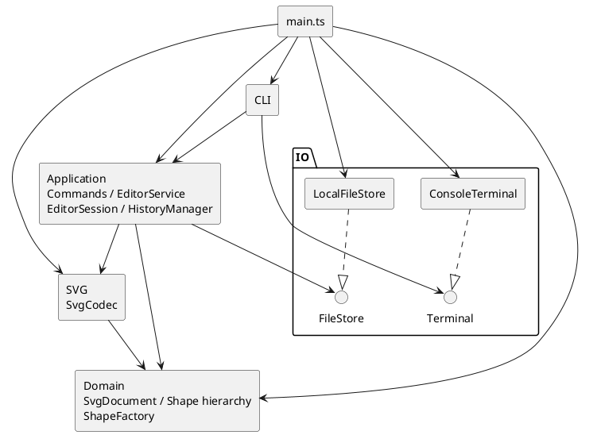

# Phase 1 工程记录

依据：`requirements/phase1.md`。本文将任务书要求、用户确认决策和设计假设分开记录。

当前完成工程初始化、2A 叶子图形、2B 领域图形树基础及其 P1 结构维护边界整改、3A 重挂/排序、3B 原子 group 分组与 3C 嵌套组 ungroup 解组。另已完成 4A 状态基础、4B 执行链路与几何/属性 Command、4C 创建/删除/树编辑 Command，十种编辑均接入快照 Undo/Redo；4D 的 init/canvas、CLI、SVG 编解码、文件 IO、box 和插件仍未实现。`npm start` 仍仅输出初始化信息并退出，不是可交互 CLI。

## 一、架构方案

### 模块与职责

以下是已批准的目标结构；目前已实现 domain 的 Shape、六种图形、SvgDocument、ShapeFactory 及内部归属管理，以及 application 的会话、历史、Service 和十种编辑 Command；不代表全部模块完成。

| 模块 | 职责 |
| --- | --- |
| domain | SvgDocument、Shape 及六种图形类、ShapeFactory；几何行为、唯一 id、有序树及结构不变量 |
| application（含 commands） | Command 行为封装；EditorService 协调执行和提交；EditorSession 持有当前文档与路径；HistoryManager 管理历史 |
| cli | 输入、引号与注释、命令分发、结果格式化；不直接操作领域对象 |
| svg | SvgCodec 负责 XML 与领域文档互转、兼容性检查和补 id，不访问文件 |
| io | FileStore/Terminal 接口及本地实现 |
| main.ts | 未来用于对象接线和启动；当前仅验证启动链路 |

### 依赖方向与图

- domain 只依赖自身和语言基础能力，保持业务模型独立。
- svg 依赖 domain 和 XML 库，不依赖 application、CLI 或文件系统。
- application 依赖 domain、svg 和 FileStore 接口，不依赖具体 IO 实现或 CLI。
- cli 依赖 application 和 Terminal 接口，通过应用结果展示信息。
- io 不依赖业务模块；启动入口可以依赖全部需接线的模块。
- 违反这些方向的依赖应记录并处理，不能用图与实现不一致的方式掩盖。



### 模式与执行策略

- **任务书要求（§1.2、§2.1）**：Command 模式、面向对象、一类一文件、字段封装及容器/叶子统一操作。
- **已落地范围**：十种图形编辑 Command 封装行为，不只是参数容器；EditorService 多态执行，不按命令名解释业务。组和叶子通过 Shape 多态完成几何操作；SvgDocument 协调跨节点结构变化。CLI 分发与文档操作仍待后续迭代。
- **设计策略**：候选文档副本上执行，成功后统一提交；完整文档快照配合过去/未来双栈，避免复杂逆操作。
- CommandDispatcher 和 ShapeFactory 是仅有的名字行为分派入口，按 §2.1 标为待重构点。工厂同时服务 create 与 SVG 导入。
- 未增加 EditTransaction、HistoryEntry、Reader/Writer 接口、独立 CanvasSize 或插件框架；当前规模不需要这些层次。

### 2A 实际领域契约

- 六个类各占同名文件，位于 src/domain。Shape 不保存或假定 x/y/r 等固定几何字段，抽象 move/scale/clone，公共样式与具体属性设置通过基类和子类分别处理。
- 每个叶子类用 JavaScript 私有字段保存自身几何状态；先计算、验证全部候选值，再一次替换几何对象。有限输入导致的加法/乘法溢出也拒绝，不能留下先更新 x 后在 y 失败的状态。
- id 通过只读访问器读取；getAttribute/getAttributes 提供属性读取，后者是冻结的独立快照，内部没有可变集合泄漏。属性值当前仅为数值或字符串，浅复制即可完整隔离。
- setAttribute 几何属性要求数值，text/fill/stroke 要求字符串；不在领域层解析 CLI 数字字符串或 CSS 颜色。未设置的公共样式读取为 undefined，不填入默认 black/none；未知属性读取或设置均抛出错误。
- move 为增量平移；scale 围绕原点同乘所有位置和尺寸，文字内容及样式不变。各类多态完成操作，没有集中类型判断。
- clone 保留具体类型、id、几何、文字和全部当前样式；复制不改变 id。这是独立对象复制，不是向文档插入，唯一性检查留到 2B。
- 领域错误是无 CLI 前缀的 Error，不打印。新增设计假设：id 不允许为空或仅空白；stroke-width 为有限非负数；样式字符串暂不做 CSS 语义校验。这些不是任务书直接给出的完整验证规范。
- 不实现 GroupShape/文档/工厂，不添加插件或 SVG 属性保留框架。待 2B 落实递归行为与文档关系，不能把现有叶子多态声明为已完成 Composite。

### 2B 实际领域树与原子性

- GroupShape 表达有序子节点，构造时支持嵌套子树；children/roots 返回冻结的快照，节点引用保持稳定，不能通过集合改写归属。P1 整改后成员集合由 TreeOwnership 私有保存，结构变更以新的冻结数组替换，旧快照不随之变化。Shape 默认空 children，只用于统一结构遍历；五个叶子类未重构。
- GroupShape 的 move/scale 多态递归，set 仅修改组自身公共样式，clone 递归复制节点及样式。文档支持默认/显式画布、原子 resize、findById、parentOf、根或指定组末尾插入、子树删除及深复制；这些是领域基础能力，不是完整业务命令。
- **组几何原子性策略**：操作前保存全部后代的有效属性快照，失败时恢复这些属性后重抛原错误。当前六种内置图形的属性均为原始值，读取完整，设置原有效值不触发数值运算；几何行为不改变成员关系或样式缺省，因此可以完整恢复，同时保留原节点引用。不替换子树，不依赖未来 EditorService。
- 组策略选择了回滚而不是复制后替换子节点：后者会使外部节点引用和文档关系失效。没有为此改写通过审查的叶子运算逻辑或引入通用事务框架。代价是嵌套组重复捕获快照；任意未来自定义 Shape 若缺少完整可恢复属性或有 setter 副作用，必须重新审查该策略，不能宣称支持任意插件。
- **结构原子性策略**：先完整检查容器、循环、根节点是否游离、子树 id/对象与现有树冲突，再同步提交归属和有序集合变更；构造也先检查全部输入再登记归属。删除先定位和检查原归属，移除子树时仅释放其根，内部归属保持；可在之后重新插入游离子树。
- 2B 原实现的 TreeOwnership 只私有保存归属，导出 treeMutation 并允许组公开维护成员；专项审查证明它可以被直接调用绕过校验。该设计已被以下 P1 整改替代，不再依赖外部遵守 token 使用约定。
- **方案修订**：暂不维护持久 id 查询索引，findById 直接遍历受控树，避免树和索引双重可变状态失配。插入校验存在重复遍历，接受当前小规模成本；将来有实际性能证据后再增加索引并验证一致性。
- ShapeFactory 使用单个 switch 选择六种内置类型（唯一类型行为分派，仍标为待重构），接受结构化属性而非 CLI 参数或 XML；各图形继续承担自身白名单和数值校验。未知类型含 box 拒绝，不添加注册/加载机制。
- 2B 不实现 group/ungroup/addto/front/back；3A 新增 addTo/front/back，3B 新增 group，3C 新增嵌套组 ungroup 子节点提升。基础 insert 仍仅接受未被拥有的子树，不偷偷执行重挂。

### P1 结构维护边界整改

- **根因**：真实 token 与底层写方法均公开，组 append 只检查游离状态；调用方可以跳过文档 id/循环校验，或者只释放归属却保留实际成员。@internal 和 AGENTS 约定没有形成封装。
- **思路 A：节点私有拥有者**。可将父引用放入 Shape，再通过完整结构操作修改；但需要扩展全部节点的归属契约，并解决独立组、文档与节点间的私有状态协调，本轮改动更广。
- **思路 B（采用）：统一结构管理器**。沿用 TreeOwnership 类，把真实有序成员与对象归属都存入 ECMAScript 私有 WeakMap；GroupShape/SvgDocument 不再各自保存可独立变更的集合，而是委托读取和结构操作。删除 treeMutation、公开 claim/release、appendChild/removeChild，不新增 token 或通用事务框架，不改叶子类。
- 所有仍公开的写入口均是完整操作：initializeGroup/initializeDocument 只允许初始化一次，不能清空已有容器；组初始化先校验所有游离子树的对象/id/循环再提交；insert 检查目标文档、父容器、循环、归属和全文档 id；remove 同步移除成员与根归属。即使直接导入管理器也无法只改登记。私有校验方法使用 #，不作为可反射调用的普通私有方法暴露。
- 校验、遍历和冻结候选数组完成后，再同步更新私有集合与归属，不在提交区调用业务回调。移除子树仅释放其根，内部归属不变。组几何回滚算法保持不变，仍保留原节点引用。
- 图形类型分派仍只在 ShapeFactory；管理器以已初始化组/文档身份判断结构能力，不按类型名分派几何行为。变化只发生在 domain 内部，外部模块依赖方向不变。

### 3A 实际实现与提交边界

- SvgDocument 新增 addTo(groupId, id)、front(id)、back(id)，委托 TreeOwnership 的同名完整操作。没有新增公共底层维护能力，也未改动 GroupShape、Shape、叶子类和工厂。
- addTo 的源节点与目标组都按当前文档 id 查询，拒绝不存在节点、缺失/非组目标、自身或自身后代目标。私有归属检查确认源节点在其登记拥有者的成员集合中，且该拥有者属于当前文档。
- 跨父级重挂准备旧父过滤后的序列和新父追加后的序列，全部冻结后提交。只改变被移动子树根的直接拥有者，后代拥有者不变，节点和 id 集合不增加、不替换，原文档 id 唯一性因而保持。原父变空时不删除。同父级仅重排一次，已在末尾合法成功且不写状态。
- front 表示视觉最前，移至同级绘制序列末尾；back 移至开头。私有排序实现只替换所属容器序列，不改变归属。已经位于目标位置的操作合法成功，是否记录历史留待应用层。
- **多步骤提交的依据**：遍历、检查、过滤/展开和冻结数组均在写入前完成；提交只对本类私有的真实 WeakMap 调用原生 set，receiver 不是代理，旧父/新父/节点均为已注册的有效对象键。原生 set 的普通 receiver/key 类型错误条件已经排除，键不需要属性读取或类型转换；不修改可能因冻结而抛错的数组，不调用其他可失败的公共结构操作。因此在正常内置运行时下，提交没有可恢复的领域异常路径。同步执行期间没有 await 或回调可以观察到两次成员更新之间的内部状态。进程终止、运行时资源耗尽或外部篡改运行时内建方法不属于这里的恢复保证；不把该策略称为通用数据库事务。
- 失败校验不触碰成员/拥有者映射，查询继续读取同一树；旧冻结快照和节点引用均保留。没有采用 remove 后 insert 或整树复制替换；前者可能部分成功，后者会改变对象身份。
- 重挂保持几何和显式属性，不承诺继承样式与视觉层叠不变。3A 时 group/ungroup 留待后续；3B 仅完成 group，不增加 CLI 或历史状态。

### 3B 实际分组契约与原子性

- SvgDocument.group(newId, ids) 返回实际新建 GroupShape，完整操作由 TreeOwnership.group 实施。至少选择一个已有节点，允许单节点分组；拒绝重复 id 选择、已有新 id、缺失目标及祖先/后代同时入选。设计假设按用户本轮明确确认记录，不冒充任务书对跨父级位置的直接规定。
- 操作前按根节点和子节点顺序作深度优先前序遍历，以此排序所选节点；每个目标沿直接拥有者链直到文档根取得父链，并校验归属。第一条父链从近到远找出所有父链共有的第一个容器，得到最近公共祖先；单节点取其原父级。
- 在公共容器的原成员中，找到最前包含任一所选节点的直接分支作锚点；在其前插入新组，再跳过该层被选走的直接节点。如果锚点是未被选择的祖先分支，它仍保留在新组之后。原父组变空仍保留，未移动兄弟/子树维持相对顺序。
- 私有 Map 为每个受影响原父容器准备一个冻结替代序列；公共容器的最终序列从原序列统一构造并覆盖其候选，防止多个来源共享父级时重复或覆盖移除。原节点不复制，只更新选中子树根的拥有者，内部关系、几何和显式属性不变。
- **新组创建边界**：目标、重复/祖先约束、父链、公共容器和锚点均检查成功后，才构造空 GroupShape；不能把已挂载目标传给游离子树构造函数。新组此时只在私有 WeakMap/WeakSet 登记，局部持有、尚未返回或接入原树，不拥有原节点。无效新 id 在 Shape 构造校验时失败，不登记新组。全部最终冻结数组和候选表完成后才提交原树变化。
- **提交异常边界**：提交只包含原生私有 WeakMap 的 set 及局部 Map/数组迭代；键均为已验证容器或刚构造的有效对象，没有 receiver/key 的普通异常条件，不调用构造函数、回调或公开 remove/insert。新组的 owner 是新增登记，可能涉及运行时内部资源分配，因此不宣称进程终止、资源耗尽或内建方法遭外部篡改时可恢复；正常领域错误全部在提交前发生。同步提交不暴露中间状态。
- TreeOwnership 增加对具体 GroupShape 的运行时导入，仅用于此确定类型的创建，不是第二个按类型名分派入口；双方只在方法执行时访问对方，不在模块顶层构造实例。构建和既有不同导入路径测试通过。没有修改领域外部依赖方向、GroupShape 或叶子几何实现，也未加入事务框架、插件或历史。

### 3C 实际解组契约与原子性

- **任务书要求（§3 编辑类、§4.2）**：直接子节点提升到父级并占据原组位置，禁止解散 SVG 根的直接子组。非容器按已确认假设报 not a container，缺失目标报 no such shape；领域层抛出无 error: 前缀的 Error，输出留给后续 CLI。
- **本轮用户确认及领域 API 选择**：SvgDocument.ungroup(id) 委托 TreeOwnership.ungroup，返回脱离文档的原 GroupShape。只解散指定层，原组变成游离空组，保留其 id 与自身显式属性；子节点及嵌套子树保持身份、几何、文本、显式属性和内部顺序。空嵌套组同样可解散，顶层空组同样拒绝。
- **准备与提交**：先定位目标、确认容器、父级及直接子节点归属；准备冻结的父级替代序列与空数组。提交仅替换父级成员、清空原组、把直接子节点 owner 改为原父级、删除原组 owner。不调用公开 remove/insert，不新增 token、claim/release 或原始成员写入口。
- **异常边界**：提交使用私有真实 WeakMap 的原生 set/delete，所有容器和子节点都是已有有效对象键，不发生键转换、领域方法调用或冻结数组写入；候选数组分配和可恢复校验已在写入前完成。普通 receiver/key 类型错误已排除；同步提交不暴露中间状态。资源耗尽、进程终止及内建方法遭外部篡改不在恢复保证内。
- 提升仅减少一层祖先关系，不添加对象/id，也不改变子树内部关系，因此保持唯一 id、单一归属和无环。查询遍历最终树，不存在独立索引更新。旧冻结数组仍是操作前快照。
- 跨父级 group 后 ungroup 只提升到当前父级，不恢复历史归属；Undo/Redo 尚未实现。与重挂一样，只保证显式属性与几何保持，不承诺继承样式或视觉层叠外观不变，不为此提前实现 SVG 样式计算。

### 4A 实际会话与快照历史基础

- **依据与边界**：任务书 §2 的失败不变、§4.3 的历史单元/禁用规则，以及已确认 D1、第四轮规划。4A 只准备状态，不执行编辑、文档命令或 IO；4B 才接入 EditorService 与 Command。领域层和启动入口均未修改。
- EditorSession 用私有只读字段保存文档及 defaultSavePath；构造时对输入文档 clone 一次，getDocumentSnapshot 每次返回独立 clone。hasDocument/defaultSavePath 只返回原始值，没有可写文档、路径 setter 或历史字段。准备下一会话直接构造新值，不修改原会话。
- **设计假设/接口选择**：无文档会话不允许带默认路径，避免孤立路径；路径暂按原始字符串保存，不做文件存在性、可写性或路径规范化。该状态约束不是任务书直接规定。新建无参数会话不等于执行 init。
- HistoryManager 构造为双空栈且未禁用；私有 #past/#future 保存文档快照，#disabled 与空栈分开。只公开计数、canUndo/canRedo/disabled 及完整转换，不暴露栈或原始快照。没有当前文档、路径、领域编辑或 IO 职责。
- recordEdit(before) 对编辑前文档 clone 一次，返回过去栈追加快照、未来栈清空、解除禁用的新管理器；调用者必须在编辑成功后使用。它不验证是否真正发生编辑，也不提交文档。合法无变化编辑沿用已有假设仍应记录。
- prepareUndo(current)/prepareRedo(current) 先检查禁用与空栈，再分别 clone 恢复目标、当前文档，准备新的两栈，最后返回只读 HistoryTransition { document, history }。document 是可编辑的独立输出副本，不是历史内部对象；结果外壳冻结只防止字段替换，不用于宣称文档深度不可变。原 HistoryManager 始终不变，失败不需回滚。
- **复制与所有权**：每次入栈产生一个新快照；每次恢复产生一个独立输出及一个当前文档快照。新历史版本只复制栈数组，未弹出的旧快照可在版本之间私有复用，因为所有 API 都不修改或泄漏这些对象；不同记录的捕获互不共享可变文档。私有工厂不接收外部裸快照，不新增公开接管 token。冻结数组仅辅助保护序列，真正隔离由 clone 与私有字段保证。
- resetBoundary() 仅返回清空且禁用的新历史值，不修改原值、不读写会话或文件，也不是 read/save 假成功入口。未禁用空栈抛 nothing to undo/nothing to redo，禁用抛任务书消息主体 undo not allowed after io command；不打印、不添加 CLI 前缀。空栈文案属于设计选择。
- SvgDocument.clone 通过现有 GroupShape/叶子 clone 和文档插入重新建立独立 TreeOwnership 归属；相同 id 在不同快照文档中合法。应用层跨快照不保证 JavaScript 对象身份延续，调用方应按 id 查询；不改变领域单次结构操作保留身份的契约。
- **未来统一提交**：EditorService 私有持有会话与历史的组合，准备 Command 结果、下一会话和历史后一次发布；本轮没有该协调器，也没有验证命令执行与会话/历史发布的原子性。向 EditorSession 交付恢复文档仍经过构造复制，防止公开的 HistoryTransition.document 引用污染正式会话，不通过公开接管接口减少这次必要复制。

### 4B 实际执行链路与原子提交

- 新增 EditorService、CommandResult 及 commands/Command 抽象类与 MoveCommand、ScaleCommand、SetAttributeCommand。每个业务类单独同名文件。Service 仅依赖 Command 契约、Session/History/Result 和领域文档类型；具体 Command 只依赖契约、Result 与领域类型；domain 无反向依赖，未增加名字行为分派。
- 具体 Command 自己按 id 查找候选节点、拒绝缺失目标、多态调用 move/scale/setAttribute，并构造摘要结果。参数仅为 string/number 原始值，构造时按值保存到只读私有字段，不接收外部数组/对象/Shape；复用表示在当次候选中重新查 id 并再次执行，不保存旧节点、执行结果或逆操作。
- CommandResult 仅保存私有字符串 summary，构造时验证字符串并冻结外壳；Service 再读取一次摘要并构造自己的 Result，隔离自定义 Command 保留或重写的结果对象。结果不含领域引用、回调或属性集合。Undo/Redo 暂返回通用完成摘要，不实现 CLI 渲染、逐命令逆操作或历史摘要元数据。
- EditorService 用单个私有 #state 持有不可变会话/历史组合。execute 依次取得候选副本、执行 Command、复制结果值、捕获编辑前历史、构造下一会话，再一次替换 #state。所有命令行为、克隆、数组和结果准备在发布前完成；发布只赋值一个有效私有字段，不调用领域方法、getter、回调或终端输出。
- **复制成本**：一次成功编辑有四次文档级 clone：候选输出、编辑前文档输出、历史入栈、下一会话输入。分别封闭不同所有权边界，不重复复制整个历史。Undo/Redo 也为四次：当前输出、历史目标恢复、当前入反向栈、下一会话输入。没有为减少复制增加裸文档接管入口；后续有性能证据再调整，不提前引入事务框架。
- 任一步失败都不替换 #state，旧文档、默认路径、双栈和禁用状态保持；成功无变化编辑同样 recordEdit 并清 Redo。Undo/Redo 从快照恢复且保留路径，不重执行原 Command。输入 Session/History 本身按 4A 契约不可变，Service 不修改它们，也不公开正式文档或内部状态对象；查询只输出独立文档和冻结的原始值历史状态。
- **HistoryManager 最小调整**：新增 assertUndoAllowed/assertRedoAllowed 只读前提检查，将与 prepare 共用的禁用/空栈判定收敛到私有 #target；内部文档仍只在私有方法返回，公开断言返回 void。Service 先检查无文档，再检查禁用/空栈，最后复制，避免克隆错误覆盖应优先返回的状态错误；没有增加历史执行协调职责。
- **同步边界**：Command 契约为同步执行。Service 的私有执行标志拒绝 Command/结果准备期间同步重入写操作，防止内层提交被外层旧状态覆盖；finally 总会释放标志。它不是新事务层，不保护任意外部篡改内建方法、原型或自定义 clone 契约，也不宣称支持异步命令。
- **接口选择/设计假设**：构造时可接收已存在的 Session/History，便于后续启动接线和本轮测试；无文档不得带非空历史。默认路径不变，Service 没有初始化、调整画布或 IO 成功入口。HistoryStatus 只读返回两栈计数、禁用和可执行状态。
- 本轮验证到实际候选执行与会话/历史一起发布；未执行 4C 的树编辑 Command，未实现文档历史边界的真实 init/read/save/canvas 行为。此前 4A 段落中的“未来 Service”描述保留为该迭代范围说明，以本段为当前状态。

### 4C 实际创建与树编辑 Command

- 新增 commands 下 CreateCommand、DeleteCommand、GroupCommand、UngroupCommand、AddToCommand、FrontCommand、BackCommand 七个同名类文件，均继承现有 Command。没有修改 EditorService、Command 契约、Session/History、既有几何 Command 或任何领域实现；执行、失败隔离、单次提交、Undo/Redo 全部复用 4B 链路。
- CreateCommand(type, id, attributes = {}, parentId?) 在构造时复制并冻结属性字典，属性值沿用 string/number 领域契约，浅复制即隔离；类型、id、父容器 id 按值保存。每次 execute 都用 ShapeFactory 创建新图形，再调用候选文档 insert，省略父容器即根级；不缓存图形或引入第二处图形类型名分派。
- GroupCommand(newId, ids) 构造时复制并冻结 id 列表，执行时交给候选文档 group 按既定公共祖先/操作前顺序规则处理，不在 Command 重写树算法。Delete/Ungroup/AddTo/Front/Back 分别调用候选文档对应完整操作，只保存原始值 id，查询及归属检查由现有领域 API 保证；局部节点引用仅用于生成字符串摘要，不保留或返回。
- **复用语义**：每次按当前候选状态执行。Create/Group 若新 id 已存在，Delete/Ungroup 若目标已不存在，均以领域错误拒绝；Undo 恢复前提后可重新执行同一对象。Create 在不同文档执行也产生独立节点，失败创建后重试不会复用临时节点。AddTo/Front/Back 已在目标位置仍合法成功并记录一个编辑单元。
- CommandResult 沿用稳定字符串数据，未增加可变集合、文档、Shape 或回调。命令不读写历史，不实现逆操作；结构方法返回值只在 execute 中临时使用。默认保存路径通过 Service 原样保持。
- **快照验收**：每项成功结构编辑先记录完整树，再 Undo 比较画布、类型、属性（包括未设置样式）、层级、兄弟顺序及全文档查询/归属；每个恢复对象与外部旧快照均不同。Group/ Ungroup 各只增一个历史单元。跨父级 group 的 Undo 恢复各原父级，而后续 ungroup 仅提升到当前父级，两者不是互逆。
- 新增一条十步混合序列，覆盖七种新 Command、属性修改、嵌套子树删除及删除后复用旧 id；逐步 Undo/Redo 对照所有中间树。测试还让 GroupCommand.execute 和文档 group/ungroup 在首次执行后抛错，确认历史恢复不重执行命令或模拟逆操作。
- 失败矩阵包括未知类型/box、创建 id/属性/几何/父级错误、非法 group 选择、顶层或非组解组、重挂循环和缺失排序目标。均在已有 Redo 分支上检查文档、路径、双栈及禁用状态保持，并实际 Redo 验证内容；失败不抹掉原分支。
- 当前只完成编辑 Command；文档历史边界实际操作、CLI 参数解析和 SVG/IO 仍未实现。既有四次文档级 clone 策略和同步执行边界不变，未增加插件或新抽象。

### 已确认决策

| 决策 | 内容 |
| --- | --- |
| D1 历史 | 成功 init/read/save/canvas 修改清空历史并禁用 Undo/Redo；下一次成功编辑解禁；失败与查询不改变历史 |
| D2 兼容 | 分为可编辑、安全保留不可 CLI 修改、无法安全处理而拒绝；不得静默丢弃影响语义的数据。这是设计策略 |
| D3 层级 | group 放在最近公共祖先内，插在包含所选节点的最前直接子分支之前；组内按操作前文档遍历顺序。addto 禁止成环，同父级时移到末尾；保证原子性与 Undo 恢复 |
| D4 分派 | 限制行为分派入口，优先多态；普通属性校验不算新增行为入口，但不能借此隐藏类型判断 |
| transform | Phase 1 暂不实现完整编辑语义；遇到不支持的 transform 明确拒绝导入，解释原因。这不是任务书硬性要求 |

### 设计假设（非任务书硬性要求）

- canvas 无参数查询不影响历史；无文档时允许 help/init/read，其余命令报无文档错误。
- 无默认路径时 save 要求显式路径；成功另存更新默认路径，失败不更新。
- 导入已有重复 id 失败；缺 id 从标签名加 1 开始，跳过全文档已有及已分配编号。
- 顶层组禁止 ungroup 是任务书明确规则；对叶子解组按非容器错误处理。
- front 为视觉最前，即绘制序列末尾；back 为开头。
- 普通 g 的 set 只修改自身公共样式，不覆盖子元素显式属性。
- 数值有限；坐标可负；尺寸和半径非负；画布尺寸及 scale 严格为正；init/canvas 接受零或两个尺寸参数，拒绝额外参数。
- 空历史输出错误；合法无变化编辑也计入历史并清 Redo。
- 忽略前导空白后以 # 开头的整行为注释；不支持行尾注释；引号内支持转义双引号和反斜杠。
- 遵守规定错误文本与稳定输出格式，不推定示例空格必须逐字符一致；功能完成后提供 npm run cli。
- group 重复选择同一节点时拒绝；跨父级重挂不承诺保持继承样式和层叠外观。
- SVG 可保留的首批候选属性包括 font-size/font-family/font-weight/text-anchor、opacity/fill-opacity/stroke-opacity 及经评估安全的 data-*；不接受任意未知属性。
- 暂拒未知图形、复杂文字、引用结构、CSS/脚本等无法安全处理的内容；首批坐标支持数值/px，viewBox 缺失或等于 0 0 width height。具体边界在编解码迭代验证。
- 提交后终端输出故障与编辑业务失败分开报告；保存采用写临时文件后替换策略，避免破坏原文件。

### 变化点与取舍

| 变化点 | 当前预留 | 不提前实现 |
| --- | --- | --- |
| 图形与命令扩展 | 多态及两个集中入口 | 动态插件、box、宏语言 |
| SVG 支持扩大 | 独立 Codec、明确兼容分类 | 完整 SVG/CSS/transform 引擎 |
| 交互通道 | 应用层与展示结果隔离 | GUI、鼠标、独立 Agent API |
| 历史性能 | 集中历史管理 | 增量、持久化、分支历史 |

## 二、过程记录

1. **需求分析**：用户限定只读分析；AI 梳理功能与工程过程要求，列出 16 项歧义，没有修改任务书或开始开发。
2. **澄清收敛**：按影响分为 A/B/C，收敛到 D1—D4。用户接受历史、层级和分派方案，纠正“不可编辑属性等于不可导入”的过度限制，要求三级兼容策略。
3. **初次架构**：AI 提出模块与类职责，但工厂归属和依赖图不一致。用户要求批判性自审，不允许直接编码。
4. **架构修订**：工厂移入 domain；删除独立事务及重复快照记录；合并 SVG Reader/Writer，明确 Service 唯一提交职责与 Command 行为封装。承认 transform 背景示例暂不可读，用户批准将其作为兼容限制记录。
5. **初始化规划与授权**：用户批准最小 TypeScript/npm 工程、本地提交；明确禁止业务实现、远程创建、推送和 final 标签，并允许使用 main.ts 避免空类。
6. **本轮实际工作**：初始目录仅有任务书和 .DS_Store，无 Git 仓库；使用现有 Node/npm。创建工程配置、最小启动及进程测试、本文与 AGENTS.md；验证结果见下一节。
7. **2A 授权与实现**：用户确认初始化提交 728ae3c 已推送，要求领域开发拆为两轮后仅批准 2A。AI 实现六个领域类和两组测试，先验证候选值再提交状态，保留未知几何布局的抽象契约；将 npm test 从单个初始化文件扩展为全部顶层测试文件，避免遗漏领域测试。未进入 2B，也未推送本轮提交。
8. **2A 只读审查与回归**：实际审查 c25f38b 源码、测试及提交差异，未发现 P1/P2，指出修改几何/文字后再复制及缺省样式复制的 P3 测试缺口。用户批准 2B 时要求先补齐，本轮新增六项回归，不改动五个叶子类。
9. **2B 实现与取舍**：用户批准领域树基础并强调不能依赖未来应用事务。AI 采用组内有效值快照回滚以保留节点身份，结构变更前完整校验，以内部归属登记防止跨树复用，并选择实际树遍历替代持久索引。新增三个主要类、一个内部辅助类及三组测试；不实现后续命令或插件。
10. **P1 发现与复现**：用户要求专项只读审查，AI 实际复现导出 token 可创建自包含组、追加重复 id、单独 release 后跨文档重复挂载。原 94 项测试未覆盖真实 token，之前将此视为内部约定低估了风险。用户批准本轮整改后，先新增三项直接使用真实公开 API 的回归（无类型强转），类型检查/构建成功，但运行结果为 0 通过、3 失败，均是 Missing expected exception；此时尚未修改领域实现。
11. **P1 修复与回归**：比较节点父引用与统一结构管理两条思路后选择后者，以复用现有边界并避免改动叶子类。移除不安全 API 后，回归测试改为断言旧入口已不存在，并直接调用剩余公开管理器操作验证同样约束，避免只测试封装外观。补充重新初始化拒绝、根子树删除重插、独立组 clone 插入、clone 冲突后可用、直接管理器循环拒绝及冻结集合检查。嵌套组 move/scale 溢出回滚继续由原测试验证。
12. **3A 授权与实现**：用户确认 49d9bd2 已推送且 main 同步，仅批准第三轮的 addto/front/back。AI 实现完整校验的领域重挂/排序，将跨父级、同父级重排、合法无变化以及直接管理器调用纳入测试；未提前实现分组或解组。复核测试时发现对私有字段对象数组仅做深比较不足以证明顺序，改为同时校验 id 序列及逐位置严格引用，提升新测试的有效性。
13. **3A 审查与回归固化**：用户要求实际运行嵌套树的重挂、排序、再次重挂、删除及跨文档重插场景。只读审查运行通过，无 P1/P2；指出完整场景尚未持久化的 P3。3B 按用户授权新增 tree-sequence.test.ts，每阶段核对对象/id 唯一、查询、顺序和直接归属，补上该回归。
14. **3B 实现与验证**：用户确认跨父级 group 的位置及排序规则。AI 基于操作前遍历和父链准备全部结构；采用空新组和私有候选表，避免调用公开移除/插入，也避免已挂载对象被构造函数提前接管。测试特别检查公共容器也是源父级、锚点分支仍有未选节点、失败后同 id 重试及直接管理器入口。首轮连续测试编译发现遍历函数把父级限定成具体组而非抽象 Shape，修正测试参数类型后通过，无需改动领域契约。

15. **3B 审查与 3C 授权**：用户确认 3B 只读专项审查无 P1/P2/P3，批准仅实现领域解组；明确顶层禁止、只解一层、原组游离且清空，以及跨父级分组不靠解组恢复旧父级。
16. **3C 实现与验证**：AI 沿用 TreeOwnership 统一成员/归属维护，在准备所有候选后提交；未改变叶子几何或添加类型名分派。新增 18 项解组专项测试，以首/中/末和空/单/多成员九种组合检查对象身份、几何与显式属性，并测试失败不变、游离组重用、直接管理器隔离及后续组合操作。

17. **第三轮验收与第四轮规划**：用户确认第三轮综合验收通过且 4ac7f3c 已推送，main 与 origin/main 同步。用户原则上接受 4A–4D 四轮计划、快照替换不保留跨提交引用、编辑 Command 不维护逆操作及 init 清除默认路径等选择，随后只授权 4A。
18. **4A 实现与测试**：AI 新增两个应用层类，采用不修改原值的历史转换与显式复制边界，没有增加 Service、Command 或领域修改。首轮 23 项专项测试有一项误用随后会被修改的输入作为预期基准；运行暴露断言错误后改为独立预期副本，并加强失败后不同栈内容的恢复断言，无需改变类实现。修正后专项测试全部通过。

19. **4A 审查与 4B 授权**：用户确认 46cd354 专项审查无 P1/P2 阻塞，批准仅实现三个几何/属性 Command 和执行链路；要求候选引用逃逸、结果准备和全部历史失败不能影响正式状态。
20. **4B 实现与验证**：AI 沿用 4A 不可变状态基础，以单次私有组合替换提交。发现恢复操作需在复制前判断禁用/空栈，故给 HistoryManager 加共用校验的只读断言，未重新设计状态层。补充同步重入拒绝；新增 48 项专项测试首轮类型检查、构建和执行均通过，包含命令/结果/历史/会话准备失败与克隆阶段故障注入。

21. **4B 审查与 4C 授权**：用户确认 ad4307b 专项审查无 P1/P2 阻塞，批准仅新增七种创建/树编辑 Command；重点要求新建对象不可复用归属、集合参数复制，以及复杂树的历史恢复。
22. **4C 实现与专项验证**：AI 复用现有 Service 和领域接口，没有发现必须调整的接入问题。七个 Command 只封装调用，不重复树算法；新增 structure-commands 专项测试首轮 65 项通过，随后补充文档根为公共容器的分组和解组保留嵌套组两项，共 67 项通过。每次恢复检查序列、属性、归属、查询及对象独立性，避免把 ungroup 等同 Undo。

## 三、一致性自查

| 检查 | 当前结论 |
| --- | --- |
| 目录与方案 | 4C 仅新增 application/commands 下七个具体类及一份专项测试；沿用 Service/History 和领域结构，无 4D 或其他模块实现 |
| 一类一文件 | 领域和应用业务类均在同名文件；状态转换接口不增加空类；测试中的匿名 Command/Result 用于注入行为，不属于新增业务类型 |
| 依赖方向 | application 仅依赖自身和 domain，无 IO/XML/CLI；domain 无反向依赖；Service 不依赖具体 Command；启动入口不接业务 |
| Command/Composite | 递归几何、样式、复制及领域重挂/排序/group/ungroup 已实现；十种图形编辑 Command、Service 与对应快照 Undo/Redo 已实现；文档命令边界尚未实现 |
| 任务书保护 | 初始化前记录 SHA-256，完成后核对，见质量保证记录 |
| 架构修订 | 工厂迁移、事务删除、快照简化和 Codec 合并已记录；后续偏差继续如实追加 |

## 四、质量保证

### 初始化验证

本轮实际环境：Node.js v26.8.1、npm 11.19.0；直接开发依赖为 TypeScript 7.0.2、@types/node 26.6.5，无运行时依赖。精确解析结果由 package-lock.json 锁定。

沿用本机已有 Node，没有为原计划中的 LTS 偏好安装或切换运行时；只声明在上述实际版本完成验证，不推定其他版本已验证。使用用户允许的 src/main.ts 替代空 ApplicationBootstrap 类。

| 验证 | 本轮结果 |
| --- | --- |
| npm ci | 成功，从锁文件重新安装依赖 |
| npm run typecheck | 通过 |
| npm run build | 通过 |
| npm test | 1 项通过，0 项失败；包含重新构建 |
| npm start | 输出 svg-editor: project initialized，退出码 0 |
| git diff --check | 通过；首次提交的新增文件另以暂存区检查确认 |
| git diff --cached --check | 全量检查发现原任务书末尾既有空行；为保护任务书保留原状。排除任务书后，本轮新增文件检查通过 |
| 任务书完整性 | 前后 SHA-256 均为 d8bbf9409a9596035f13ae809888c64e813ea76966b649911536da44eabc7f76 |

初始化前没有 Git 仓库，创建本地 main 分支。原任务书原样纳入首个版本基线，.DS_Store 保留但忽略；node_modules、dist 和覆盖率目录不提交。暂存检查和本地提交结果以本轮实际 Git 输出为准，不将提交哈希回写导致文档自引用。

```sh
npm ci
npm run typecheck
npm run build
npm test
npm start
git diff --check
git diff --cached --check
git diff --cached --check -- . ':!requirements/phase1.md'
git status --short
```

测试执行真实编译入口的独立进程，检查退出码、超时、标准错误及初始化输出。它只证明工程链路可运行，不证明 SVG 或命令功能完整。

### 2A 验证结果

- npm run typecheck、npm run build、npm test、npm start 均通过；总计 61 项测试通过（60 项领域测试及 1 项初始化测试），0 失败。
- 测试覆盖五种几何语义、负坐标/浮点、零尺寸、非法输入、后部字段溢出时整体不变、属性白名单与类型校验、冻结快照、样式缺省、具体类型保留及双向复制独立。
- 本轮未新增或升级依赖，package-lock.json 保持不变。Git 差异与暂存范围另行核查，任务书 SHA-256 应保持初始化记录值。
- 验证只覆盖叶子模型，尚不能据此宣称树结构、命令、文件或历史功能正确。

### 2B 验证结果

- npm run typecheck、npm run build、npm test、npm start 全部通过。总计 94 项测试通过，0 失败：原 61 项继续通过，新增 6 项叶子复制回归、9 项组测试、10 项文档测试和 8 项工厂测试。
- 重点覆盖多层嵌套、后部 move/scale 溢出后的节点状态与引用恢复、复制隔离、id 大小写、子树冲突、跨文档重复归属、自包含/祖先循环拒绝、插入失败不占用归属、删除后重用及查询顺序保持。
- 五个叶子源文件、任务书、package.json、package-lock.json 均无变化；仅 Shape 增加统一只读 children。无新增依赖；启动仍是初始化入口。
- git diff --check 通过；提交前继续核对暂存清单及任务书哈希，确保只提交本轮领域基础与记录，不含 dist/node_modules。

### P1 验证记录

- 修改前：三条实际公开 API 回归全部失败（0/3 通过），确认实现缺陷而非类型检查失败。
- 修改后：npm run typecheck、npm run build、npm test、npm start 全部通过；102 项测试通过，0 失败。包含原 94 项（删除旧维护入口的两条断言改为检查 API 不存在）及新增八项专项回归。git diff --check 通过，任务书 SHA-256 与初始化记录一致。
- 无任务书、叶子类、依赖或工厂改动；没有实现后续树编辑命令。只创建独立本地修复提交，不推送、不打标签。

### 3A 验证记录

- 新增 test/tree-reparenting.test.ts（10 项）与 test/tree-order.test.ts（11 项），涵盖节点身份、同级顺序、归属、几何属性、失败不变及多文档隔离；包含重挂与排序组合、重挂后复制/删除/重新插入。
- 实际 npm run typecheck、npm run build、npm test、npm start 全部通过；123 项测试通过，0 失败，原 102 项及 P1 专项回归继续通过。git diff --check 通过；任务书 SHA-256 与初始化记录一致。
- 任务书、依赖、GroupShape/Shape/叶子类/工厂保持不变；不实现 group/ungroup，不推送或打标签。

### 3B 验证记录

- 新增 tree-grouping.test.ts（19 项）与 tree-sequence.test.ts（1 项），覆盖同父/跨父/跨深度、前序排序、单节点、锚点、空原组、子树身份/属性、非法选择的完整状态不变及跨文档隔离。
- npm run typecheck、npm run build、npm test、npm start 均通过；143 项测试通过，0 失败，包含原 123 项及 P1 回归。git diff --check 通过，任务书 SHA-256 与初始化记录一致；提交前另核对暂存范围。
- 任务书、依赖、Shape/GroupShape/叶子类/工厂均未改动；ungroup 未实现，本轮不推送或打标签。

### 3C 验证记录

- 新增 test/tree-ungrouping.test.ts，共 18 项：位置/成员数九种组合、仅解一层、四种失败场景、游离空组复用、直接管理器多文档/大小写隔离、解组后组合操作及跨父级 group 后解组。
- npm run typecheck、npm run build、npm test、npm start 全部通过；总计 161 项测试通过，0 失败，原 143 项（含 TreeOwnership P1、3A、3B 和连续场景）继续通过。断言包含逐位置引用、显式属性/几何快照、归属、查询及失败后冻结成员快照保持。
- git diff --check 通过；任务书 SHA-256 仍为初始化记录值。任务书、依赖、Shape/GroupShape、五个叶子类和 ShapeFactory 均未修改。生成物不提交；本轮只创建独立本地提交，不推送、不打标签，不进入后续模块。
- 尚未验证应用命令、历史恢复或 SVG 输出；这些不属于本轮范围。当前未发现必须在第三轮最终验收前整改的已知结构一致性问题，仍待用户专项审查与第三轮最终验收。

### 4A 验证记录

- 新增 editor-session.test.ts（9 项）和 history-manager.test.ts（14 项），共 23 项。覆盖无文档/默认路径、输入输出隔离、六种内置类型的嵌套树、顺序、几何/文字/显式属性和缺省样式、独立归属、双栈转换、旧历史分支可用及禁用/空栈区别。
- 使用 node:test 的方法 mock 在输入捕获、恢复目标克隆及当前文档捕获阶段注入异常；检查状态不变并重试恢复实际内容，不只检查计数或抛错。未通过类型强转或读取私有栈绕过封装。
- npm run typecheck、npm run build、npm test、npm start 均实际通过；184 项测试通过、0 失败，原 161 项全部继续通过。git diff --check 通过；任务书 SHA-256 保持初始化记录值。
- 未修改领域层、任务书、依赖配置或启动入口；不提交 dist/node_modules。只创建本轮独立本地提交，不推送、不打标签。
- 本轮验证范围是会话值与历史转换准备，不证明未来 Command 执行与当前文档/历史统一发布的原子性；后者留待 4B。当前不限制历史容量，不支持任意自定义 clone 契约、持久化历史或 IO 成功状态。

### 4B 验证记录

- 新增 geometry-commands.test.ts（9 项）与 editor-service.test.ts（39 项），共 48 项；覆盖叶子/嵌套组 Move/Scale/Set、参数按值捕获与复用、连续 Undo/Redo、新分支、合法无变化、非法属性/缺失目标/后代溢出、输入输出及结果引用隔离。
- 通过测试专用匿名 Command 先修改几何/树/画布再抛错，或保留候选和节点后继续修改；检查正式文档、路径、完整树、属性、查询和归属仍一致。结果读取、历史准备和下一会话克隆失败均保留 Redo，并实际执行恢复以验证栈内容。
- 对编辑的前三个文档克隆以及 Undo/Redo 全部四个克隆阶段注入异常；新会话输入失败另以候选后部节点 clone 抛错验证。无文档/禁用/空栈错误在复制前返回，异常后仍可继续执行，同步重入写操作拒绝。
- npm run typecheck、npm run build、npm test、npm start 均实际通过；232 项测试通过、0 失败，原 184 项全部继续通过。git diff --check 通过，任务书 SHA-256 与初始化记录一致。
- HistoryManager 只新增共用校验的只读前提断言，EditorSession 仅更新注释；领域层、任务书、依赖、配置和启动入口均未修改。提交前检查暂存范围，排除生成物；只创建一次本地提交，不推送、不打标签。
- 本轮支持同步可信编辑 Command；不支持异步 Command 或不遵守领域 clone 契约的任意扩展。通用 Undo/Redo 摘要和当前快照成本已记录；没有发现必须在 4C 前解决的已知状态一致性问题，仍待用户专项审查。

### 4C 验证记录

- 新增 structure-commands.test.ts 共 67 项：六类型根级/容器创建，字典/列表参数隔离，新对象归属，命令复用，叶子/子树删除，同父及跨父/深度/文档根分组，空/单/多成员及保留嵌套组的解组，重挂/排序和历史恢复。
- 26 类非法结构操作分别在 Undo 后的 Redo 分支上验证失败不变并实际重做；另覆盖禁用状态失败不解禁、成功新结构编辑清 Redo、合法无变化重挂/排序记录历史。十步混合序列逐次比较所有 Undo/Redo 中间状态，检查独立对象、类型、属性、id、顺序和 TreeOwnership 归属。
- npm run typecheck、npm run build、npm test、npm start 均实际通过；299 项测试通过、0 失败，原 232 项（含 P1 及 2A–4B）全部继续通过。git diff --check 通过，任务书 SHA-256 保持初始化记录值。
- 仅新增七个 Command 类和一份专项测试、更新 AGENTS/doc；Service、Session/History、契约、结果类、几何 Command、领域层、任务书、依赖和启动入口均未修改。提交前检查暂存范围，不提交生成物；只创建一次本地提交，不推送、不打标签。
- 仍未实现 4D 文档操作或任何 CLI/SVG/IO；沿用同步 Command、完整快照和通用 Undo/Redo 摘要限制。未发现必须在 4D 前解决的已知接入或状态一致性问题，仍待用户专项审查。

### 后续验收范围

后续按领域基础、树操作、应用命令与历史、CLI、SVG 文件读写、全流程验收分别迭代和提交。重点验证：树结构与顺序、失败不变、Undo 恢复、文档历史边界、兼容拒绝和安全属性保留。最终对照任务书逐项检查，并用浏览器验证保存产物。

### Git 交付边界

初始化提交由用户确认已推送到 GitHub，main 跟踪 origin/main。2A/2B 各自只创建本地独立提交，不推送、不打标签；每轮提交前检查范围及生成物。课程最终远程与 final 交付仍按用户授权处理。
