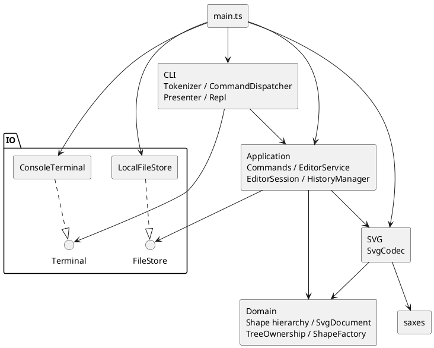

# SVG Editor Lab — Phase 1 工程报告

**GitHub 仓库地址：** https://github.com/WSYits/svg-editor-lab

本项目依据 [Phase 1 任务书](../requirements/phase1.md)，实现了一个基于 TypeScript 的命令行 SVG 编辑器，支持六种图形、19 个命令、嵌套分组、Undo/Redo 以及 SVG 文件读写。本报告从架构方案、AI 协作过程、一致性自查和质量保证四个方面，记录项目的设计决策、实现过程及验证结果。安装与使用说明见[项目首页](../README.md)。

## 一、架构方案

### 1.1 模块划分与依赖方向

本项目按照领域模型、应用逻辑、命令行交互、SVG 格式转换和外部 IO 划分模块。核心原则是将图形编辑规则与外部交互方式分离，使领域模型不依赖终端、文件系统或 XML 解析，同时由应用层统一协调命令执行和状态管理。

各模块的主要职责如下：

| 目录或入口 | 主要对象 | 职责 |
| --- | --- | --- |
| `src/domain/` | Shape、五种叶子图形、GroupShape、SvgDocument、TreeOwnership、ShapeFactory、PreservedAttributes | 封装几何操作、属性校验、图形创建，以及图形树的顺序、唯一 id 和归属约束 |
| `src/application/` | EditorService、EditorSession、HistoryManager、CommandResult、DocumentIoResult、查询投影 | 协调命令执行、文档操作、历史管理和正式状态提交，提供独立的查询结果 |
| `src/application/commands/` | Command 及十种具体编辑 Command | 封装具体编辑行为，通过统一接口调用领域操作 |
| `src/cli/` | Tokenizer、CommandDispatcher、Presenter、Repl、CommandOutput | 负责输入解析、命令分发、结果展示及逐行交互 |
| `src/svg/` | SvgCodec | 实现 SVG 字符串与领域文档的转换，处理 XML 解析、自动补 id 及兼容性校验 |
| `src/io/` | FileStore、LocalFileStore、Terminal、ConsoleTerminal | 抽象并实现文件读写和终端输入输出 |
| `src/main.ts` | 程序装配入口 | 创建并连接各模块的具体实现，启动 REPL 并设置退出码 |

模块之间的依赖关系如下图所示：




为保证模块职责清晰，项目采用以下依赖规则：

- **domain：** 仅依赖领域内部类型和语言基础能力，不依赖 application、cli、svg 或 io，使几何操作与图形树约束能够独立于外部交互方式。

- **application：** 可以依赖 domain、`SvgCodec` 和 `FileStore` 接口，但不依赖 CLI 或 `LocalFileStore` 等具体实现。应用层负责协调编辑与文档操作，具体文件访问由接口隔离。

- **cli：** 可以依赖应用层的命令与服务接口，以及 `Terminal` 接口，但不直接修改领域对象。命令解析和结果展示由 CLI 负责，具体编辑规则交给应用层和领域层处理。

- **svg：** 可以依赖 domain 和 XML 解析器，但不依赖应用会话、CLI 或文件系统。`SvgCodec` 仅负责格式转换，便于独立测试和复用。

- **io：** 依赖 Node.js 提供的文件、路径和终端能力，不依赖领域或应用业务模块，负责隔离具体外部环境。

- **main.ts：** 作为程序装配入口，可以依赖各模块及其具体实现，负责建立依赖关系，但不承担实际编辑业务。

通过上述划分，图形操作、状态管理、命令行交互和外部 IO 各自具有明确的职责。后续增加命令、调整 SVG 兼容范围或更换外部交互实现时，可以优先在对应模块中修改，减少对其他模块的影响。

### 1.2 领域模型与 Composite 模式

SVG 文档既包含矩形、圆形、文字等独立图形，也允许通过 `<g>` 将多个图形组合成嵌套结构。例如，一个流程图节点可以由矩形和文字共同组成，移动整个节点时，内部图形也需要同步移动。如果为叶子图形和图形组分别实现编辑逻辑，就容易在各种命令中反复判断目标类型。因此，本项目采用 Composite 模式，使叶子图形和容器通过统一接口接受编辑操作。

`Shape` 定义 `move`、`scale`、`clone` 和属性操作等公共契约，不要求所有图形具有相同的几何字段。`RectShape`、`CircleShape`、`EllipseShape`、`LineShape`、`TextShape` 分别封装自身的几何与属性规则；`GroupShape` 则维护有序子节点视图，并通过相同接口递归操作后代。例如，执行 `move node1 20 0` 时，无论 `node1` 是单个图形还是包含多个子图形的组，编辑命令都只需调用目标的 `move` 方法，由具体对象决定如何完成移动。

几何操作遵循统一规则：`move` 使用增量坐标，`scale` 围绕原点同比例修改位置与尺寸，文字内容和样式不随几何缩放改变。组的移动与缩放递归作用于后代，而 `set` 修改组自身的公共样式，不自动传播到子节点；删除组则删除完整子树。叶子在更新前验证候选数值，组的递归几何操作在后续节点失败时恢复此前的修改，并保留原有节点引用，避免部分修改造成状态不一致。

Composite 模式统一了编辑行为，但图形树还需要维护结构约束。`SvgDocument` 管理画布和根节点，对外提供按 id 查询、插入、删除及结构编辑接口；`TreeOwnership` 集中管理成员顺序与节点归属，保证文档内 id 唯一且大小写敏感、节点单一归属及结构无环。底层成员集合不能由外部直接修改，结构操作在完成必要校验与候选结构准备后统一提交。本阶段通过遍历图形树完成查询，不额外维护 id 索引，以避免引入缓存一致性问题。

对于任务书没有完全规定的结构操作，本项目补充了以下规则：

- **`group`：** 至少选择一个节点，拒绝重复选择以及祖先、后代同时入选。成员按照原文档前序排列，新组插入最近公共祖先容器的第一个相关直接分支之前，原容器即使变空也会保留。
- **`addto`：** 将已有节点移动到目标组末尾，同一父级内也按照末尾位置重新排列；禁止将节点移动到自身或其后代内部。
- **`front` / `back`：** 仅调整同一父级下的绘制顺序，分别移动到末尾和开头，不改变其他节点的相对顺序。
- **`ungroup`：** 只解散指定组，将直接子节点提升到原组位置，不递归解散内部嵌套组；按照任务书规定，顶层组不允许解组。

上述操作保留节点的几何属性、显式样式和其他受控保留属性。深复制能够保留图形具体类型、id、文字、属性及子节点顺序，同时隔离可变状态。但跨容器移动可能改变 SVG 样式继承关系，因此不保证视觉外观完全不变；`ungroup` 也不会自动恢复分组前的原始父级，完整恢复需要通过 Undo 快照完成。

综上，Composite 模式负责统一叶子与容器的编辑行为，`SvgDocument` 和 `TreeOwnership` 则负责维护图形树的结构约束。前者减少针对图形类型的重复分支，后者保证结构操作不会破坏文档的一致性。

### 1.3 Command 模式与应用执行链路

SVG 编辑器需要支持创建、删除、移动、缩放和分组等多种编辑操作。如果由 CLI 直接实现这些操作，容易将命令解析、业务逻辑和状态管理混在一起，随着命令增加，也会产生重复的类型判断和执行流程。因此，本项目采用 Command 模式，将不同编辑行为封装为独立对象，再由应用服务统一协调执行。

`Command` 定义同步编辑操作的统一接口 `execute(candidate)`，具体实现包括 Create、Delete、Move、Scale、SetAttribute、Group、Ungroup、AddTo、Front 和 Back 共十种 Command。每个 Command 不只是保存参数，还负责调用相应的领域操作。例如，`MoveCommand` 根据 id 在候选文档中查找目标图形，检查目标是否存在，再通过图形对象的 `move` 方法完成移动，并返回执行结果。这样，具体编辑行为由对应 Command 封装，而不需要集中在应用服务中通过命令类型分支实现。

以 `move r1 10 20` 为例，一条编辑命令的执行过程如下：

1. **输入解析：** `Tokenizer` 将用户输入解析为 token，`CommandDispatcher` 校验参数并创建 `MoveCommand`。
2. **编辑执行：** `EditorService` 从当前会话取得独立的候选文档，通过 `Command.execute` 执行编辑，由 `MoveCommand` 完成目标查找和移动。
3. **状态提交：** 命令成功后，`EditorService` 准备编辑结果、历史快照及下一会话，并在全部准备成功后统一发布正式状态；如果执行失败，则保留原有文档和历史状态。
4. **结果展示：** `Presenter` 将执行结果格式化为文本，由 `Terminal` 输出。展示过程与业务执行分离，展示失败不会导致已成功的编辑被重新执行。

这一设计将具体编辑行为与通用执行流程分离。`EditorService` 不需要判断当前 Command 的具体类型，只需通过 `Command.execute` 多态调用对应实现。新增编辑命令时，主要需要增加新的 Command 并接入命令分发，而不必修改应用服务的通用执行逻辑。同时，不同编辑操作可以共用状态提交、错误处理和 Undo/Redo 历史管理机制。

状态管理由三个对象分工完成：`EditorSession` 保存隔离的当前文档和默认文件路径，`HistoryManager` 管理 Undo/Redo 历史，`EditorService` 负责协调命令执行与状态提交。应用层对外提供独立的查询结果，`CommandResult` 和 `DocumentIoResult` 不暴露正式领域对象，避免外部调用绕过编辑流程直接修改状态。对于包含属性字典或 id 列表的 Command，构造时进行防御性复制；命令重复执行时重新查询候选文档，不依赖此前执行保留的节点引用。

目前，`CommandDispatcher` 集中处理命令名到具体执行逻辑的分派，`ShapeFactory` 集中处理图形类型名到构造逻辑的分派。这是项目保留的两处按名字分派入口，均已明确为后续可重构点。本阶段不提前引入动态注册或插件机制，具体编辑业务仍通过 Command 和领域对象的多态操作完成。

### 1.4 快照历史与文档状态

本项目采用完整文档快照实现 Undo/Redo，而不是为每个 Command 分别编写逆操作。对于简单的移动或属性修改，逆操作相对容易实现；但对于删除子树、跨容器分组和解组等操作，撤销还需要恢复原有的父子关系、节点顺序及属性。若为每种命令单独维护逆操作，不仅会增加实现复杂度，也容易出现编辑与撤销逻辑不一致的问题。

因此，`HistoryManager` 使用 `SvgDocument` 的完整快照管理历史。每次成功编辑作为一个 Undo 单元，历史记录保存编辑前的文档状态；撤销和重做通过恢复相应快照完成。例如，删除一个包含矩形和文字的组后，执行一次 `undo` 即可恢复整个组及其原有成员和顺序。不同 Command 因而能够共用同一套历史机制，但代价是文档复制带来的时间和内存开销。本阶段接受这一成本，不引入增量快照或逐命令逆操作。

为避免外部引用影响正式状态，`EditorSession` 在接收和返回文档时进行复制，`HistoryManager` 内部的历史快照也不会直接暴露给调用方。历史恢复能够保留图形的 id、属性、层级和顺序，但不保证恢复后的节点与原节点具有相同的 JavaScript 对象身份。这里需要区分两个层次：领域层单次结构操作会保留未被替换节点的引用，而应用层通过快照恢复的是等价的文档状态，不要求延续原有对象身份。

不同操作对当前文档和历史记录的影响如下：

| 操作 | 文档及路径 | 历史行为 |
| --- | --- | --- |
| 成功编辑，包括合法但无实际变化的编辑 | 发布候选文档，保留默认路径 | 记录编辑前状态、清空 Redo、解除历史禁用 |
| Undo / Redo | 恢复对应的文档快照，默认路径不随历史回退 | 在过去栈和未来栈之间转换快照 |
| `init` | 创建新空文档，默认 800×600，清除默认路径 | 清空双栈并禁用历史操作 |
| `read(path)` | 替换当前文档，更新默认路径 | 清空双栈并禁用历史操作 |
| `save(path)` / `save()` | 文档内容不变，更新或沿用默认路径；没有默认路径时不能省略参数 | 成功后清空双栈并禁用历史操作 |
| `canvas` 修改 | 保留现有图形和路径，修改画布尺寸；设置相同尺寸也视为修改 | 清空双栈并禁用历史操作 |
| 查询或失败操作 | 当前文档和默认路径保持不变 | 不改变历史栈或禁用状态 |

文档类操作与普通编辑采用不同的历史规则。`init`、`read`、`save` 和 `canvas` 修改成功后，都会建立新的历史边界：清空 Undo/Redo 栈并禁用历史操作，直到下一次成功编辑才重新启用。禁用期间执行 `undo` 或 `redo` 会报告 `undo not allowed after io command`；重新启用后，如果对应历史栈为空，则分别报告 `nothing to undo` 或 `nothing to redo`。

失败操作不会改变已有历史。例如，执行 `undo` 后，如果下一条编辑命令失败，原有的 Redo 分支仍然保留；只有新的编辑成功，才会清空 Redo。应用层通过先准备候选文档、历史和下一会话，再统一发布正式状态，使失败操作不会留下部分提交的编辑结果。

### 1.5 SVG、文件与终端边界

本项目将 SVG 格式转换、文件读写和终端交互分别放在独立模块中，避免格式解析、外部 IO 与编辑逻辑相互混杂。`SvgCodec` 负责 SVG 字符串与领域文档之间的转换，`FileStore` 负责文件持久化，CLI 则负责用户输入、命令执行和结果展示。这种划分使领域模型不需要了解 XML、文件系统或终端环境，也便于独立验证各模块的行为。

[SvgCodec](../src/svg/SvgCodec.ts) 只处理 SVG 字符串与领域文档的转换，不直接访问文件。读取时先检查 XML 的合法性及支持范围，再通过 `ShapeFactory` 创建图形并构建文档树。对于缺少 id 的图形，Codec 会预先收集文档中已有的 id，再按照文档前序自动分配“标签名＋序号”，跳过可能冲突的编号。只有整个文档成功解码后，才会返回自动补 id 的警告。

SVG 属性按照编辑器的处理能力分为三类：可以通过 CLI 编辑的属性、安全保留但不能通过 CLI 修改的属性，以及当前无法正确处理而需要拒绝的语义。对于第二类属性，项目通过 `PreservedAttributes` 单独保存，并在图形复制、结构编辑和历史恢复时予以保留。本阶段不追求完整支持 SVG 标准，而是明确受控子集的能力边界，避免在导入时静默丢失不支持的内容。

文件操作通过 `FileStore` 接口与应用服务隔离。[LocalFileStore](../src/io/LocalFileStore.ts) 负责实际文件读写，对读取大小和 UTF-8 编码进行检查。保存时，`EditorService` 先准备文档快照、SVG 编码结果、下一会话、历史状态及执行结果，再由 `LocalFileStore` 独占创建同目录临时文件，完成写入、刷新和关闭后替换目标文件。文件成功替换后，应用层只需发布已准备好的状态，避免因后续状态构造失败而将已完成的保存误报为失败。

文件读写失败由文件层报告为异常，应用层在失败时保持正式状态不变，再由 CLI 统一呈现错误信息。这种机制能够处理常见的文件操作故障，但不构成文件系统与应用内存之间的完整事务保证。

终端交互同样采用职责分离。[Repl](../src/cli/Repl.ts) 逐行接收输入，`CommandDispatcher` 负责命令解析与执行，`Presenter` 将结果格式化为文本，`Terminal` 负责实际输出。普通命令错误由 `Presenter` 添加统一的 `error:` 前缀，并允许继续交互。如果结果展示或终端传输发生故障，则最多尝试一次诊断输出，以退出码 1 结束，不重新执行已经成功的命令。正常 EOF 退出码为 0。

在交互方式上，当标准输入和标准输出均连接到 TTY 时，终端显示 `svg>` 提示符；管道模式不显示提示符，便于通过脚本回放命令。终端输入输出可以异步进行，但具体编辑操作和文件持久化仍采用同步执行方式，以保持业务执行与展示传输的边界清晰。

通过上述划分，SVG 格式转换、文件持久化和终端交互各自具有明确的职责，业务执行结果也不会与展示结果混淆。后续调整 SVG 兼容范围或更换外部交互实现时，可以优先修改对应模块，而不必改变图形的几何操作和树结构规则。

### 1.6 未来变化点与取舍

在设计过程中，本项目重点考虑了图形与命令扩展、SVG 格式兼容范围扩大这两类可能发生的变化，同时关注交互方式、历史记录性能和大规模文档查询等后续需求。当前阶段优先为可能影响核心架构的变化保留清晰的职责边界，而不为尚未确定的需求提前实现完整的扩展机制。

主要变化点及设计取舍如下：

| 可能的变化点 | 当前设计提供的支持 | 本阶段的取舍 |
| --- | --- | --- |
| 图形与命令扩展 | `Shape` 多态接口、`Command` 抽象，以及集中的 `ShapeFactory` 和 `CommandDispatcher` | 新增类型或命令仍需扩展相应实现和集中分派逻辑；暂不引入动态插件机制，`box` 留待后续阶段 |
| SVG 格式兼容范围扩大 | 独立的 `SvgCodec`、图形创建与 XML 属性描述，以及 `PreservedAttributes` | 保留能够安全处理的属性，明确拒绝不支持的语义；暂不实现完整 SVG、CSS 或 `transform` 支持 |
| 交互方式变化 | 应用服务与 CLI 分离，通过 `Terminal` 接口隔离终端输入输出 | 保持编辑逻辑独立，不提前开发 GUI、鼠标交互或专用 Agent API |
| Undo/Redo 性能优化 | `HistoryManager` 集中管理完整文档快照和历史转换 | 接受文档复制的时间与内存开销，暂不实现增量快照、持久化历史或分支历史 |
| 大规模文档查询 | `SvgDocument` 提供统一的图形树查询入口 | 当前直接遍历图形树，不额外维护 id 索引，避免增加索引更新及一致性维护成本 |

上述取舍体现了本项目对扩展性与实现复杂度的平衡。例如，新增编辑命令可以复用 `EditorService` 的执行与历史管理机制，但仍需要在 `CommandDispatcher` 中接入；新增图形类型可以复用 `Shape` 的公共操作契约，但仍需要在 `ShapeFactory` 中补充创建逻辑。因此，当前架构支持在现有模块边界内扩展功能，但并不具备无需修改核心代码即可动态加载插件的能力。

对于历史性能和文档查询，本阶段优先采用完整快照与直接遍历等相对简单的方案，以减少额外的状态维护和一致性问题。只有在实际使用中出现明确的性能瓶颈时，再考虑增量历史记录或 id 索引等优化，而不是提前增加设计和维护成本。

## 二、过程记录

本项目使用 Codex 参与需求拆解、架构讨论、代码生成、测试设计和只读审查。AI 给出的方案与代码也可能有缺陷，实际保留的设计经过任务书对照、方案比较、运行验证和 Git 差异检查。以下选取对架构和质量影响较大的案例；完整增量过程可从 Git 历史追溯。

### 2.1 工厂归属与架构简化

在初步架构讨论中，AI 提出的方案对 `ShapeFactory` 的模块归属存在文字与图示不一致的问题，同时考虑了 `EditorService`、`EditorSession`、`EditTransaction` 和 `HistoryManager` 等多个状态协调对象。针对这一方案，审查主要围绕两个问题展开：CLI 创建图形与 SVG 导入如何复用创建逻辑，以及编辑命令的执行和状态更新究竟应由哪些对象负责。

首先是 `ShapeFactory` 的归属问题。CLI 创建图形和 `SvgCodec` 导入 SVG 都需要复用图形创建能力。如果将工厂放在 application，`SvgCodec` 为了调用工厂就需要依赖应用层，与预期的依赖方向不符。因此，最终将 `ShapeFactory` 归入 domain，统一提供图形构造及相关类型描述，供 CLI 创建流程和 SVG 编解码流程复用。这里调整的是设计草案中的模块归属，并没有发生将已有工厂源文件从 application 迁移到 domain 的过程。

其次是应用层的职责划分。经过讨论，最终确定由 `EditorService` 协调命令执行和正式状态发布，`EditorSession` 保存当前文档及默认路径，`HistoryManager` 管理历史记录。由于这些对象已经能够承担所需职责，独立的 `EditTransaction` 尚无明确的额外作用，继续引入反而可能造成协调逻辑重复，因此没有将其纳入最终实现。出于相同的职责划分考虑，SVG 编解码也统一由 `SvgCodec` 负责，没有额外拆分为独立的 Reader/Writer 类。

最终实现采用了上述方案。提交 `1bbdd76` 完善了工厂的创建参数描述，`cd3ba11` 增加了 SVG 属性描述与编解码实现，使 CLI 创建和 SVG 导入能够复用同一工厂提供的能力。最终模块划分见 §1.1，命令执行与状态管理机制见 §1.3。

这一过程说明，审查 AI 提出的架构方案时，不仅需要检查类和模块是否齐全，还应结合实际调用关系判断依赖方向，并确认每个对象是否具有独立职责，避免为了分层而引入不必要的协调对象。

### 2.2 图形树封装问题的发现与修复

领域树初版（`d90095e`）尝试通过 `treeMutation` 限制对树结构的修改，但该 token 仍被公开导出，同时还提供了组成员修改及独立的 `claim/release` 接口。这意味着调用方虽然需要经过特定入口，却仍能绕过 `SvgDocument` 的完整校验，直接修改图形树的成员关系或节点归属，从而破坏结构一致性。

针对这一问题，对 AI 生成代码进行了只读审查，并设计了三条专项测试，分别验证：能否将节点挂载到自身形成循环、能否绕过文档内 id 唯一性检查，以及能否只修改归属登记而不更新实际成员关系。开发记录中的首次专项测试结果为 0 项通过、3 项失败，说明初版公开接口未能有效维护图形树的不变量。这些测试均通过正常可访问的 API 完成，没有使用 `as any` 绕过 TypeScript 类型系统，也暴露了此前测试主要关注正常插入行为、缺少异常结构操作验证的问题。

修复时比较了两种方案：一种是在每个节点上保存父引用，由节点和容器共同维护归属关系；另一种是继续使用 `TreeOwnership`，但将成员序列和归属状态集中管理，并移除能够绕过完整校验的底层修改入口。最终选择后者，因为它能够统一维护结构约束，避免多个对象分别修改同一关系，也更符合现有模块划分。仅重命名 token 或增加内部使用说明，并不能真正阻止外部调用，因此没有采用这类表面修补方式。

修复提交 `49d9bd2` 移除了不安全的公开入口，将结构修改收敛到经过完整校验的操作，并补充了直接管理器调用、重复初始化、删除后重新插入、复制后插入及冲突后继续操作等回归测试。阶段性记录显示，修复后共有 102 项测试通过，其中 `tree-ownership-regression.test.ts` 保留了 8 项专项检查。后续的 `group`、`ungroup` 和节点重挂操作也沿用这一封装边界。

这一案例说明，封装不仅是将修改逻辑集中到某个类中，更重要的是保证外部调用方无法绕过对象必须维护的不变量。因此，对 AI 生成代码的审查不能只检查正常功能是否可用，还需要验证公开接口在异常调用下能否保持状态一致。

### 2.3 快照方案与测试策略演进

实现 Undo/Redo 时，首先需要确定如何记录和恢复编辑操作。对于简单的移动或属性修改，可以考虑通过逆操作撤销；但删除子树、跨容器分组和解组等操作还需要恢复原有的父子关系、节点顺序及属性。经过方案比较，最终选择完整文档快照，而不是为每种 Command 分别实现逆操作。该方案能够统一处理不同类型的编辑，但需要承担文档复制带来的时间和内存开销。考虑到本阶段主要面向小规模 SVG 编辑场景，这一取舍是可以接受的。

在与 AI 讨论测试方案时，进一步发现仅检查命令是否执行成功、节点 id 是否存在，不能充分证明图形树和历史状态正确。因此，测试从基本功能验证扩展到几何属性、子节点顺序、对象引用、实际归属关系，以及操作失败后的状态完整性。同时明确区分两种约束：领域层单次结构操作应保留未被替换节点的引用，而应用层通过快照恢复历史时，不要求保持原有的 JavaScript 对象身份。

针对失败场景，测试不仅比较操作前后的文档和历史状态，还会继续执行原有的 Redo 分支，确认失败操作没有破坏后续恢复能力。例如，测试模拟 Command 修改候选文档后抛出异常、历史快照准备失败等情况，验证正式状态不会被部分更新。此外，还保留执行过程中取得的候选文档引用，在成功提交后继续修改该引用，检查正式文档和历史快照是否受到影响。此前临时验证的“重挂→排序→再重挂→删除→跨文档插入”操作序列，也被固化为持续运行的回归测试。

最终，提交 `ad4307b` 建立了通用编辑执行链路，`ba117ab` 接入创建与结构编辑 Command。相关测试见 [editor-service.test.ts](../test/editor-service.test.ts)、[structure-commands.test.ts](../test/structure-commands.test.ts) 和 [tree-sequence.test.ts](../test/tree-sequence.test.ts)，覆盖失败操作的状态隔离、复杂结构编辑的历史恢复、合法但没有实际变化的编辑，以及命令参数和文档副本的防御性复制。

这一过程说明，设计 Undo/Redo 不仅需要选择合适的历史记录机制，还需要明确编辑操作的状态边界。完整快照简化了恢复逻辑，而逐步完善的状态一致性测试，则为这一设计提供了更充分的验证依据。

### 2.4 SVG 解析中的字符校验问题

SVG 读写模块的初版实现（`cd3ba11`）使用 saxes 解析 XML，并依赖解析器完成字符合法性检查。后续对 AI 生成代码的只读审查发现，部分不符合 XML 1.0 字符规则的 UTF-16 代理码元可能在解码阶段被接受，却在重新编码时被拒绝。例如，文本或 CDATA 中出现孤立的高代理码元 U+D800 后接普通字符时，可能出现解码成功、重新编码失败的情况；如果非法字符位于注释中，还可能被接受后直接丢弃。

为确认问题，先增加了 16 项专项测试，覆盖非法代理码元、不同 XML 内容位置及合法 Unicode 字符。修复前有 7 项通过、9 项失败，说明原有解码与编码的字符接受范围不一致。测试使用 `String.fromCharCode(0xd800)` 构造实际的 UTF-16 代理码元，而不是普通的转义文本，确保问题能够真实复现。

修复时没有直接更换 XML 解析器，而是检查了项目已有的 XML 1.0 字符校验逻辑。该校验能够正确处理合法代理对组成的 Unicode 字符，并拒绝孤立或顺序错误的代理码元。因此，最终选择在 SVG 解码入口的输入大小检查之后、XML 解析之前，对完整输入进行统一校验，使文本、属性、CDATA 和注释等区域都受到相同约束。

独立修复提交 `bc53c8f` 增加了入口字符校验。修复后，`svg-xml-characters.test.ts` 中的 16 项测试全部通过，完整测试数量由 569 项增加至 585 项。回归测试还确认，非法输入会在进入 XML 解析和领域文档构建之前被拒绝，而 ASCII、中文、emoji 及其他合法补充平面字符仍能够正常读写。这里检查的是 JavaScript 字符串中的 XML 1.0 字符合法性；文件层的非法 UTF-8 字节则由严格解码机制负责。

这一案例说明，使用第三方解析器并不意味着各处理阶段的规则必然一致。对 AI 生成的集成代码进行审查时，除了验证单个组件的功能，还需要检查输入解析与输出编码之间的契约是否一致。

### 2.5 文件成功与展示失败的分离

实现 SVG 文件保存时，需要处理磁盘文件、应用状态和终端展示之间的一致性问题。如果目标文件已经成功替换，但程序随后在准备内部状态或输出结果时发生异常，就可能出现“文件实际保存成功，程序却报告失败”的情况。这会使用户误判保存结果，也反映出文件操作、状态提交与结果展示之间需要明确的职责边界。

在审查 AI 提出的实现方案时，首先关注了保存操作的执行顺序。如果在替换目标文件后才构造下一会话、历史状态或执行结果，这些步骤一旦失败，就可能导致磁盘状态与应用状态不一致。因此，在首次接入真实文件 IO 时，就采用先准备完整状态与结果、再写入文件、最后发布状态的顺序。同时，CLI 初期由 `CommandDispatcher` 直接调用 `Presenter`，执行与展示尚未充分分离；如果将两者放在同一异常处理范围内，就可能把展示故障误判为业务执行失败。

针对上述风险，最终采用了两方面设计。文件保存通过同步 `FileStore` 完成，`EditorService` 在写盘前准备好编码内容、下一会话、历史状态和执行结果；`LocalFileStore` 则通过同目录临时文件完成写入、刷新、关闭及目标替换，避免在文件成功替换后继续执行可能失败的状态准备工作。CLI 方面，将命令执行与结果展示分开：`CommandDispatcher` 执行命令并返回稳定的 `CommandOutput`，`Presenter` 负责格式化结果，`Terminal` 负责实际输出。展示故障不会导致已经成功的业务操作被重新执行或撤销。

为验证这些设计，测试在文件写入、刷新、关闭、替换，以及会话、历史和结果准备等环节注入故障，检查原有文件内容、应用状态和历史记录是否保持预期结果。真实进程测试还模拟了标准输出管道断开（EPIPE）的情况：在输出通道失效后，保存操作仍能成功完成，但后续结果无法正常展示。测试确认文件已经正确保存、后续命令没有继续执行、进程以退出码 1 结束，也没有将终端输出故障误报为文件写入失败。终端测试还发现并修正了 readline 在输入关闭后转发错误事件的问题。

相关实现由提交 `c86bd5a` 和 `21ca5dc` 逐步完成。前者接入真实文件持久化与文档历史边界，后者完成交互式 REPL，并将业务执行与结果展示分离。相应的故障注入测试和真实进程测试为这些设计提供了验证依据。

这一案例说明，命令执行成功、文件保存成功和结果展示成功并不完全是同一件事。通过明确各阶段的职责与状态提交边界，可以避免后续环节的故障影响已经完成的操作，并使错误信息更符合实际执行结果。

### 2.6 增量开发与记录追溯

本项目没有一次性生成全部代码，而是在 AI 辅助下，按照工程初始化、领域模型、图形树结构、应用服务与历史管理、CLI 基础、SVG 编解码、文件 IO 和交互式 REPL 等阶段逐步实现。每个阶段结合任务书要求进行设计讨论、代码实现与测试验证，并在发现问题后通过后续提交修复，而不是直接覆盖原有实现。

Git 历史保留了这一迭代过程。例如，`d90095e` 实现的初版图形树存在结构维护接口的封装问题，后续通过 `49d9bd2` 修复；`cd3ba11` 接入的 SVG 编解码存在 XML 字符接受规则不一致的问题，随后通过 `bc53c8f` 补充入口校验。这些独立修复提交保留了问题出现及解决的过程，也便于核查修复前后的代码与测试变化。

完整提交顺序可通过 `git log --reverse --oneline` 查看，使用 `git show 49d9bd2` 和 `git show bc53c8f` 可以检查两项代表性缺陷的修复内容，阶段性报告记录则可通过 `git show 2af66cc:doc/README.md` 查阅。上述过程表明，AI 能够参与需求分析、架构讨论、代码实现和测试设计，但其生成的方案与代码仍需经过人工审查、实际运行和回归验证。报告据此区分设计讨论、实际代码变更与测试结论，避免将尚未实现的方案或不同阶段的结果混为一谈。

## 三、一致性自查

### 3.1 实际目录是否符合模块方案

项目最终按照 `domain`、`application`、`cli`、`svg` 和 `io` 划分主要模块，另设程序装配入口、测试目录和课程文档目录，与第一章确定的整体模块方案一致。主要业务类采用独立文件组织，`main.ts` 负责创建并装配各模块的具体实现，没有额外引入缺乏独立职责的 `Bootstrap` 类。

开发过程中，部分模块归属和内部职责经过讨论或审查后进行了调整，主要变化如下：

| 设计调整 | 原因及最终结果 | 记录位置 |
| --- | --- | --- |
| 工厂归属澄清 | 避免 `SvgCodec` 为复用图形创建逻辑而依赖应用层，最终将 `ShapeFactory` 放在 `domain` | §2.1 |
| 简化事务协调层 | `EditorService`、`EditorSession` 和 `HistoryManager` 已能承担执行协调、当前状态与历史管理职责，因此没有实现独立的 `EditTransaction` | §2.1、§1.3 |
| 统一图形树结构维护 | 由 `TreeOwnership` 集中维护成员序列和节点归属，修复公开入口绕过结构校验的问题 | §2.2，提交 `49d9bd2` |
| 采用完整快照历史 | 统一处理复杂结构操作的撤销与重做，接受文档复制带来的性能开销 | §2.3、§1.4 |
| 增加保留属性对象 | 通过 `PreservedAttributes` 保存可安全保留、但不能通过 CLI 编辑的 SVG 属性 | §1.5、§4.4 |
| 分离命令执行与展示 | 将业务执行结果与终端展示分离，避免展示故障被误判为已成功操作的执行失败 | §2.5，提交 `21ca5dc` |

上述调整没有改变项目的主要分层结构，而是进一步明确了模块职责和内部约束。对于设计阶段尚无独立职责的对象，选择不引入额外抽象；对于实际实现中发现的封装和状态一致性问题，则通过代码修复与回归测试完善。最终目录结构与第一章描述的架构方案保持一致。

### 3.2 实际依赖是否符合规则

根据第一章确定的模块职责和依赖规则，对主要模块中的代表性源码进行了 `import` 关系检查。所检查的文件未发现与既定架构相冲突的模块级反向依赖，具体依据如下：

| 源码 | 实际依赖及检查结果 |
| --- | --- |
| [ShapeFactory.ts](../src/domain/ShapeFactory.ts)、[GroupShape.ts](../src/domain/GroupShape.ts) | 仅依赖领域内部的图形类型、`Shape` 和 `TreeOwnership`，不依赖 application、cli 或文件 IO |
| [EditorService.ts](../src/application/EditorService.ts) | 依赖 domain、`SvgCodec`、`FileStore` 接口及应用状态对象；仅引用 `Command` 抽象，不导入具体 Command 实现或 `LocalFileStore` |
| [CreateCommand.ts](../src/application/commands/CreateCommand.ts) | 通过 `ShapeFactory` 创建图形，再调用 `SvgDocument` 接口完成插入，不维护独立的图形类型分派逻辑 |
| [CommandDispatcher.ts](../src/cli/CommandDispatcher.ts) | 依赖应用层的服务和具体 Command，以及 CLI 自身的解析与展示类型，不直接修改领域对象 |
| [SvgCodec.ts](../src/svg/SvgCodec.ts) | 依赖 domain 和 XML 解析库 saxes，通过 `node:module` 加载解析器，不依赖应用服务或实际文件存储 |
| [LocalFileStore.ts](../src/io/LocalFileStore.ts)、[ConsoleTerminal.ts](../src/io/ConsoleTerminal.ts) | 依赖 Node.js 的文件、路径、流和终端相关能力，以及本模块接口，不依赖领域或应用业务模块 |
| [main.ts](../src/main.ts) | 负责创建各模块的具体实现并建立依赖关系，不承担编辑业务或命令名分派 |

从上述检查可以看出，领域模型没有直接依赖终端或文件系统，应用服务通过 `FileStore` 接口访问文件存储，SVG 格式转换也没有与实际文件读写混在一起。这与 §1.1 确定的模块职责及依赖方向保持一致。

此外，`CommandDispatcher` 和 `ShapeFactory` 分别承担命令名和图形类型名的集中分派，已在 §1.3 中明确为待重构点。其他字段校验、结构约束判断和展示格式选择，虽然可能包含条件分支，但并不承担按照命令名或图形类型执行具体编辑业务的职责。

需要说明的是，本次自查以代表性源码的静态依赖关系为依据，未进行覆盖全部源码的自动化依赖规则验证。因此，上述结论仅针对已检查的依赖关系，不将其扩大为对整个项目所有潜在依赖问题的形式化保证。

### 3.3 文档与证据的一致性

本项目通过不同文档分别说明使用方法和工程设计。仓库根目录的 [README.md](../README.md) 提供环境要求、安装运行、命令示例和功能说明；`doc/README.md` 则记录架构方案、AI 协作过程、一致性自查和质量保证依据，两者职责明确，避免重复维护完整的技术说明。

报告中的模块划分、类与执行流程以实际源码为依据，关键实现和测试文件通过相对链接提供核查入口。运行和测试命令以 [package.json](../package.json) 为准，功能要求以 [Phase 1 任务书](../requirements/phase1.md) 为依据，Git 提交号则用于追溯不同阶段的设计调整、功能实现和缺陷修复。

对于曾经讨论但最终没有实现的方案，例如独立的 `EditTransaction`、动态插件机制和完整 SVG 语义支持，报告均明确说明其当前状态，不将设计设想表述为已有功能。同时，历史阶段的测试数量、缺陷修复结果与最终验收结果分开记录，避免混淆不同版本的工程状态。通过上述方式，使报告中的设计说明、实现证据和验证结论能够相互对应。

## 四、质量保证手段

### 4.1 需求与测试覆盖

为验证 Phase 1 功能完整性，本项目依据任务书 §2–§5，将各项命令及关键横向约束与实际实现、专项测试建立对应关系。下表覆盖全部 19 个命令，并补充图形树约束、CLI 错误处理及 SVG 格式兼容性等要求。

| 要求及出处 | 实现依据 | 专项测试 |
| --- | --- | --- |
| `init`，§3 | 创建新文档、默认画布尺寸及默认路径清除 | [document-boundaries](../test/document-boundaries.test.ts) |
| `read`，§2/§3 | `EditorService`、`SvgCodec`、`FileStore` 协作读取；缺失 id 自动分配并返回警告 | [document-io](../test/document-io.test.ts)、[cli-io](../test/cli-io.test.ts) |
| `save`，§3 | 显式或默认保存路径、同步文件替换及历史边界 | [file-store](../test/file-store.test.ts)、[document-io-failures](../test/document-io-failures.test.ts) |
| `canvas`，§3 | 查询不改变历史，修改尺寸及设置相同尺寸均建立历史边界 | [document-boundaries](../test/document-boundaries.test.ts) |
| `create`，§4.1 | 六种图形类型、必填 id、样式缺省及可选的 `in` 子句 | [creation-description](../test/creation-description.test.ts)、[command-dispatcher](../test/command-dispatcher.test.ts) |
| `delete`，§3 | 删除叶子或完整子树，并支持历史恢复 | [structure-commands](../test/structure-commands.test.ts) |
| `move`，§3 | 增量平移、组递归操作及数值溢出拒绝 | [geometry-commands](../test/geometry-commands.test.ts)、[leaf-shapes](../test/leaf-shapes.test.ts) |
| `scale`，§3/§4.2 | 正有限倍率、位置与尺寸同比例变化及组递归失败恢复 | [group-shape](../test/group-shape.test.ts)、[geometry-commands](../test/geometry-commands.test.ts) |
| `set`，§4.1 | 几何数值、文本内容和公共样式的属性白名单 | [shape-contract](../test/shape-contract.test.ts)、[command-dispatcher](../test/command-dispatcher.test.ts) |
| `group`，§3 | 同父级及跨父级分组、文档顺序、共同祖先与非法选择检查 | [tree-grouping](../test/tree-grouping.test.ts) |
| `ungroup`，§3/§4.2 | 只解散指定组、直接子节点原位置提升及顶层组拒绝 | [tree-ungrouping](../test/tree-ungrouping.test.ts) |
| `addto`，§3 | 同父级与跨父级重挂、自包含及循环结构拒绝 | [tree-reparenting](../test/tree-reparenting.test.ts) |
| `front`，§3 | 移至同级绘制顺序末尾，保留其他节点相对顺序 | [tree-order](../test/tree-order.test.ts) |
| `back`，§3 | 移至同级绘制顺序开头，保留其他节点相对顺序 | [tree-order](../test/tree-order.test.ts) |
| `tree`，§5.1 | 全文档或指定子树展示、节点顺序及几何属性 | [presenter](../test/presenter.test.ts)、[application-queries](../test/application-queries.test.ts) |
| `show`，§5.2 | 图形类型、id、父级、几何属性、文字及显式样式展示 | [presenter](../test/presenter.test.ts)、[application-queries](../test/application-queries.test.ts) |
| `help`，§3 | 根据命令注册信息列出全部 19 个命令，并提供各图形类型的创建参数说明 | [command-dispatcher](../test/command-dispatcher.test.ts) |
| `undo`，§4.3 | 一次编辑对应一个历史单元、完整快照恢复及禁用与空栈区分 | [history-manager](../test/history-manager.test.ts)、[editor-service](../test/editor-service.test.ts) |
| `redo`，§4.3 | 快照恢复、新编辑清空 Redo、失败编辑保留原有 Redo | [structure-commands](../test/structure-commands.test.ts)、[document-io](../test/document-io.test.ts) |
| id / Composite，§2/§2.1 | 文档内 id 唯一且大小写敏感，叶子和容器通过统一接口接受编辑操作 | [svg-document](../test/svg-document.test.ts)、[tree-ownership-regression](../test/tree-ownership-regression.test.ts) |
| CLI / 错误处理，§2/§4.2 | 引号与转义、中文、注释、严格数值解析、统一错误前缀及错误后继续交互 | [tokenizer](../test/tokenizer.test.ts)、[repl](../test/repl.test.ts)、[console-terminal](../test/console-terminal.test.ts) |
| SVG / XML，§0/§2/§3 | 六种图形元素、实体与 CDATA、保留属性、资源限制及不支持语义的明确拒绝 | [svg-codec](../test/svg-codec.test.ts)、[svg-xml-characters](../test/svg-xml-characters.test.ts)、[preserved-attributes](../test/preserved-attributes.test.ts) |

除专项测试外，[cli-process.test.ts](../test/cli-process.test.ts) 还通过编译后的真实 CLI 进程执行全部 19 个命令，覆盖六种图形、混合编辑与历史恢复、错误处理及 SVG 文件保存和读回。相关测试不仅检查命令执行结果，还验证标准输出、标准错误、进程退出状态及实际生成的 SVG 内容，从而补充模块级测试难以覆盖的端到端行为。

### 4.2 测试层次与失败验证

为确认功能完整性和代码质量，本项目采用单元测试、集成测试和真实进程测试相结合的验证方式。单元测试主要覆盖图形几何、属性校验、对象复制、命令解析和历史管理；集成测试验证图形树结构、Command 执行、文档状态转换及文件读写；真实进程测试则从编译后的 CLI 入口检查完整交互流程，包括命令输入、结果输出、SVG 保存与读回，以及终端异常退出。

除了验证正常功能，测试还重点检查操作失败后的状态一致性。对于可能修改状态的操作，不仅要求正确报告错误，还要确认正式状态未被部分更新，且后续操作仍可正常执行。主要包括以下方面：

- **图形与树结构：** 同时检查几何属性、节点顺序、对象引用、文档内 id 唯一性和实际归属关系，避免只通过输出信息或节点 id 判断操作是否正确。
- **编辑与历史状态：** 模拟 Command 修改候选文档后抛错、文档克隆或历史准备失败等情况，验证正式文档、默认路径、Undo/Redo 历史栈及禁用状态保持不变，并继续执行原有 Redo 分支确认历史可恢复。
- **状态隔离：** 修改 Command 的输入参数、返回的文档副本以及保留的候选文档引用，检查外部修改不会影响正式状态或历史快照。
- **文件读写：** 在文件创建、写入、刷新、关闭和替换等阶段注入故障，检查原有文件内容及应用状态；同时验证临时文件清理行为，并明确清理失败时可能残留临时文件的限制。
- **SVG 输入：** 覆盖正常文件、缺失 id、非法 UTF-8/XML/SVG、DTD 与实体声明、命名空间及资源限制等情况，验证非法输入或不支持的语义能够被明确拒绝。

开发过程中发现的图形树封装和 XML 字符校验问题，均保留了相应的专项回归测试，防止后续修改重新引入相同缺陷。相关问题的发现、修复和阶段性测试结果已在 §2.2 与 §2.4 中记录。

真实进程测试进一步验证了多命令连续执行的行为，包括 200 次连续编辑、普通命令出错后继续交互、输入末尾没有换行、只读查询不改变历史，以及成功或失败的新编辑对 Redo 分支的不同影响。终端测试覆盖管道模式、交互式提示符、Ctrl-D 退出和输出通道故障，并检查实际文件内容及进程退出状态。

其中，部分交互式终端测试依赖 Python 标准库 PTY，在 Windows 或缺少 `python3` 的环境下会跳过。本机综合验收记录为 0 项跳过，说明该验收环境中的相关测试实际执行了，而不代表所有运行环境都具备相同的测试条件。

### 4.3 验收版本、结果与复现方法

本项目在 Phase 1 功能实现完成后进行了综合验收，并在后续文档整理阶段开展了交付审计。验收内容包括自动化测试、类型检查、项目构建、任务书示例执行，以及真实 SVG 文件的浏览器预览。

主要验收结果如下：

| 项目 | 已记录的验收结果 |
| --- | --- |
| 功能验收版本 | `21ca5dc`，于 2026-10-24 完成 Phase 1 综合验收 |
| 自动化测试 | 716 项通过、0 失败、0 跳过，覆盖领域模型、图形树、Command、Undo/Redo、SVG 编解码、文件 IO 和 CLI |
| 类型检查与构建 | 类型检查及构建通过；综合验收在临时副本中重新构建并运行全部测试，进程测试使用新构建产物 |
| 后续交付审计 | 在文档基线 `266b7a4` 上再次完成类型检查、构建和 716 项测试，记录结果与功能验收一致 |
| 已验收环境 | macOS、Node.js v26.8.1、npm 11.19.0；项目依赖版本由 `package-lock.json` 锁定 |
| 开发与修复记录 | 功能开发、架构调整和代表性缺陷修复均保留独立 Git 提交，详见第二章 |

可在项目根目录执行以下命令，复现主要检查：

```sh
npm ci
npm run typecheck
npm run build
npm test
npm run cli
```

其中，`npm test` 会重新构建并运行自动化测试，`npm run cli` 会先构建再启动命令行编辑器；`npm start` 则直接使用已有编译产物，需要提前完成构建。上述命令为复现方法，不表示本次报告审查已重新执行这些检查。

除自动化测试外，综合验收与交付审计还记录了以下真实 CLI 工作流：

- **任务书 §6 典型会话：** 执行图形创建、分组、移动、Undo/Redo、删除和保存等操作，生成包含 5 个图形元素的 SVG，并重新读回检查。非法分组和文档历史边界操作返回预期错误。
- **任务书 §6.1 版本 A：** 使用嵌套组构建两节点流程图，验证节点归属、整体移动、文字修改和文件保存，生成包含 8 个图形元素的 SVG，读回结果符合预期。
- **补充工作流：** 验证中文、空文本、XML 特殊字符、带空格的文件路径、图形树恢复，以及失败操作后默认路径和历史状态的保持。

在输出兼容性方面，成功反馈采用 `moved by`、`undo completed` 等统一摘要格式，`tree` 使用明确的几何属性展示，不要求与任务书示例的排版逐字相同。但对于任务书 §4.2 明确规定的错误信息，仍按照指定文本进行核对；交付审计记录的 13 个错误场景均得到预期结果。

此外，综合验收通过真实 CLI 创建并保存了一份 640×360 的 SVG 文件，再使用本机 headless Chrome 打开并截图检查。检查内容包括六种图形、嵌套组、画布边界、位置与尺寸、颜色和描边、中文及 XML 特殊字符，以及图形覆盖顺序，记录结果符合预期。

上述浏览器验证仅针对本机 Chrome 和实际生成的 SVG 文件，不代表已完成跨浏览器或完整 SVG 标准兼容性测试。临时 SVG 与截图没有作为长期交付文件纳入 Git。

需要区分功能验收版本、后续文档基线和课程最终交付版本。最终提交应按任务书要求使用 `final` 标签标识；后续文档修改或标签更新不会自动构成新的功能验收。本次报告审查主要核对已有文档、源码、测试和 Git 记录，没有重新运行完整测试套件，因此上述运行结果均按历史验收记录表述。

### 4.4 兼容性限制与验证边界

本项目采用受控 SVG 子集实现文件读写，并不追求完整支持 SVG 标准。当前支持六种图形元素、嵌套组、文本及常见 XML 字符内容。对于能够正确处理的属性进行解析和编辑，对于安全但暂不支持编辑的属性予以保留；对于无法保证正确处理的语义，则明确拒绝，而不是在导入时静默忽略。

具体支持范围如下：

| 内容 | 当前支持情况 |
| --- | --- |
| 几何与公共样式 | 支持各图形的几何属性及 `fill`、`stroke`、`stroke-width`；SVG 中的数值或长度使用严格的十进制格式，长度允许 `px` 单位 |
| 安全保留属性 | 支持部分字体属性、`text-anchor`、透明度、`xml:space` 和经过校验的 `data-*` 属性；可以保留，但不能通过 CLI 的 `set` 命令修改 |
| 画布与坐标 | `width`、`height` 必须为正；`viewBox` 可以省略，或等于 `0 0 width height`，不支持其他坐标映射 |
| 颜色 | 支持由字母组成的简单颜色值及 3/4/6/8 位十六进制颜色；不支持 `rgb()`、`hsl()`、CSS 变量、`currentColor` 和 `url()` 等表达式 |
| 不支持的 SVG 语义 | `transform`、CSS/style、未知图形或属性、复杂文本子结构、脚本、事件及资源引用等明确拒绝 |
| XML 处理 | 支持文本、预定义及数字实体、CDATA 和合法 Unicode 字符；检查 XML 良构性、命名空间及字符合法性，拒绝 DTD、实体声明和不支持的处理指令 |
| 资源限制 | 默认限制为 1 MiB UTF-8 输入/输出、10,000 个解析节点和 64 层嵌套深度（包含 SVG 根元素）；文件读取采用严格 UTF-8 解码 |

可安全保留的属性与 CLI 可编辑属性分别管理。保留属性参与图形复制和历史快照，但不进入 `set` 命令的属性白名单。具体实现见 [PreservedAttributes.ts](../src/domain/PreservedAttributes.ts) 和 [ShapeFactory.ts](../src/domain/ShapeFactory.ts)。当前 `tree`、`show` 主要展示可编辑属性，其他安全保留元数据由领域模型和 SVG 编解码模块维护。

需要注意，CLI 对部分样式字符串的接受范围与 SVG 编码器的受控子集并不完全相同。例如，某个 `fill` 值可以通过 CLI 设置，但如果不符合当前 SVG 颜色规则，保存时仍会被拒绝。此外，SVG 语义往返不等于 XML 文件逐字节一致。XML 解析可能规范化行尾或属性空白，因此测试主要比较图形类型、id、几何、文字、样式、保留属性、层级及顺序，而不要求重新保存后的 XML 与原文件完全相同。

任务书中的 SVG 示例也进行了针对性检查：

| 任务书示例 | 验证结果 | 对应证据 |
| --- | --- | --- |
| §0.1 基础 SVG XML | 支持语义往返 | [task-basic.svg](../test/fixtures/svg/task-basic.svg) |
| §0.1 基础内联预览 | 因根元素 `style` 属性不受支持而拒绝 | [task-preview-basic.svg](../test/fixtures/svg/task-preview-basic.svg) |
| §0.1 带 `transform` 的嵌套 SVG | 当前不支持 `transform`，明确拒绝 | [task-transform.svg](../test/fixtures/svg/task-transform.svg) |
| §0.1 带 `transform` 的内联预览 | 首先因根元素 `style` 属性被拒绝 | [task-preview-transform.svg](../test/fixtures/svg/task-preview-transform.svg) |
| §6 `other.svg` | 支持读取，自动补充 `rect1` 并返回警告 | [task-other.svg](../test/fixtures/svg/task-other.svg) |
| §6 典型会话与 §6.1 版本 A | 命令执行、SVG 语义往返及历史验收记录中的实际保存和读回验证通过 | [svg-task-workflows.test.ts](../test/svg-task-workflows.test.ts)、进程测试及 §4.3 |
| §4.4、§6.1 版本 B 的 `box` | 属于后续插件化阶段，Phase 1 不要求实现 | `ShapeFactory` 对未注册类型明确拒绝 |

文件保存采用同步 IO 与同目录临时文件替换机制，常见写入失败路径已通过故障注入验证。但文件替换不构成磁盘与应用内存之间的完整事务，也不保证断电、进程异常终止或网络文件系统故障下的恢复能力。新建临时文件采用 `0600` 权限（受 `umask` 限制）；覆盖目标时会产生新的文件节点，不保留旧文件的权限、所有者、时间戳等元数据，其他硬链接仍指向原有内容。直接符号链接及非普通文件会被拒绝，但父目录中的符号链接仍由操作系统正常解析。失败后的临时文件清理属于尽力执行，清理本身失败时可能留下临时文件。

当前使用 `saxes` 6.0.0 解析 XML，字符、命名空间及资源限制等行为已纳入测试，后续升级依赖时需要重新验证。现有综合验收主要基于 macOS、指定 Node.js/npm 环境及本机 Chrome；其他操作系统、Node.js 版本、浏览器及第三方图形扩展尚未完成同等验证。

以上限制属于 Phase 1 当前实现与验证的实际边界，不应将受控子集的测试通过解释为对完整 SVG 标准或所有运行环境的兼容性保证。