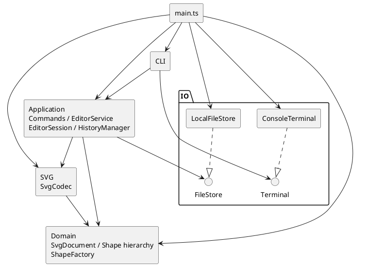

# Phase 1 工程记录

依据：`requirements/phase1.md`。本文将任务书要求、用户确认决策和设计假设分开记录。

当前完成工程初始化、2A 叶子图形、2B 领域图形树基础及其 P1 结构维护边界整改。命令系统、SVG 编解码、Undo/Redo、box 和插件功能均未实现。`npm start` 仍仅输出初始化信息并退出，不是可交互 CLI。

## 一、架构方案

### 模块与职责

以下是已批准的目标结构；目前已实现 domain 的 Shape、六种图形、SvgDocument、ShapeFactory 及内部归属管理，不代表全部模块完成。

| 模块 | 职责 |
| --- | --- |
| domain | SvgDocument、Shape 及六种图形类、ShapeFactory；几何行为、唯一 id、有序树及结构不变量 |
| application（含 commands） | Command 行为封装；EditorService 协调执行和提交；EditorSession 持有当前文档与路径；HistoryManager 管理历史 |
| cli | 输入、引号与注释、命令分发、结果格式化；不直接操作领域对象 |
| svg | SvgCodec 负责 XML 与领域文档互转、兼容性检查和补 id，不访问文件 |
| io | FileStore/Terminal 接口及本地实现 |
| main.ts | 未来用于对象接线和启动；当前仅验证启动链路 |

### 依赖方向与图

- domain 只依赖自身和语言基础能力，保持业务模型独立。
- svg 依赖 domain 和 XML 库，不依赖 application、CLI 或文件系统。
- application 依赖 domain、svg 和 FileStore 接口，不依赖具体 IO 实现或 CLI。
- cli 依赖 application 和 Terminal 接口，通过应用结果展示信息。
- io 不依赖业务模块；启动入口可以依赖全部需接线的模块。
- 违反这些方向的依赖应记录并处理，不能用图与实现不一致的方式掩盖。



### 模式与执行策略

- **任务书要求（§1.2、§2.1）**：Command 模式、面向对象、一类一文件、字段封装及容器/叶子统一操作。
- **计划落地，尚未实现**：具体命令封装业务行为，不只是参数容器；EditorService 不按命令名解释业务。组和叶子通过 Shape 多态完成几何操作；SvgDocument 协调跨节点结构变化。
- **设计策略**：候选文档副本上执行，成功后统一提交；完整文档快照配合过去/未来双栈，避免复杂逆操作。
- CommandDispatcher 和 ShapeFactory 是仅有的名字行为分派入口，按 §2.1 标为待重构点。工厂同时服务 create 与 SVG 导入。
- 未增加 EditTransaction、HistoryEntry、Reader/Writer 接口、独立 CanvasSize 或插件框架；当前规模不需要这些层次。

### 2A 实际领域契约

- 六个类各占同名文件，位于 src/domain。Shape 不保存或假定 x/y/r 等固定几何字段，抽象 move/scale/clone，公共样式与具体属性设置通过基类和子类分别处理。
- 每个叶子类用 JavaScript 私有字段保存自身几何状态；先计算、验证全部候选值，再一次替换几何对象。有限输入导致的加法/乘法溢出也拒绝，不能留下先更新 x 后在 y 失败的状态。
- id 通过只读访问器读取；getAttribute/getAttributes 提供属性读取，后者是冻结的独立快照，内部没有可变集合泄漏。属性值当前仅为数值或字符串，浅复制即可完整隔离。
- setAttribute 几何属性要求数值，text/fill/stroke 要求字符串；不在领域层解析 CLI 数字字符串或 CSS 颜色。未设置的公共样式读取为 undefined，不填入默认 black/none；未知属性读取或设置均抛出错误。
- move 为增量平移；scale 围绕原点同乘所有位置和尺寸，文字内容及样式不变。各类多态完成操作，没有集中类型判断。
- clone 保留具体类型、id、几何、文字和全部当前样式；复制不改变 id。这是独立对象复制，不是向文档插入，唯一性检查留到 2B。
- 领域错误是无 CLI 前缀的 Error，不打印。新增设计假设：id 不允许为空或仅空白；stroke-width 为有限非负数；样式字符串暂不做 CSS 语义校验。这些不是任务书直接给出的完整验证规范。
- 不实现 GroupShape/文档/工厂，不添加插件或 SVG 属性保留框架。待 2B 落实递归行为与文档关系，不能把现有叶子多态声明为已完成 Composite。

### 2B 实际领域树与原子性

- GroupShape 表达有序子节点，构造时支持嵌套子树；children/roots 返回冻结的快照，节点引用保持稳定，不能通过集合改写归属。P1 整改后成员集合由 TreeOwnership 私有保存，结构变更以新的冻结数组替换，旧快照不随之变化。Shape 默认空 children，只用于统一结构遍历；五个叶子类未重构。
- GroupShape 的 move/scale 多态递归，set 仅修改组自身公共样式，clone 递归复制节点及样式。文档支持默认/显式画布、原子 resize、findById、parentOf、根或指定组末尾插入、子树删除及深复制；这些是领域基础能力，不是完整业务命令。
- **组几何原子性策略**：操作前保存全部后代的有效属性快照，失败时恢复这些属性后重抛原错误。当前六种内置图形的属性均为原始值，读取完整，设置原有效值不触发数值运算；几何行为不改变成员关系或样式缺省，因此可以完整恢复，同时保留原节点引用。不替换子树，不依赖未来 EditorService。
- 组策略选择了回滚而不是复制后替换子节点：后者会使外部节点引用和文档关系失效。没有为此改写通过审查的叶子运算逻辑或引入通用事务框架。代价是嵌套组重复捕获快照；任意未来自定义 Shape 若缺少完整可恢复属性或有 setter 副作用，必须重新审查该策略，不能宣称支持任意插件。
- **结构原子性策略**：先完整检查容器、循环、根节点是否游离、子树 id/对象与现有树冲突，再同步提交归属和有序集合变更；构造也先检查全部输入再登记归属。删除先定位和检查原归属，移除子树时仅释放其根，内部归属保持；可在之后重新插入游离子树。
- 2B 原实现的 TreeOwnership 只私有保存归属，导出 treeMutation 并允许组公开维护成员；专项审查证明它可以被直接调用绕过校验。该设计已被以下 P1 整改替代，不再依赖外部遵守 token 使用约定。
- **方案修订**：暂不维护持久 id 查询索引，findById 直接遍历受控树，避免树和索引双重可变状态失配。插入校验存在重复遍历，接受当前小规模成本；将来有实际性能证据后再增加索引并验证一致性。
- ShapeFactory 使用单个 switch 选择六种内置类型（唯一类型行为分派，仍标为待重构），接受结构化属性而非 CLI 参数或 XML；各图形继续承担自身白名单和数值校验。未知类型含 box 拒绝，不添加注册/加载机制。
- 目前不实现 group/ungroup/addto/front/back 完整语义；最近公共祖先、收编重排等已确认规则留待后续树操作迭代。基础 insert 仅接受未被拥有的子树，不偷偷执行重挂。

### P1 结构维护边界整改

- **根因**：真实 token 与底层写方法均公开，组 append 只检查游离状态；调用方可以跳过文档 id/循环校验，或者只释放归属却保留实际成员。@internal 和 AGENTS 约定没有形成封装。
- **思路 A：节点私有拥有者**。可将父引用放入 Shape，再通过完整结构操作修改；但需要扩展全部节点的归属契约，并解决独立组、文档与节点间的私有状态协调，本轮改动更广。
- **思路 B（采用）：统一结构管理器**。沿用 TreeOwnership 类，把真实有序成员与对象归属都存入 ECMAScript 私有 WeakMap；GroupShape/SvgDocument 不再各自保存可独立变更的集合，而是委托读取和结构操作。删除 treeMutation、公开 claim/release、appendChild/removeChild，不新增 token 或通用事务框架，不改叶子类。
- 所有仍公开的写入口均是完整操作：initializeGroup/initializeDocument 只允许初始化一次，不能清空已有容器；组初始化先校验所有游离子树的对象/id/循环再提交；insert 检查目标文档、父容器、循环、归属和全文档 id；remove 同步移除成员与根归属。即使直接导入管理器也无法只改登记。私有校验方法使用 #，不作为可反射调用的普通私有方法暴露。
- 校验、遍历和冻结候选数组完成后，再同步更新私有集合与归属，不在提交区调用业务回调。移除子树仅释放其根，内部归属不变。组几何回滚算法保持不变，仍保留原节点引用。
- 图形类型分派仍只在 ShapeFactory；管理器以已初始化组/文档身份判断结构能力，不按类型名分派几何行为。变化只发生在 domain 内部，外部模块依赖方向不变。

### 已确认决策

| 决策 | 内容 |
| --- | --- |
| D1 历史 | 成功 init/read/save/canvas 修改清空历史并禁用 Undo/Redo；下一次成功编辑解禁；失败与查询不改变历史 |
| D2 兼容 | 分为可编辑、安全保留不可 CLI 修改、无法安全处理而拒绝；不得静默丢弃影响语义的数据。这是设计策略 |
| D3 层级 | group 放在最近公共祖先内，插在包含所选节点的最前直接子分支之前；组内按操作前文档遍历顺序。addto 禁止成环，同父级时移到末尾；保证原子性与 Undo 恢复 |
| D4 分派 | 限制行为分派入口，优先多态；普通属性校验不算新增行为入口，但不能借此隐藏类型判断 |
| transform | Phase 1 暂不实现完整编辑语义；遇到不支持的 transform 明确拒绝导入，解释原因。这不是任务书硬性要求 |

### 设计假设（非任务书硬性要求）

- canvas 无参数查询不影响历史；无文档时允许 help/init/read，其余命令报无文档错误。
- 无默认路径时 save 要求显式路径；成功另存更新默认路径，失败不更新。
- 导入已有重复 id 失败；缺 id 从标签名加 1 开始，跳过全文档已有及已分配编号。
- 顶层组禁止 ungroup 是任务书明确规则；对叶子解组按非容器错误处理。
- front 为视觉最前，即绘制序列末尾；back 为开头。
- 普通 g 的 set 只修改自身公共样式，不覆盖子元素显式属性。
- 数值有限；坐标可负；尺寸和半径非负；画布尺寸及 scale 严格为正；init/canvas 接受零或两个尺寸参数，拒绝额外参数。
- 空历史输出错误；合法无变化编辑也计入历史并清 Redo。
- 忽略前导空白后以 # 开头的整行为注释；不支持行尾注释；引号内支持转义双引号和反斜杠。
- 遵守规定错误文本与稳定输出格式，不推定示例空格必须逐字符一致；功能完成后提供 npm run cli。
- group 重复选择同一节点时拒绝；跨父级重挂不承诺保持继承样式和层叠外观。
- SVG 可保留的首批候选属性包括 font-size/font-family/font-weight/text-anchor、opacity/fill-opacity/stroke-opacity 及经评估安全的 data-*；不接受任意未知属性。
- 暂拒未知图形、复杂文字、引用结构、CSS/脚本等无法安全处理的内容；首批坐标支持数值/px，viewBox 缺失或等于 0 0 width height。具体边界在编解码迭代验证。
- 提交后终端输出故障与编辑业务失败分开报告；保存采用写临时文件后替换策略，避免破坏原文件。

### 变化点与取舍

| 变化点 | 当前预留 | 不提前实现 |
| --- | --- | --- |
| 图形与命令扩展 | 多态及两个集中入口 | 动态插件、box、宏语言 |
| SVG 支持扩大 | 独立 Codec、明确兼容分类 | 完整 SVG/CSS/transform 引擎 |
| 交互通道 | 应用层与展示结果隔离 | GUI、鼠标、独立 Agent API |
| 历史性能 | 集中历史管理 | 增量、持久化、分支历史 |

## 二、过程记录

1. **需求分析**：用户限定只读分析；AI 梳理功能与工程过程要求，列出 16 项歧义，没有修改任务书或开始开发。
2. **澄清收敛**：按影响分为 A/B/C，收敛到 D1—D4。用户接受历史、层级和分派方案，纠正“不可编辑属性等于不可导入”的过度限制，要求三级兼容策略。
3. **初次架构**：AI 提出模块与类职责，但工厂归属和依赖图不一致。用户要求批判性自审，不允许直接编码。
4. **架构修订**：工厂移入 domain；删除独立事务及重复快照记录；合并 SVG Reader/Writer，明确 Service 唯一提交职责与 Command 行为封装。承认 transform 背景示例暂不可读，用户批准将其作为兼容限制记录。
5. **初始化规划与授权**：用户批准最小 TypeScript/npm 工程、本地提交；明确禁止业务实现、远程创建、推送和 final 标签，并允许使用 main.ts 避免空类。
6. **本轮实际工作**：初始目录仅有任务书和 .DS_Store，无 Git 仓库；使用现有 Node/npm。创建工程配置、最小启动及进程测试、本文与 AGENTS.md；验证结果见下一节。
7. **2A 授权与实现**：用户确认初始化提交 728ae3c 已推送，要求领域开发拆为两轮后仅批准 2A。AI 实现六个领域类和两组测试，先验证候选值再提交状态，保留未知几何布局的抽象契约；将 npm test 从单个初始化文件扩展为全部顶层测试文件，避免遗漏领域测试。未进入 2B，也未推送本轮提交。
8. **2A 只读审查与回归**：实际审查 c25f38b 源码、测试及提交差异，未发现 P1/P2，指出修改几何/文字后再复制及缺省样式复制的 P3 测试缺口。用户批准 2B 时要求先补齐，本轮新增六项回归，不改动五个叶子类。
9. **2B 实现与取舍**：用户批准领域树基础并强调不能依赖未来应用事务。AI 采用组内有效值快照回滚以保留节点身份，结构变更前完整校验，以内部归属登记防止跨树复用，并选择实际树遍历替代持久索引。新增三个主要类、一个内部辅助类及三组测试；不实现后续命令或插件。
10. **P1 发现与复现**：用户要求专项只读审查，AI 实际复现导出 token 可创建自包含组、追加重复 id、单独 release 后跨文档重复挂载。原 94 项测试未覆盖真实 token，之前将此视为内部约定低估了风险。用户批准本轮整改后，先新增三项直接使用真实公开 API 的回归（无类型强转），类型检查/构建成功，但运行结果为 0 通过、3 失败，均是 Missing expected exception；此时尚未修改领域实现。
11. **P1 修复与回归**：比较节点父引用与统一结构管理两条思路后选择后者，以复用现有边界并避免改动叶子类。移除不安全 API 后，回归测试改为断言旧入口已不存在，并直接调用剩余公开管理器操作验证同样约束，避免只测试封装外观。补充重新初始化拒绝、根子树删除重插、独立组 clone 插入、clone 冲突后可用、直接管理器循环拒绝及冻结集合检查。嵌套组 move/scale 溢出回滚继续由原测试验证。

## 三、一致性自查

| 检查 | 当前结论 |
| --- | --- |
| 目录与方案 | P1 整改集中修改已有三类及测试/记录，新增专项回归文件；成员集合与归属收拢到 TreeOwnership，原因见整改记录 |
| 一类一文件 | 十个领域类分别在同名文件；main.ts 与测试回调采用已批准例外 |
| 依赖方向 | domain 仅依赖内部类，无 IO/XML/应用层依赖；启动入口未接入业务；类型创建分派仅位于 ShapeFactory |
| Command/Composite | 容器/叶子的递归几何、样式和复制已实现；Command 与完整树操作语义尚未实现 |
| 任务书保护 | 初始化前记录 SHA-256，完成后核对，见质量保证记录 |
| 架构修订 | 工厂迁移、事务删除、快照简化和 Codec 合并已记录；后续偏差继续如实追加 |

## 四、质量保证

### 初始化验证

本轮实际环境：Node.js v26.8.1、npm 11.19.0；直接开发依赖为 TypeScript 7.0.2、@types/node 26.6.5，无运行时依赖。精确解析结果由 package-lock.json 锁定。

沿用本机已有 Node，没有为原计划中的 LTS 偏好安装或切换运行时；只声明在上述实际版本完成验证，不推定其他版本已验证。使用用户允许的 src/main.ts 替代空 ApplicationBootstrap 类。

| 验证 | 本轮结果 |
| --- | --- |
| npm ci | 成功，从锁文件重新安装依赖 |
| npm run typecheck | 通过 |
| npm run build | 通过 |
| npm test | 1 项通过，0 项失败；包含重新构建 |
| npm start | 输出 svg-editor: project initialized，退出码 0 |
| git diff --check | 通过；首次提交的新增文件另以暂存区检查确认 |
| git diff --cached --check | 全量检查发现原任务书末尾既有空行；为保护任务书保留原状。排除任务书后，本轮新增文件检查通过 |
| 任务书完整性 | 前后 SHA-256 均为 d8bbf9409a9596035f13ae809888c64e813ea76966b649911536da44eabc7f76 |

初始化前没有 Git 仓库，创建本地 main 分支。原任务书原样纳入首个版本基线，.DS_Store 保留但忽略；node_modules、dist 和覆盖率目录不提交。暂存检查和本地提交结果以本轮实际 Git 输出为准，不将提交哈希回写导致文档自引用。

```sh
npm ci
npm run typecheck
npm run build
npm test
npm start
git diff --check
git diff --cached --check
git diff --cached --check -- . ':!requirements/phase1.md'
git status --short
```

测试执行真实编译入口的独立进程，检查退出码、超时、标准错误及初始化输出。它只证明工程链路可运行，不证明 SVG 或命令功能完整。

### 2A 验证结果

- npm run typecheck、npm run build、npm test、npm start 均通过；总计 61 项测试通过（60 项领域测试及 1 项初始化测试），0 失败。
- 测试覆盖五种几何语义、负坐标/浮点、零尺寸、非法输入、后部字段溢出时整体不变、属性白名单与类型校验、冻结快照、样式缺省、具体类型保留及双向复制独立。
- 本轮未新增或升级依赖，package-lock.json 保持不变。Git 差异与暂存范围另行核查，任务书 SHA-256 应保持初始化记录值。
- 验证只覆盖叶子模型，尚不能据此宣称树结构、命令、文件或历史功能正确。

### 2B 验证结果

- npm run typecheck、npm run build、npm test、npm start 全部通过。总计 94 项测试通过，0 失败：原 61 项继续通过，新增 6 项叶子复制回归、9 项组测试、10 项文档测试和 8 项工厂测试。
- 重点覆盖多层嵌套、后部 move/scale 溢出后的节点状态与引用恢复、复制隔离、id 大小写、子树冲突、跨文档重复归属、自包含/祖先循环拒绝、插入失败不占用归属、删除后重用及查询顺序保持。
- 五个叶子源文件、任务书、package.json、package-lock.json 均无变化；仅 Shape 增加统一只读 children。无新增依赖；启动仍是初始化入口。
- git diff --check 通过；提交前继续核对暂存清单及任务书哈希，确保只提交本轮领域基础与记录，不含 dist/node_modules。

### P1 验证记录

- 修改前：三条实际公开 API 回归全部失败（0/3 通过），确认实现缺陷而非类型检查失败。
- 修改后：npm run typecheck、npm run build、npm test、npm start 全部通过；102 项测试通过，0 失败。包含原 94 项（删除旧维护入口的两条断言改为检查 API 不存在）及新增八项专项回归。git diff --check 通过，任务书 SHA-256 与初始化记录一致。
- 无任务书、叶子类、依赖或工厂改动；没有实现后续树编辑命令。只创建独立本地修复提交，不推送、不打标签。

### 后续验收范围

后续按领域基础、树操作、应用命令与历史、CLI、SVG 文件读写、全流程验收分别迭代和提交。重点验证：树结构与顺序、失败不变、Undo 恢复、文档历史边界、兼容拒绝和安全属性保留。最终对照任务书逐项检查，并用浏览器验证保存产物。

### Git 交付边界

初始化提交由用户确认已推送到 GitHub，main 跟踪 origin/main。2A/2B 各自只创建本地独立提交，不推送、不打标签；每轮提交前检查范围及生成物。课程最终远程与 final 交付仍按用户授权处理。
